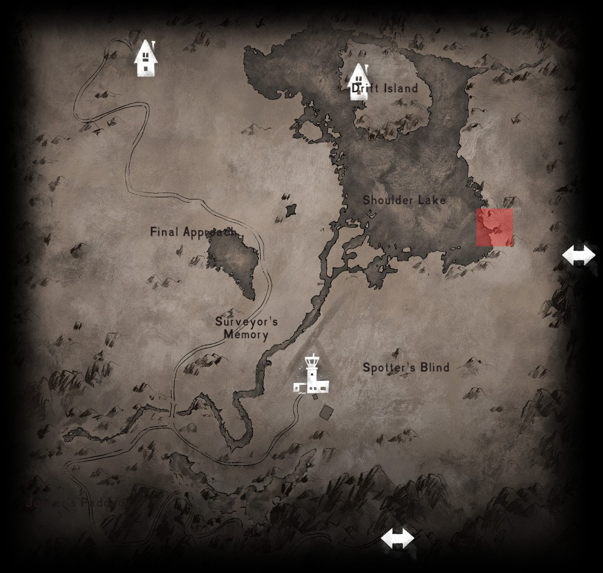

# Fallow Dugout

**Fallow Dugout**

| Property | Details |
| --- | --- |
|  |  / *Fallow\_Dugout.jpg* |
| **Location** |  |
|  |  / *Fallow\_Dugout\_Location.png* |
| Region |  |
| Location | On the south-east bank of shoulder lake |
| Description | A cave at shoulder lake |
| **General** |  |
| Type | Cave\|- |
|  | Provides some shelter\|} **Fallow Dugout** is a small cave located in [Forsaken Airfield](./Forsaken%20Airfield.md), east of [Shoulder Lake](./Shoulder%20Lake.md). / ## Overview / The cave doesn't have a bed but does spawn a campfire alongside some meager loot including an axe. / Survivors looking for easy loot may want to reconsider, the cave itself is home to a [Bear](./Bear.md) that roams [Shoulder Lake](./Shoulder%20Lake.md) during the day. A [Bedroll](./Bedroll.md) can be placed on the rock part on the left side of the cave, or the snow near the entrance. A [Plane Crash](./Plane%20Crashes.md) on the lake is just west of the cave. / **Lua execution error in Module:Navbox function navbox** |
