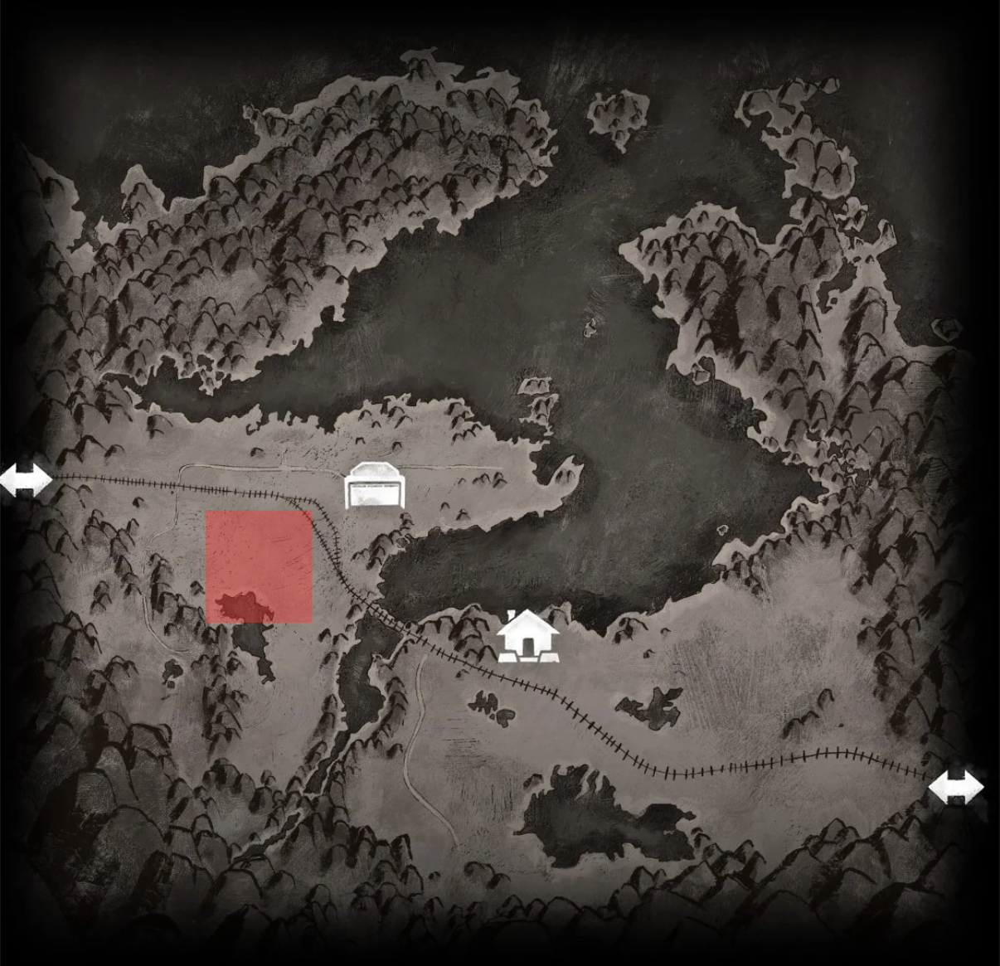

# Fallow Field

**Categories:** DLC Content, Locations, Locations in Port Remnant, Outdoor locations · **Source:** [Fandom](https://thelongdark.fandom.com/wiki/Fallow_Field)

**DLC-Exclusive content.** This content requires the [Iron Road](./Iron%20Road.md) addon to be installed before it can be seen or used in regular gameplay.

 **Fallow Field**  **Location**  **Region:** [Port Remnant](./Port%20Remnant.md)\\|- **Description:** A field and pond below Desecrated Church **General** Has no shelter\ **Fallow Field** is a location in [Port Remnant](./Port%20Remnant.md).

## Overview

This location is found below the cliffs of [Desecrated Church](./Desecrated%20Church.md), and south west of [Obstructed Transit](./Obstructed%20Transit.md).
