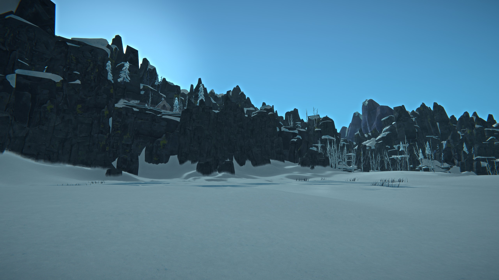

# Fallow Field

| Column 1 | Column 2 | Column 3 |
| --- | --- | --- |
|  / *Seal\_icon.png* | **DLC-Exclusive content.** / This content requires the [Iron Road](./Iron%20Road.md) addon to be installed before it can be seen or used in regular gameplay. | \|} / **Fallow Field** / \| Property \| Details \| / \| --- \| --- \| / \|  \|  / *Fallow\_Field.jpg* \| / \| **Location** \|  \| / \|  \|  / *Fallow\_Field\_Location.png* \| / \| Region \| [Port Remnant](./Port%20Remnant.md)\\|- \| / \| Description \| A field and pond below Desecrated Church \| / \| **General** \|  \| / \|  \| Has no shelter\\|} **Fallow Field** is a location in [Port Remnant](./Port%20Remnant.md). / ## Overview / This location is found below the cliffs of [Desecrated Church](./Desecrated%20Church.md), and south west of [Obstructed Transit](./Obstructed%20Transit.md). / The area is a large field, with some [Wolves](./Wolf.md) found around the area, and [Cat Tails](./Cat%20Tail.md) are found near the pond. A small birch tree forest is found to the west.**Lua execution error in Module:Navbox function navbox** \| |
|  / *Fallow\_Field.jpg* |  |  |
| **Location** |  |  |
|  / *Fallow\_Field\_Location.png* |  |  |
| Region | [Port Remnant](./Port%20Remnant.md)\|- |  |
| Description | A field and pond below Desecrated Church |  |
| **General** |  |  |
|  | Has no shelter\|} **Fallow Field** is a location in [Port Remnant](./Port%20Remnant.md). / ## Overview / This location is found below the cliffs of [Desecrated Church](./Desecrated%20Church.md), and south west of [Obstructed Transit](./Obstructed%20Transit.md). / The area is a large field, with some [Wolves](./Wolf.md) found around the area, and [Cat Tails](./Cat%20Tail.md) are found near the pond. A small birch tree forest is found to the west.**Lua execution error in Module:Navbox function navbox** |  |
