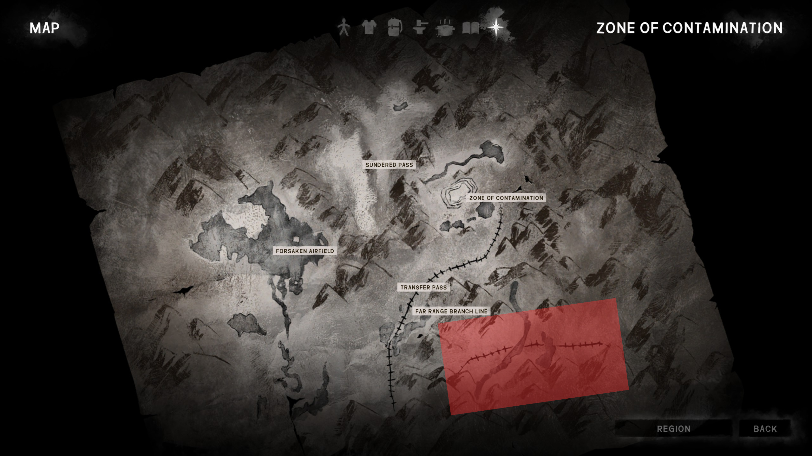
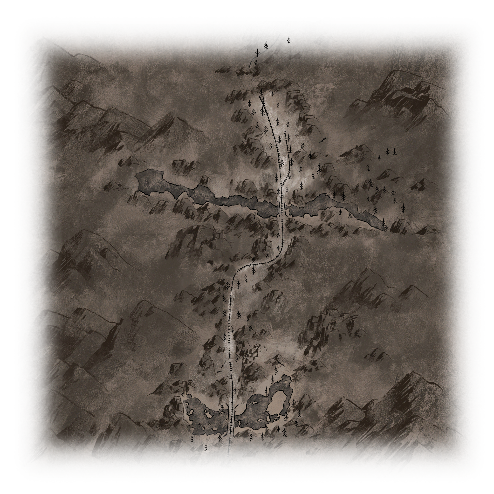

# Far Range Branch Line

**Categories:** DLC Content, Regions, Transition zones · **Source:** [Fandom](https://thelongdark.fandom.com/wiki/Far_Range_Branch_Line)

**Contents**

- [Overview](#overview)
- [Wildlife Availability](#wildlife-availability)
- [Locations](#locations)
- [Trivia](#trivia)
- [Gallery](#gallery)

_Ptarmigan\_icon.png_

**DLC-Exclusive content.** / This content requires the [Tales from the Far Territory](./Tales%20from%20the%20Far%20Territory.md) addon to be installed before it can be seen or used in regular gameplay.

_Far\_range\_line\_first\_look.png_

**Location on [Great Bear Island](./Great%20Bear%20Island.md)**

_Far\_Range\_Branch\_Line\_Location.png_

_FarRangeBranchLine.png_

**Details**

**Description:** A railway line in the mountains separating Lower Great Bear and The Far Territory

**Connecting Regions:** [Broken Railroad](./Broken%20Railroad.md) and [Transfer Pass](./Transfer%20Pass.md)

**TFTFT paid content:** Yes

**Characters:** None

**Interloper Region Spawn:** No

**Locations:** 9

**Date Added:** Dec 5, 2022

> “**Travel down the Far Range Branch Line and arrive at Transfer Pass, the railway hub providing access to the foothills of the Far Range. The journey is a long and harrowing trek from Broken Railroad region, deep into the heart of Great Bear.**”
>
> — Official Marketing Description

_A detailed map of the Far Range Branch Line v2.32 (includes spoilers)_

_A detailed map of the Far Range Branch Line v2.32 (Interloper/Misery edition, includes spoilers)_
