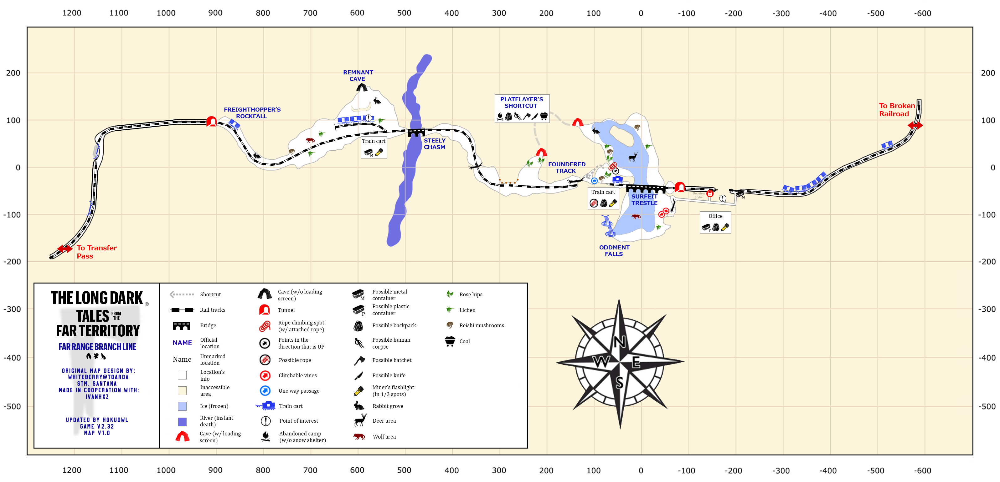

# Far Range Branch Line

**Categories:** DLC Content, Regions, Transition zones · **Source:** [Fandom](https://thelongdark.fandom.com/wiki/Far_Range_Branch_Line)

**Contents**

- [Overview](#overview)
- [Wildlife Availability](#wildlife-availability)
- [Locations](#locations)
- [Trivia](#trivia)
- [Gallery](#gallery)

**DLC-Exclusive content.**

This content requires the [Tales from the Far Territory](./Tales%20from%20the%20Far%20Territory.md) addon to be installed before it can be seen or used in regular gameplay.

**Far Range Branch Line**

| Property | Details |
| --- | --- |
| | [Far range line first look](../assets/Far_range_line_first_look.png) |
| **Location on [Great Bear Island](./Great%20Bear%20Island.md)** | |
| | [Far Range Branch Line Location](../assets/Far_Range_Branch_Line_Location.png) |
| | [FarRangeBranchLine](../assets/FarRangeBranchLine.png) |
| **Details** | |
| Description | A railway line in the mountains separating Lower Great Bear and The Far Territory |
| Connecting Regions | [Broken Railroad](./Broken%20Railroad.md) and [Transfer Pass](./Transfer%20Pass.md) |
| TFTFT paid content | Yes |
| Characters | None |
| Interloper Region Spawn | No |
| Locations | 9 |
| Date Added | Dec 5, 2022 |

> “**Travel down the Far Range Branch Line and arrive at Transfer Pass, the railway hub providing access to the foothills of the Far Range. The journey is a long and harrowing trek from Broken Railroad region, deep into the heart of Great Bear.**”
>
> — Official Marketing Description

**Far Range Branch Line** is the 6th Transition Zone [Region](./Region.md) added to [_The Long Dark_](./The%20Long%20Dark.md). It was released on December 5, 2022 for players who purchased the [Tales from the Far Territory](./Tales%20from%20the%20Far%20Territory.md) expansion pack. The transition region connects to [Broken Railroad](./Broken%20Railroad.md) and [Transfer Pass](./Transfer%20Pass.md).

## Overview

The Far Branch Range Line is a modestly large, highly linear Transition Region located on [Great Bear Island](./Great%20Bear%20Island.md), serving as the barrier between the Lower Great Bear and The Far Territory Regions. Centered on the [Trans-Island Railway Line](./Trans-Island%20Railway%20Line.md), the Region offers very little in the way of exploration, being composed of a winding railroad that cuts through several mountains and carved out tunnels.

This region is entirely encompassed with unmarked locations and no [surveyable](./Charcoal.md) Region Transition barriers.

## Wildlife Availability

The only 3 wildlife that appear in this region:

- [Rabbits](./Rabbit.md) can be found throughout much of the outdoor areas
- [Deer](./Deer.md) can be found only below Surfeit Trestle.
- [Wolves](./Wolf.md) have been observed in the basin below Surfeit Trestle, near the fallen tree between Foundered Track and Steely Chasm, and close to Remnant Cave.

It is possible for Wolves to be completely absent from the region after surviving for at least 100 days, a trait shared with [Keeper's Pass North](./Keeper%27s%20Pass%20North.md).

## Locations

There are a number of unmarked locations in the Far Range Branch Line, including:

- [Foundered Track](./Foundered%20Track.md)
- [Freighthopper's Rockfall](./Freighthopper%27s%20Rockfall.md)
- [Oddment Falls](./Oddment%20Falls.md)
- [Platelayer's Shortcut](./Platelayer%27s%20Shortcut.md)
- [Remnant Cave](./Remnant%20Cave.md)
- [Steely Chasm](./Steely%20Chasm.md)
- [Surfeit Trestle](./Surfeit%20Trestle.md)
- To Transfer Pass (Region Transition to [Transfer Pass](./Transfer%20Pass.md))
- To Broken Railroad (Region Transition to [Broken Railroad](./Broken%20Railroad.md))

## Trivia

- All named locations in this region do not show up as marked on the map, even when scouted. Similarly, the entrance/exit areas that transition to new regions are found inside indoor train tunnels, preventing them from being marked down on the map.
- The description of [Vagabond Soup](./Vagabond%20Soup.md) mentions that it "Originated in the community of people known to hop trains along the Far Range Branch Line, who would harvest the many Rabbits that lived alongside the tracks."

## Gallery

