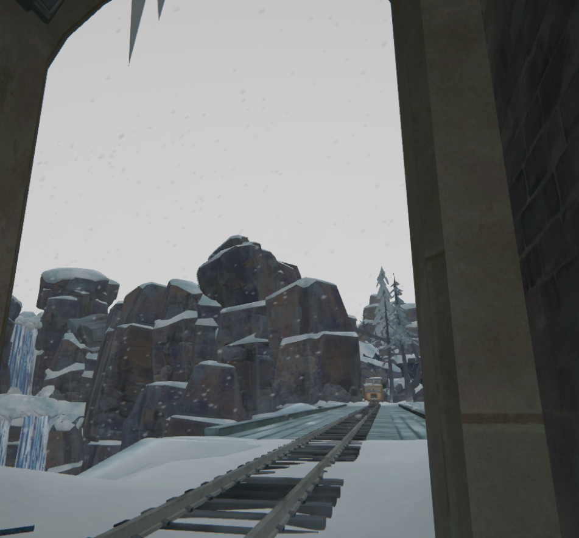

# Far Range Branch Line

**Contents**

- [Overview](#Overview)
- [Wildlife Availability](#Wildlife_Availability)
- [Locations](#Locations)
- [Trivia](#Trivia)
- [Gallery](#Gallery)

<table>
<colgroup>
<col style="width: 33%" />
<col style="width: 33%" />
<col style="width: 33%" />
</colgroup>
<tbody>
<tr>
<td width="40px"><figure>
[Missing image: Ptarmigan_icon.png]
<figcaption>Ptarmigan_icon.png</figcaption>
</figure></td>
<td>
<strong>DLC-Exclusive content.</strong> 

This content requires the <a href="./Tales%20from%20the%20Far%20Territory.md" class="wikilink" title="Tales from the Far Territory">Tales from the Far Territory</a> addon to be installed before it can be seen or used in regular gameplay.

</td>
<td>
|}

<table class="infobox">
<caption>Far Range Branch Line</caption>
<colgroup>
<col style="width: 50%" />
<col style="width: 50%" />
</colgroup>
<tbody>
<tr>
<td colspan="2"><figure>

<figcaption>Far_range_line_first_look.png</figcaption>
</figure></td>
</tr>
<tr>
<td colspan="2" class="section">
<strong>Location on <a href="./Great%20Bear%20Island.md" class="wikilink" title="Great Bear Island">Great Bear Island</a></strong>
</td>
</tr>
<tr>
<td colspan="2"><figure>
[Missing image: Far_Range_Branch_Line_Location.png]
<figcaption>Far_Range_Branch_Line_Location.png</figcaption>
</figure></td>
</tr>
<tr>
<td colspan="2"><figure>

<figcaption>FarRangeBranchLine.png</figcaption>
</figure></td>
</tr>
<tr>
<td colspan="2" class="section">
<strong>Details</strong>
</td>
</tr>
<tr>
<td>
Description
</td>
<td>
A railway line in the mountains separating Lower Great Bear and The Far Territory
</td>
</tr>
<tr>
<td>
Connecting Regions
</td>
<td>
<a href="./Broken%20Railroad.md" class="wikilink" title="Broken Railroad">Broken Railroad</a> and <a href="./Transfer%20Pass.md" class="wikilink" title="Transfer Pass">Transfer Pass</a>
</td>
</tr>
<tr>
<td>
TFTFT paid content
</td>
<td>
Yes
</td>
</tr>
<tr>
<td>
Characters
</td>
<td>
None
</td>
</tr>
<tr>
<td>
Interloper Region Spawn
</td>
<td>
No
</td>
</tr>
<tr>
<td>
Locations
</td>
<td>
9
</td>
</tr>
<tr>
<td>
Date Added
</td>
<td>
Dec 5, 2022
</td>
</tr>
</tbody>
</table>
<table>
<colgroup>
<col style="width: 33%" />
<col style="width: 33%" />
<col style="width: 33%" />
</colgroup>
<tbody>
<tr>
<td style="vertical-align: top; font-size: 3em; color: #5d5980; padding-right: 10px">
“
</td>
<td>
Travel down the Far Range Branch Line and arrive at Transfer Pass, the railway hub providing access to the foothills of the Far Range. The journey is a long and harrowing trek from Broken Railroad region, deep into the heart of Great Bear.

&#10;

Official Marketing Description

</td>
<td style="vertical-align: bottom; font-size: 3em; color: #5d5980; padding-left: 10px">
”
</td>
</tr>
</tbody>
</table>

<strong>Far Range Branch Line</strong> is the 6th Transition Zone <a href="./Region.md" class="wikilink" title="Region">Region</a> added to <a href="./The%20Long%20Dark.md" class="wikilink" title="The Long Dark"><em>The Long Dark</em></a>. It was released on December 5, 2022 for players who purchased the <a href="./Tales%20from%20the%20Far%20Territory.md" class="wikilink" title="Tales from the Far Territory">Tales from the Far Territory</a> expansion pack. The transition region connects to <a href="./Broken%20Railroad.md" class="wikilink" title="Broken Railroad">Broken Railroad</a> and <a href="./Transfer%20Pass.md" class="wikilink" title="Transfer Pass">Transfer Pass</a>.

<h2 id="Overview">Overview</h2>

The Far Branch Range Line is a modestly large, highly linear Transition Region located on <a href="./Great%20Bear%20Island.md" class="wikilink" title="Great Bear Island">Great Bear Island</a>, serving as the barrier between the Lower Great Bear and The Far Territory Regions. Centered on the <a href="./Trans-Island%20Railway%20Line.md" class="wikilink" title="Trans-Island Railway Line">Trans-Island Railway Line</a>, the Region offers very little in the way of exploration, being composed of a winding railroad that cuts through several mountains and carved out tunnels.

This region is entirely encompassed with unmarked locations and no <a href="./Charcoal.md" class="wikilink" title="surveyable">surveyable</a> Region Transition barriers.

<h2 id="Wildlife_Availability">Wildlife Availability</h2>

The only 3 wildlife that appear in this region:

<ul>
<li><a href="./Rabbit.md" class="wikilink" title="Rabbits">Rabbits</a> can be found throughout much of the outdoor areas</li>
<li><a href="./Deer.md" class="wikilink" title="Deer">Deer</a> can be found only below Surfeit Trestle.</li>
<li><a href="./Wolf.md" class="wikilink" title="Wolves">Wolves</a> have been observed in the basin below Surfeit Trestle, near the fallen tree between Foundered Track and Steely Chasm, and close to Remnant Cave.</li>
</ul>

It is possible for Wolves to be completely absent from the region after surviving for at least 100 days, a trait shared with <a href="./Keeper%27s%20Pass%20North.md" class="wikilink" title="Keeper&#39;s Pass North">Keeper's Pass North</a>.

<h2 id="Locations">Locations</h2>

There are a number of unmarked locations in the Far Range Branch Line, including:

<ul>
<li><a href="./Foundered%20Track.md" class="wikilink" title="Foundered Track">Foundered Track</a></li>
<li><a href="./Freighthopper%27s%20Rockfall.md" class="wikilink" title="Freighthopper&#39;s Rockfall">Freighthopper's Rockfall</a></li>
<li><a href="./Oddment%20Falls.md" class="wikilink" title="Oddment Falls">Oddment Falls</a></li>
<li><a href="./Platelayer%27s%20Shortcut.md" class="wikilink" title="Platelayer&#39;s Shortcut">Platelayer's Shortcut</a></li>
<li><a href="./Remnant%20Cave.md" class="wikilink" title="Remnant Cave">Remnant Cave</a></li>
<li><a href="./Steely%20Chasm.md" class="wikilink" title="Steely Chasm">Steely Chasm</a></li>
<li><a href="./Surfeit%20Trestle.md" class="wikilink" title="Surfeit Trestle">Surfeit Trestle</a></li>
<li>To Transfer Pass (Region Transition to <a href="./Transfer%20Pass.md" class="wikilink" title="Transfer Pass">Transfer Pass</a>)</li>
<li>To Broken Railroad (Region Transition to <a href="./Broken%20Railroad.md" class="wikilink" title="Broken Railroad">Broken Railroad</a>)</li>
</ul>
<h2 id="Trivia">Trivia</h2>
<ul>
<li>All named locations in this region do not show up as marked on the map, even when scouted. Similarly, the entrance/exit areas that transition to new regions are found inside indoor train tunnels, preventing them from being marked down on the map.</li>
<li>The description of <a href="./Vagabond%20Soup.md" class="wikilink" title="Vagabond Soup">Vagabond Soup</a> mentions that it "Originated in the community of people known to hop trains along the Far Range Branch Line, who would harvest the many Rabbits that lived alongside the tracks."</li>
</ul>
<h2 id="Gallery">Gallery</h2>
<table class="gallery">
<colgroup>
<col style="width: 50%" />
<col style="width: 50%" />
</colgroup>
<tbody>
<tr>
<td><figure>
[Missing image: FRBL_map.png]
<figcaption>A detailed map of the Far Range Branch Line v2.32 (includes spoilers)</figcaption>
</figure></td>
<td><figure>
[Missing image: FRBL_map_loper.png]
<figcaption>A detailed map of the Far Range Branch Line v2.32 (Interloper/Misery edition, includes spoilers)</figcaption>
</figure></td>
</tr>
</tbody>
</table>

<strong>Lua execution error in Module:Navbox function navboxLua execution error in Module:Navbox function navbox</strong> <a href="ru:%D0%94%D0%B0%D0%BB%D1%8C%D0%BD%D1%8F%D1%8F_%D0%B6/%D0%B4_%D0%B2%D0%B5%D1%82%D0%BA%D0%B0" class="wikilink" title="ru:Дальняя ж/д ветка">ru:Дальняя ж/д ветка</a>
</td>
</tr>
</tbody>
</table>

