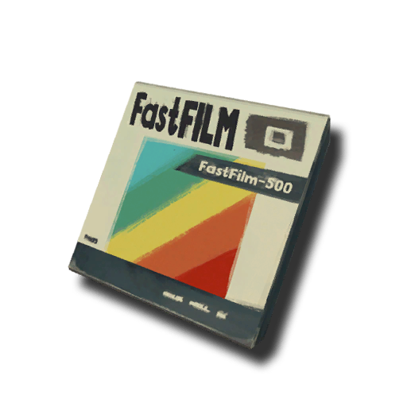

# FastFilm\-500

**Categories:** DLC Content · **Source:** [Fandom](https://thelongdark.fandom.com/wiki/FastFilm-500)

| Column 1 | Column 2 | Column 3 |
| --- | --- | --- |

|  / _FastFilm-500\_icon.png_ |  |  |
| Release | [TFTFT Part 6 Broken Silence](./The%20Long%20Dark%20%E2%80%94%20Changelog.md#2.33) |  |
| Renewable | Yes ([Trader](./Trader.md) only) |  |
| **Properties** |  |  |
| Examine | A box of Colour Instant Film |  |
| **Values** |  |  |
| Weight | 0.10 kg (0.22 lbs) |  |
| **Actions** |  |  |
| Backpack | Examine, Drop, Pick up |  |
| **Advanced data** |  |  |
| Item key | GEAR\_FilmBoxColour |  |
