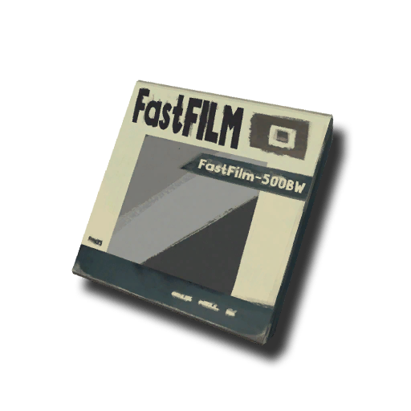

# FastFilm\-500BW

**Categories:** DLC Content · **Source:** [Fandom](https://thelongdark.fandom.com/wiki/FastFilm-500BW)

**DLC-Exclusive content.** This content requires the [Tales from the Far Territory](./Tales%20from%20the%20Far%20Territory.md) addon to be installed before it can be seen or used in regular gameplay.

 **FastFilm-500BW**  **Release:** [TFTFT Part 6 Broken Silence](./The%20Long%20Dark%20%E2%80%94%20Changelog.md#2.33) **Renewable:** Yes ([Trader](./Trader.md) only) **Properties** **Examine:** A box of Black and White Instant Film **Values** **Weight:** 0.10 kg (0.22 lbs) **Actions** **Backpack:** Examine, Drop, Pick up **Advanced data** **Item key:** GEAR\_FilmBoxBw **FastFilm-500BW** is a tool used with the [Camera](./Camera.md) to take photos.

## Overview

1 box contains 6 film Shots, and takes pictures in Black and White. They are commonly found in various locations around Great Bear Island, mostly hidden in houses and cabins.

## Game History
