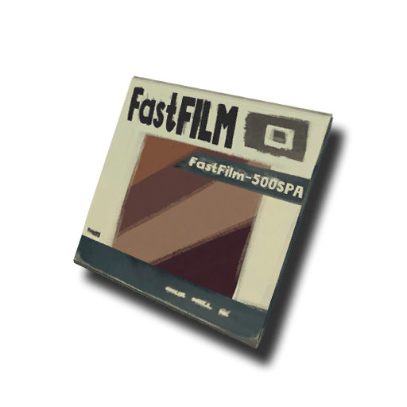

# FastFilm\-500SPA

| Column 1 | Column 2 | Column 3 |
| --- | --- | --- |
|  / *Ptarmigan\_icon.png* | **DLC-Exclusive content.** / This content requires the [Tales from the Far Territory](./Tales%20from%20the%20Far%20Territory.md) addon to be installed before it can be seen or used in regular gameplay. | \|} / **FastFilm-500SPA** / \| Property \| Details \| / \| --- \| --- \| / \|  \|  / *FastFilm-500SPA\_icon.png* \| / \| Release \| [TFTFT Part 6 Broken Silence](./The%20Long%20Dark%20%E2%80%94%20Changelog.md#2.33) \| / \| Renewable \| Yes ([Trader](./Trader.md) only) \| / \| **Properties** \|  \| / \| Examine \| A box of Sepia Instant Film \| / \| **Values** \|  \| / \| Weight \| 0.10 kg (0.22 lbs) \| / \| **Actions** \|  \| / \| Backpack \| Examine, Drop, Pick up \| / \| **Advanced data** \|  \| / \| Item key \| GEAR\_FilmBoxSepia \| / **FastFilm-500SPA** is a tool used with the [Camera](./Camera.md) to take photos. / ## Overview / 1 box contains 6 film Shots, and takes pictures in Sepia. They are commonly found in various locations around Great Bear Island, mostly hidden in houses and cabins. / ## Game History / **Template:update history****Lua execution error in Module:Navbox function navbox** / [ru:FASTFILM-500SPA](ru:FASTFILM-500SPA) |
|  / *FastFilm-500SPA\_icon.png* |  |  |
| Release | [TFTFT Part 6 Broken Silence](./The%20Long%20Dark%20%E2%80%94%20Changelog.md#2.33) |  |
| Renewable | Yes ([Trader](./Trader.md) only) |  |
| **Properties** |  |  |
| Examine | A box of Sepia Instant Film |  |
| **Values** |  |  |
| Weight | 0.10 kg (0.22 lbs) |  |
| **Actions** |  |  |
| Backpack | Examine, Drop, Pick up |  |
| **Advanced data** |  |  |
| Item key | GEAR\_FilmBoxSepia |  |
