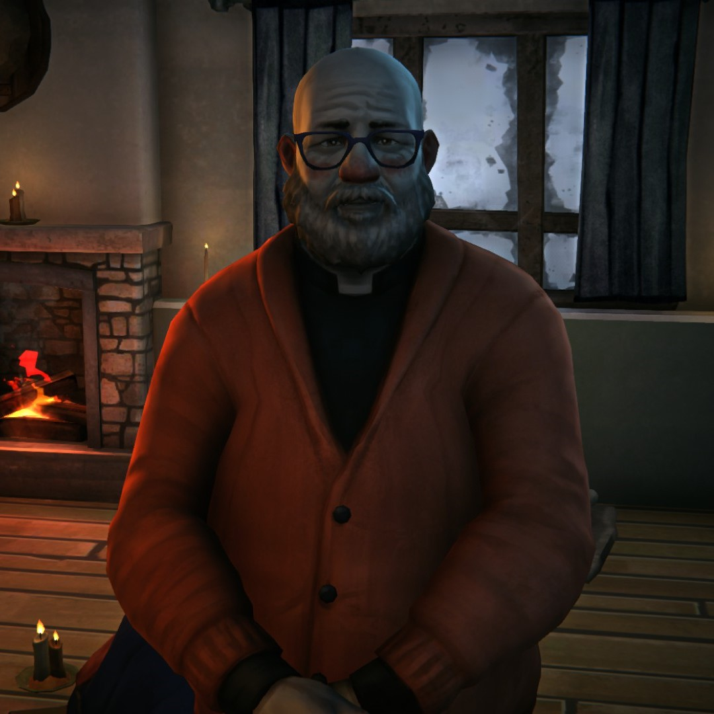
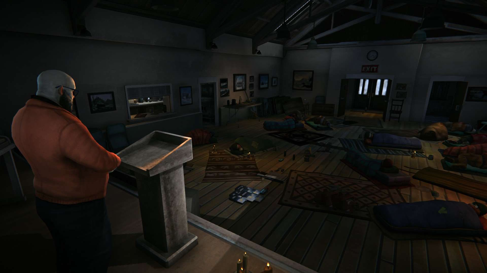
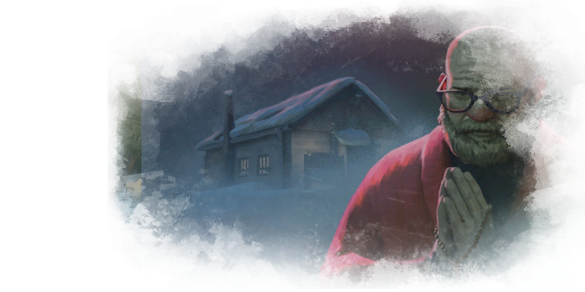

# Father Thomas

**Categories:** Characters, Pages with update history · **Source:** [Fandom](https://thelongdark.fandom.com/wiki/Father_Thomas)

**Contents**

- [History](#history)
- [Episode 3](#episode-3)
- [Trauma](#trauma)
- [Fallen Star](#fallen-star)
- [Aftermath](#aftermath)
- [Side Missions](#side-missions)
- [Church Artifact (mission)](#church-artifact-mission)
- [Trivia](#trivia)
- [Gallery](#gallery)
- [Update History](#update-history)

**Father Thomas**

**Release:** [Crossroads Elegy (v1.60)](./The%20Long%20Dark%20%E2%80%94%20Changelog.md#1.60)

**Date:** 22 October 2019

**Wintermute:** [Episode 3: Crossroads Elegy](./Episode%203%20-%20Crossroads%20Elegy.md)

**Mission:** **•** [Trauma](./Trauma.md) **•** [Fallen Star](./Fallen%20Star.md) **•** [Coming Storm](./Coming%20Storm.md) **•** [Aftermath](./Aftermath.md)

**Location(s):** [Community Hall](./Community%20Hall.md)

**Biographical Information**

**Age:** 60's

**Status:** Alive

**Occupation:** Priest

**Game Information**

**Voiced by:** Alec Willows

> “__Affable and quick to laugh, even in crisis Father Thomas is lifted by his faith rather than weighed down by it. While erudite when he needs to be, he treasures the immediate, pragmatic spiritual needs of life on remote Great Bear Island -- births, baptisms, and funerals, mostly.  
   
 Just how and why Father Thomas came to find himself in Pleasant Valley remains a mystery. But it’s clear his devotion to the tiny parish in Thomson’s Crossing has helped bind the community together.__”
>
> — In-game description

> “__Yes, you're a doctor so you understand the fragility of human life. The fragility of the human spirit is more my domain. __”
>
> — Father Thomas to Astrid

**Father Thomas** is the primary non-player character in [Episode 3](./Episode%203%20-%20Crossroads%20Elegy.md) of [Wintermute](./Wintermute.md). He is the priest of the [church](./Pleasant%20Valley%20Church.md) in [Thomson's Crossing](./Thomson%27s%20Crossing.md), and can be found inside the [Community Hall](./Community%20Hall.md) for the entirety of the episode.

## History

Soft-spoken and kind, Father Thomas is the main quest-giver for the storyline of Episode 3. He cares for the [Crash Survivors](./Crash%20Survivor.md) in the Community Hall, while directly or indirectly requesting Astrid's assistance to help the sick and injured.

## Episode 3

### [Trauma](./Trauma.md)

After leaving the [Pleasant Valley Farmstead](./Pleasant%20Valley%20Farmstead.md) behind and finding a [Community Hall Flyer](./Community%20Hall%20Flyer.md), [Astrid Greenwood](./Astrid%20Greenwood.md) follows the road to [Thomson's Crossing](./Thomson%27s%20Crossing.md). Seeing an active burning signal fire outside of the Community Hall, Astrid walks inside and is greeted by several wounded individuals, and a priest who welcomes her in. Believing that a confused Astrid is the victim of a recent plane crash in the mountains, Father Thomas introduces himself and offers the doctor shelter and the warmth of the nearby fireplace.

Father Thomas tells Astrid about how the survivors of the recent plane crash started showing up recently, with many dying and being stored in the basement of the Community Hall. He also informs Astrid that all the paths out of Pleasant Valley have been blocked for weeks now, and that with no way out, there is no chance that anyone will come to rescue the plane crash survivors (and that Astrid cannot leave the Valley to make her way to [Perseverance Mills](./Perseverance%20Mills.md)). Finally, Father Thomas mentions that a monster of a blizzard is due to approach any day now. Because of the grim state of the survivors, Father Thomas is relived when Astrid offers to diagnose the injuries of each Crash Survivor.

### [Fallen Star](./Fallen%20Star.md)

Astrid checks the current needs of each of the plane crash victims and finds that one of them is a Diabetic, meaning that he will need a dose of [Insulin](./Insulin.md) soon or he will die. With the priest unable to leave the wounded survivors' sides, Astrid volunteers to go to the crashed plane to find other survivors, as well as bring back any physical aid or any item that might give mental closure to the survivor's of the Community Hall. Father Thomas prays for Astrid's safe journey and wishes her good luck, but not before giving a reluctant Astrid a [Rosary](./Rosary.md) to protect her. Astrid is skeptical that the Rosary will help, but the priest insists that it will at least help him bless the victims of the plane crash site on his behalf without him having to be there in person.

Astrid later brings back a single survivor she finds at the crash site, brings another survivor his Insulin, and provides I.D.'s to several of the Crash Survivors. Father Thomas is relieved that she succeeded in helping the victims of the crash, but notices that the weather is turning worse. Father Thomas also states that there is a major lack of food and medical supplies, and that the coming blizzard will surely seal the fate of the Crash Survivors if nothing is done about this reality soon. Astrid notes that there may be more survivors, and that she will also secure more supplies to help keep everyone in the Community Hall alive before the storm arrives.

Astrid eventually finds 3 more survivors and secures enough food, water, and medical supplies to see that everyone in the Community Hall survives the impending monster blizzard. Father Thomas thanks the doctor, and provides her with a [Map of Pleasant Valley](./Map%20of%20Pleasant%20Valley.md) that shows a [dangerous path](./Cinder%20Hills%20Coal%20Mine.md) through the mountains, so that she may continue her journey to Perseverance Mills.

Father Thomas then comforts Astrid with the burdens she carries, and asks that Astrid keeps the Rosary he initially gave her when the doctor tries to give it back. The priest wishes her luck, and does not have any new dialogue for the rest of the Episode as he tends to the Crash Survivors.

### [Aftermath](./Aftermath.md)

Father Thomas is last seen in the ending cutscene to the Episode, with Astrid noting that the world is changing while reminiscing about how the people she has just met in Pleasant Valley will be living through a new, very harsh world soon.

## Side Missions

### [Church Artifact (mission)](./Church%20Artifact%20%28mission%29.md)

Astrid can return a stolen [Church Artifact](./Church%20Artifact.md) to the nearby church, with a [Thank You Letter](./Thankyou%20Letter.md) from the Father being left behind thanking whomever returned this precious item to the church.

## Trivia

- Father Thomas is an ordained Christian priest based on the Roman collar he wears, his denomination is either Catholic or Episcopal.
- Father Thomas is the parochial vicar of Thompson's Crossing.
- His church is one of three on [Great Bear Island](./Great%20Bear%20Island.md); the other two being the Catholic [St. Christopher's Church](./St.%20Christopher%27s%20Church.md) of [Milton](./Milton.md), and the [Stone Church](./Stone%20Church.md) of [Desolation Point](./Desolation%20Point.md).
- Despite neither Father Thomas nor Astrid ever bringing up the existence of [Molly](./Molly.md) in any of their conversations throughout the Episode, it can be inferred that Father Thomas most likely knows who she is, seeing that she is a residence of the valley.
- It is suggested Thompson's Crossing was the largest remaining settlement on Great Bear Island prior to [The First Flare](./First%20Flare.md), because Milton's church was closed due to the towns declining population (as detailed in [Buffer Memories](./Buffer%20Memories.md) and Notes), and the Desolation Point's church seems derelict for years if not decades.

## Gallery

## Update History

- UPDATE **22 October 2019 ([Update](./The%20Long%20Dark%20%E2%80%94%20Changelog.md#1.60)):**
  - Added to game.
