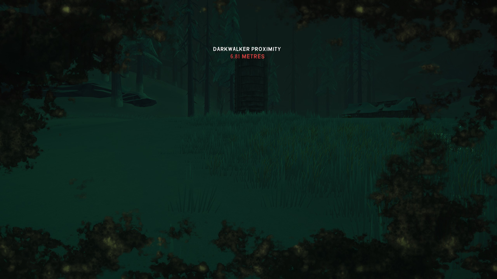

# Fear

**Fear**

| Property | Details |
| --- | --- |
|  |  / *Fear\_icon.png* |
| Release | [29 Oct 2020](./The%20Long%20Dark%20%E2%80%94%20Changelog.md#1.86) |
| Update | 1.86 |
| **Properties** |  |
| Category | [Afflictions](./Afflictions.md) |
| Caused By | Being within 50m or less from the Darkwalker |
| Effect | Negative |
| Type | Injury |
| Affliction Duration | Until Treated |
| **Treatment** |  |
| Treatment | Move 50m (~164 feet) away from the Darkwalker |
| Recovery Time | Instant |

**Fear** is an [Affliction](./Afflictions.md) found within *[The Long Dark](./The%20Long%20Dark.md)*. It is one of two unique Afflictions that can be encountered only within the [Escape the Darkwalker](./Escape%20the%20Darkwalker.md) [Challenge](./Challenge.md).

## Overview

A much worse affliction than [Anxiety](./Anxiety.md), Fear occurs when the player is less than 50m (~164 feet) from the Darkwalker. The player's screen will become very bloody and the player will lose -50% [Condition](./Condition.md) per minute (real-time) as long as they remain near the beast. The player survivor will occasionally scream hysterically as long as they suffer from Fear.

Moving 50m away from the Darkwalker will result in the player returning to the [Anxiety](./Anxiety.md) Affliction and will stop the condition loss drain.

## Trivia

Fear is treated as an injury, despite being a psychological state of mind. It also does not cause direct harm/mental deterioration to a person in small doses, and should not cause a player's condition to drop so rapidly. This is likely due to the Darkwalker's toxic cloud being so concentrated up close, as well as the eldritch nature of the creature having a mental effect on the player. *The Darkwalker is near...* **Lua execution error in Module:Navbox function navbox**
