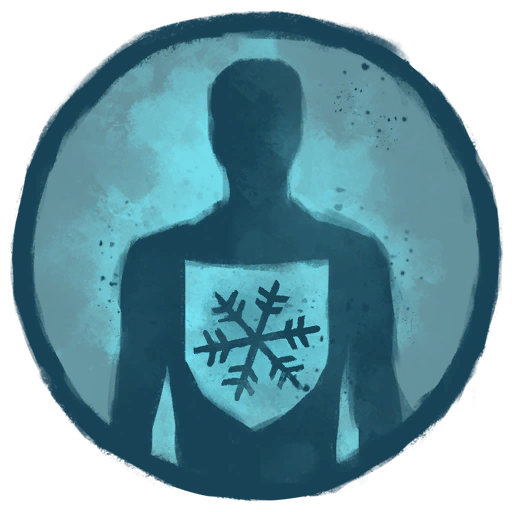
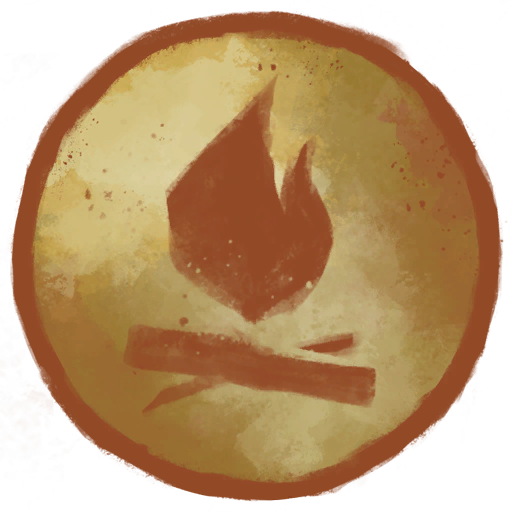
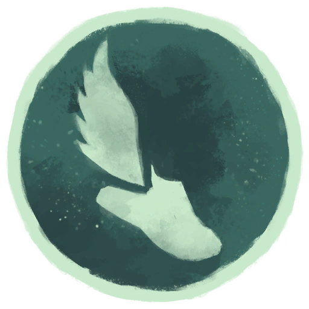
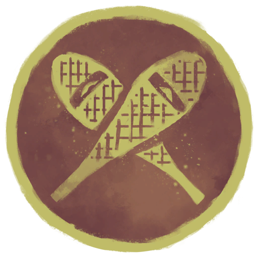
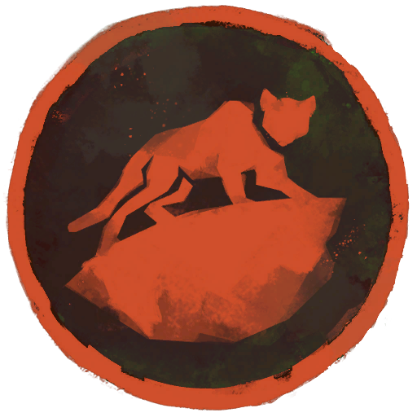

# Feats

**Contents**

- [Overview](#Overview)
- [List of Feats](#List_of_Feats)
- [Base Game](#Base_Game)
- [DLC Content](#DLC_Content)
- [Legacy](#Legacy)
- [Trivia](#Trivia)

\[Missing image: Feat.jpg\] A player achieving the Free Running feat **Feats** are passive perk bonuses that can be unlocked in *<a href="./The%20Long%20Dark.md" class="wikilink" title="The Long Dark">The Long Dark</a>* and enabled in <a href="./Survival%20Mode.md" class="wikilink" title="Survival Mode">Survival Mode</a>.

## Overview

Feats are a form of persistent progression, offering passive bonuses to Survival Mode characters. They cannot be used while playing <a href="./Wintermute.md" class="wikilink" title="Wintermute">Wintermute</a>, <a href="./Challenge.md" class="wikilink" title="Challenges">Challenges</a> or <a href="./Misery.md" class="wikilink" title="Misery Mode">Misery Mode</a>. As of Tales from the Far Territory Part 5 (June 2024) there are 13 different Feats, each with unique effects. Feat progression is acquired while playing Survival Mode or Challenges.

As of v.2.0.0, Wintermute no longer provides progression towards unlocking Feats.

- Feats must be 'Activated' for use when creating a new Survival sandbox
- To activate a Feat, it must be unlocked by completing its requirement(s) on a Survival save (E.g. *"Spend 100 days outside"* for *"Cold Fusion")*
- Playing in a Custom sandbox allows Feats to be used, but does not count towards feat progress
- Feat progress is persistent even if a Survival Mode character dies
- Once a sandbox game has been created, Feats selected for that save file cannot be changed
- Unlike <a href="./Skills.md" class="wikilink" title="Survival Skills">Survival Skills</a>, Feats are a type of meta-progression and are available from the start of a new save

The number of active Feats allowed in a game depends on the selected difficulty:

| Difficulty | Active Feats |
|------------|--------------|
| Pilgrim    | 5            |
| Voyageur   | 4            |
| Stalker    | 3            |
| Interloper | 2            |
| Misery     | 0            |
| Custom     | 5            |

Feat slots may be left empty for added challenge.

## List of Feats

Each obtainable Feat is listed below, along with their requirements for unlocking and unique effects.

### Base Game

\<table-progress-tracking table-id="1" unique-column-index="2"\>

<table style="width:100%;">
<colgroup>
<col style="width: 16%" />
<col style="width: 16%" />
<col style="width: 16%" />
<col style="width: 16%" />
<col style="width: 16%" />
<col style="width: 16%" />
</colgroup>
<thead>
<tr>
<th class="unsortable" style="border-style: solid none solid solid"><figure>

<figcaption>Feats_icon.png</figcaption>
</figure></th>
<th style="border-style: solid solid solid none">
Feat
</th>
<th class="unsortable">
Requirement
</th>
<th class="unsortable">
Benefit
</th>
<th class="unsortable">
Notes
</th>
<th>
Added
</th>
</tr>
</thead>
<tbody>
<tr>
<td><figure>

<figcaption>Badge_feat_BlizzardWalker.png</figcaption>
</figure></td>
<td>
Blizzard Walker
</td>
<td>
You've spent 20 days outdoors during <a href="./Weather.md" class="wikilink" title="blizzards">blizzards</a>.
</td>
<td>
Speed reduction for walking into wind reduced by 25%
</td>
<td>
Only relevant during High Winds while walking against the wind direction. Has no effect during Blizzards because during them there is no <a href="./Weather.md#Movement_Speed_Penalty" class="wikilink" title="speed reduction">speed reduction</a>.
</td>
<td>
2019-12-10
</td>
</tr>
<tr>
<td><figure>

<figcaption>Badge_feat_bookSmarts.png</figcaption>
</figure></td>
<td>
Book Smarts
</td>
<td>
You've completed 250 hours of <a href="./Research%20Book.md" class="wikilink" title="Research">Research</a>.
</td>
<td>
From now on, you gain 10% more benefit from each completely researched book.
</td>
<td>
Unlikely to be able to complete the requirement in a single run without use of the <a href="./Trader.md" class="wikilink" title="Trader">Trader</a>. Each copy of <em>"<a href="./Advanced%20Guns%20Guns%20Guns!.md" class="wikilink" title="Advanced Guns Guns Guns!">Advanced Guns Guns Guns!</a>"</em> yields 10% towards Book Smarts.
</td>
<td>
2016-06-23
</td>
</tr>
<tr>
<td><figure>

<figcaption>Badge_feat_coldFusion.png</figcaption>
</figure></td>
<td>
Cold Fusion
</td>
<td>
You've spent a total of 100 days outside.
</td>
<td>
You are now less susceptible to the cold, and get a permanent +2°C bonus to <a href="./Feels%20Like.md#Air_Temp" class="wikilink" title="Air Temperature">Air Temperature</a>.
</td>
<td>
Despite the text, actually warms the player against ambient temperature and windchill, giving a +3°C bonus.
</td>
<td>
2016-06-23
</td>
</tr>
<tr>
<td><figure>

<figcaption>Badge_feat_nightWalker.png</figcaption>
</figure></td>
<td>
Darkwalker
</td>
<td>
You've completed the "<a href="./Escape%20the%20Darkwalker.md" class="wikilink" title="Escape the Darkwalker">Escape the Darkwalker</a>" Challenge.
</td>
<td>
You are less <a href="./Fatigue.md" class="wikilink" title="Fatigue">Fatigued</a> at night, but more Fatigued during the day.
</td>
<td>
Halves Fatigue drain at night from 8:30pm - 6:00am (9.5h), but doubles Fatigue drain during the day from 6:00 am - 8:30 pm (14.5h). This penalty is however a permanent boost if the "Endless Night" setting is chosen in a Custom game, as the game is permanently set to midnight.
</td>
<td>
2020-10-29
</td>
</tr>
<tr>
<td><figure>

<figcaption>Badge_feat_efficientMachine.png</figcaption>
</figure></td>
<td>
Efficient Machine
</td>
<td>
You've survived 500 days.
</td>
<td>
Your body has adapted to these touch conditions. You now consume 10% fewer <a href="./Food%20And%20Drink.md" class="wikilink" title="calories">calories</a>.
</td>
<td>
Affects all sources of calorie burn: being awake or asleep, <a href="./Rope%20Climbing.md" class="wikilink" title="climbing ropes">climbing ropes</a>, <a href="./Stamina.md" class="wikilink" title="sprinting">sprinting</a>, harvesting, <a href="./Scrap%20Metal.md" class="wikilink" title="sawing metal">sawing metal</a> and walking uphill. This makes "-10% calories consumed" stronger than "+10% calories",
</td>
<td>
2016-06-23
</td>
</tr>
<tr>
<td><figure>

<figcaption>Badge_feat_ExpertTrapper.png</figcaption>
</figure></td>
<td>
Expert Trapper
</td>
<td>
You've snared 100 <a href="./Rabbit.md" class="wikilink" title="Rabbit">Rabbits</a>.
</td>
<td>
Your <a href="./Snare.md" class="wikilink" title="Snare">Snares</a> are now 100% more effective.
</td>
<td>
Increases the chance for the Snare to catch a Rabbit if placed within a Rabbit Grove from 20% to 40%. Does not get around the hard limit of how many Rabbits can be caught at a given time (most Groves having a Rabbit snare limit of 2-4 every 12 hours).
</td>
<td>
2019-12-10
</td>
</tr>
<tr>
<td><figure>

<figcaption>Badge_feat_firemaster.png</figcaption>
</figure></td>
<td>
Fire Master
</td>
<td>
You've successfully started 1000 <a href="./Fire.md" class="wikilink" title="fires">fires</a>.
</td>
<td>
From now on, all your survivors start with a Level 3 <a href="./Fire%20Starting.md" class="wikilink" title="Fire Starting">Fire Starting</a> skill.
</td>
<td>
Despite the text, only applies to the survivor in a game in which the feat is active. Starting at Level 3 increases base chance to start fires (45%&gt;65%), increases fire duration by 10%, and makes tinder unnecessary.
</td>
<td>
2016-06-23
</td>
</tr>
<tr>
<td><figure>

<figcaption>Badge_feat_freeRunner.png</figcaption>
</figure></td>
<td>
Free Runner
</td>
<td>
You've <a href="./Stamina.md" class="wikilink" title="sprinted">sprinted</a> 50 km. (31.07 miles)
</td>
<td>
Sprinting burns 25% fewer Calories.
</td>
<td>
Sprinting is the second most calorie-intensive action (only to <a href="./Rope%20Climbing.md" class="wikilink" title="Rope Climbing">Rope Climbing</a>). The Feat but does not affect the <a href="./Fatigue.md" class="wikilink" title="fatigue">fatigue</a> drain, and Sprinting while already starving carries no benefit.
</td>
<td>
2016-06-23
</td>
</tr>
<tr>
<td><figure>

<figcaption>Badge_feat_snowWalker.png</figcaption>
</figure></td>
<td>
Snow Walker
</td>
<td>
You've travelled 1000 km in the game. (621.37 miles)
</td>
<td>
Your <a href="./Stamina.md" class="wikilink" title="Stamina">Stamina</a> bar recharges 20% faster.
</td>
<td>
Has no effect on single short Sprints and negligible use in Rope Climbing.
</td>
<td>
2016-06-23
</td>
</tr>
<tr>
<td><figure>

<figcaption>Badge_feat_StraightToTheHeart.png</figcaption>
</figure></td>
<td>
Straight To The Heart
</td>
<td>
Use or consume 250 <a href="./Cup%20of%20Coffee.md" class="wikilink" title="Coffee">Coffee</a>, <a href="./Go!%20Energy%20Drink.md" class="wikilink" title="Energy Drinks">Energy Drinks</a>, or <a href="./Emergency%20Stim.md" class="wikilink" title="Emergency Stim">Emergency Stims</a>.
</td>
<td>
You now experience the effects of Coffee, Energy Drinks, and Emergency Stims for 25% longer.
</td>
<td>
Increases the duration of <a href="./Afflictions.md#Benefits" class="wikilink" title="Benefits">Benefits</a> from <a href="./Cup%20of%20Acorn%20Coffee.md" class="wikilink" title="Cup of Acorn Coffee">Cup of Acorn Coffee</a>, <a href="./Cup%20of%20Coffee.md" class="wikilink" title="Cup of Coffee">Cup of Coffee</a>, <a href="./Go!%20Energy%20Drink.md" class="wikilink" title="Go! Energy Drink">Go! Energy Drink</a>, and <a href="./Emergency%20Stim.md" class="wikilink" title="Emergency Stim">Emergency Stims</a> (e.g. "<a href="./Fatigue%20Reduced.md" class="wikilink" title="Fatigue Reduced">Fatigue Reduced</a>" from 1 hour to 1 hour and 15 minutes), but has no effect on the <a href="./Thirst.md" class="wikilink" title="hydration">hydration</a>, calories, or other effects of these items.
</td>
<td>
2019-12-10
</td>
</tr>
</tbody>
</table>

\</table-progress-tracking\>

### DLC Content

The following feats require the <a href="./Tales%20from%20the%20Far%20Territory.md" class="wikilink" title="Tales from the Far Territory">Tales from the Far Territory</a> expansion to be installed to be unlocked and used.

\<table-progress-tracking table-id="2" unique-column-index="2"\>

<table style="width:100%;">
<colgroup>
<col style="width: 16%" />
<col style="width: 16%" />
<col style="width: 16%" />
<col style="width: 16%" />
<col style="width: 16%" />
<col style="width: 16%" />
</colgroup>
<thead>
<tr>
<th class="unsortable"><figure>

<figcaption>Feats_icon.png</figcaption>
</figure></th>
<th>
Feat
</th>
<th class="unsortable">
Requirement
</th>
<th class="unsortable">
Benefit
</th>
<th class="unsortable">
Notes
</th>
<th>
Added
</th>
</tr>
</thead>
<tbody>
<tr>
<td><figure>

<figcaption>Celestial_Navigator_icon.png</figcaption>
</figure></td>
<td>
Celestial Navigator
</td>
<td>
You recovered a Tales from the Far Territory <a href="./R%C3%BCdiger%27s%20Watch.md" class="wikilink" title="Relic">Relic</a>)
</td>
<td>
You walk faster during a clear night or during an <a href="./Aurora.md" class="wikilink" title="Aurora">Aurora</a>.
</td>
<td>
Movement speed increased by 10% at night while the stars are visible. It is useful when paired with Darkwalker during an "Endless Night" Custom game.
</td>
<td>
2024-06-24
</td>
</tr>
<tr>
<td><figure>

<figcaption>Settled_Mind_icon.png</figcaption>
</figure></td>
<td>
Settled Mind
</td>
<td>
You recovered a Tales from the Far Territory <a href="./Security%20Chief%27s%20ID%20Badge.md" class="wikilink" title="Relic">Relic</a>)
</td>
<td>
You are immune from <a href="./Cabin%20Fever.md" class="wikilink" title="Cabin Fever">Cabin Fever</a> and Research actions happen 20% faster.
</td>
<td>
Permanent avoidance of <a href="./Cabin%20Fever%20Risk.md" class="wikilink" title="Cabin Fever Risk">Cabin Fever Risk</a>/<a href="./Cabin%20Fever.md" class="wikilink" title="Cabin Fever">Cabin Fever</a> (not present on Pilgrim). The reduced research time will negatively impact the ability to unlock Book Smarts.
</td>
<td>
2024-06-24
</td>
</tr>
</tbody>
</table>

\</table-progress-tracking\>

### Legacy

The following feat is a legacy Feat that can no longer be unlocked on the current game version. \<table-progress-tracking table-id="3" unique-column-index="2"\>

<table style="width:100%;">
<colgroup>
<col style="width: 16%" />
<col style="width: 16%" />
<col style="width: 16%" />
<col style="width: 16%" />
<col style="width: 16%" />
<col style="width: 16%" />
</colgroup>
<thead>
<tr>
<th><figure>

<figcaption>Feats_icon.png</figcaption>
</figure></th>
<th>
Feat
</th>
<th>
Acquisition
</th>
<th>
Benefit
</th>
<th>
Notes
</th>
<th>
Added
</th>
</tr>
</thead>
<tbody>
<tr>
<td><figure>

<figcaption>Master_Hunter_icon.png</figcaption>
</figure></td>
<td>
<a href="./Big%20Cat%20Killer.md" class="wikilink" title="Big Cat Killer">Big Cat Killer</a>
</td>
<td>
You've successfully killed 3 <a href="./Cougar.md" class="wikilink" title="Cougars">Cougars</a> in a single game.
</td>
<td>
Wildlife are less aware of your presence.
</td>
<td>
Halves all animal detection ranges (sight, smell, sound).
</td>
<td>
2024-06-24
</td>
</tr>
</tbody>
</table>

\</table-progress-tracking\>

## Trivia

2 unreleased icons for the Feats Expert Crafter and Mountain Goat have been in the game files since 2019, but are considered <a href="./Cut%20%E2%80%94%20Discontinued%20Content.md" class="wikilink" title="Cut/Discontinued Content">Cut/Discontinued Content</a>.

<table class="gallery">
<colgroup>
<col style="width: 33%" />
<col style="width: 33%" />
<col style="width: 33%" />
</colgroup>
<tbody>
<tr>
<td><figure>
[Missing image: Settled_Mind_Feat.jpg]
<figcaption>The player unlocking Settled Mind</figcaption>
</figure></td>
<td><figure>

<figcaption>The icon for Expert Crafter</figcaption>
</figure></td>
<td><figure>

<figcaption>The icon for Mountain Goat</figcaption>
</figure></td>
</tr>
</tbody>
</table>

**Lua execution error in Module:Navbox function navbox** <a href="ru:%D0%97%D0%BD%D0%B0%D1%87%D0%BA%D0%B8" class="wikilink" title="ru:Значки">ru:Значки</a>

