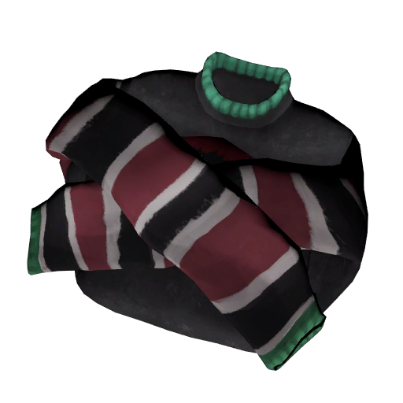

# Festive Sweater

<table class="infobox">
<caption>Festive Sweater</caption>
<colgroup>
<col style="width: 50%" />
<col style="width: 50%" />
</colgroup>
<tbody>
<tr>
<td colspan="2"><figure>

<figcaption>Festive_Sweater_icon.png</figcaption>
</figure></td>
</tr>
<tr>
<td colspan="2" class="section">
<strong>General</strong>
</td>
</tr>
<tr>
<td>
Item Type
</td>
<td>
Clothing|-
</td>
</tr>
<tr>
<td>
Clothing Slot
</td>
<td>
Inner torso
</td>
</tr>
<tr>
<td colspan="2" class="section">
<strong>Statistics</strong>
</td>
</tr>
<tr>
<td>
Weight
</td>
<td>
0.30 kg(0.66 lbs)
</td>
</tr>
<tr>
<td>
Warmth bonus
</td>
<td>
1.0 °C(1.8 °F)
</td>
</tr>
<tr>
<td>
Windproof bonus
</td>
<td>
3.0 °C(5.4 °F)
</td>
</tr>
<tr>
<td>
Waterproof bonus
</td>
<td>
15%
</td>
</tr>
<tr>
<td>
Protection
</td>
<td>
3%
</td>
</tr>
<tr>
<td>
Mobility
</td>
<td>
0%
</td>
</tr>
<tr>
<td>
Harvest
</td>
<td>
1 × <a href="./Cloth.md" class="wikilink" title="Cloth">Cloth</a> 
30 minutes
</td>
</tr>
<tr>
<td>
Repair
</td>
<td>
1 × <a href="./Cloth.md" class="wikilink" title="Cloth">Cloth</a> 
60 minutes 
40% condition
</td>
</tr>
</tbody>
</table>

<table>
<colgroup>
<col style="width: 33%" />
<col style="width: 33%" />
<col style="width: 33%" />
</colgroup>
<tbody>
<tr>
<td style="vertical-align: top; font-size: 3em; color: #5d5980; padding-right: 10px">
“
</td>
<td>
A warm, durable sweater fit for the holiday season.

&#10;

In-game description

</td>
<td style="vertical-align: bottom; font-size: 3em; color: #5d5980; padding-left: 10px">
”
</td>
</tr>
</tbody>
</table>

A **Festive Sweater** is a type of clothing in *<a href="./The%20Long%20Dark.md" class="wikilink" title="The Long Dark">The Long Dark</a>*.

## Overview

Light and warm mid-tier sweater, which spawns rarely on all game modes. Functionally, the Festive Sweater has identical stats to the <a href="./Hockey%20Jersey.md" class="wikilink" title="Hockey Jersey">Hockey Jersey</a>.

It is one of the best Inner Torso clothing which can spawn on <a href="./Interloper.md" class="wikilink" title="Interloper">Interloper</a> mode, along with the Hockey Jersey and <a href="./Thin%20Wool%20Sweater.md" class="wikilink" title="Thin Wool Sweater">Thin Wool Sweater</a>.

## Locations

- <a href="./Carter%20Hydro%20Dam.md" class="wikilink" title="Carter Hydro Dam">Carter Hydro Dam</a> (upper, <a href="./Mystery%20Lake%20%28region%29.md" class="wikilink" title="Mystery Lake">Mystery Lake</a> side), bottom of the office stairwell.
  - With 4 strings of Festive Lights
- <a href="./Community%20Hall.md" class="wikilink" title="Community Hall">Community Hall</a> backstage or in the main recreational room, in <a href="./Thomson%27s%20Crossing.md" class="wikilink" title="Thomson&#39;s Crossing">Thomson's Crossing</a>, <a href="./Pleasant%20Valley.md" class="wikilink" title="Pleasant Valley">Pleasant Valley</a>.
  - With 5 strings of Festive Lights
- <a href="./Hunting%20Lodge.md" class="wikilink" title="Hunting Lodge">Hunting Lodge</a> basement in <a href="./Broken%20Railroad.md" class="wikilink" title="Broken Railroad">Broken Railroad</a>.
  - With 5 strings of Festive Lights
- <a href="./Hangar%20Basement.md" class="wikilink" title="Hangar Basement">Hangar Basement</a> at <a href="./Field%2031.md" class="wikilink" title="Field 31">Field 31</a>, in <a href="./Forsaken%20Airfield.md" class="wikilink" title="Forsaken Airfield">Forsaken Airfield</a>.
  - With 5 strings of Festive Lights

0-1 Festive Sweater will be present, with multiple possible spawn points per location. Festive Lights <a href="./Decorations.md" class="wikilink" title="Decorations">Decorations</a> are guaranteed and can be found near the sweater spawn area.

## Update history

- UPDATE **16 December 2024 (<a href="./The%20Long%20Dark%20%E2%80%94%20Changelog.md#2.36" class="wikilink" title="Update">Update</a>):**
  - Added to game.

==Gallery==

<table class="gallery">
<colgroup>
<col style="width: 50%" />
<col style="width: 50%" />
</colgroup>
<tbody>
<tr>
<td><figure>

<figcaption>Clothing model</figcaption>
</figure></td>
<td><figure>

<figcaption>Clothing model damaged</figcaption>
</figure></td>
</tr>
</tbody>
</table>

**Lua execution error in Module:Navbox function navbox** <a href="ru:%D0%9F%D1%80%D0%B0%D0%B7%D0%B4%D0%BD%D0%B8%D1%87%D0%BD%D1%8B%D0%B9_%D1%81%D0%B2%D0%B8%D1%82%D0%B5%D1%80" class="wikilink" title="ru:Праздничный свитер">ru:Праздничный свитер</a>

