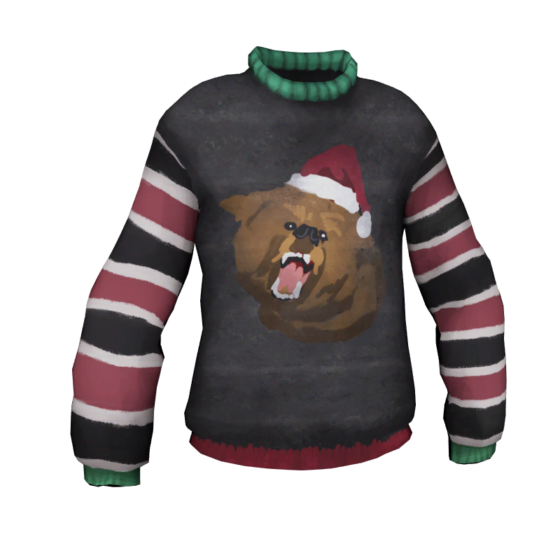
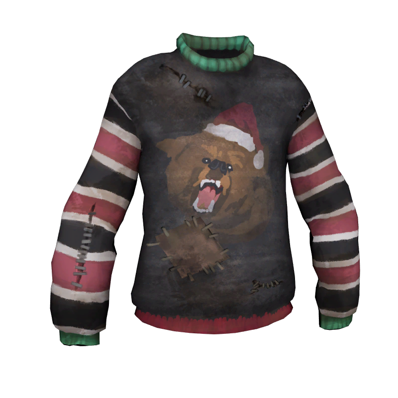

# Festive Sweater

**Festive Sweater**

| Property | Details |
| --- | --- |
|  |  / *Festive\_Sweater\_icon.png* |
| **General** |  |
| Item Type | Clothing\|- |
| Clothing Slot | Inner torso |
| **Statistics** |  |
| Weight | 0.30 kg(0.66 lbs) |
| Warmth bonus | 1.0 °C(1.8 °F) |
| Windproof bonus | 3.0 °C(5.4 °F) |
| Waterproof bonus | 15% |
| Protection | 3% |
| Mobility | 0% |
| Harvest | 1 × [Cloth](./Cloth.md) / 30 minutes |
| Repair | 1 × [Cloth](./Cloth.md) / 60 minutes / 40% condition |

> “**A warm, durable sweater fit for the holiday season.**”
>
> — In-game description

A **Festive Sweater** is a type of clothing in *[The Long Dark](./The%20Long%20Dark.md)*.

## Overview

Light and warm mid-tier sweater, which spawns rarely on all game modes. Functionally, the Festive Sweater has identical stats to the [Hockey Jersey](./Hockey%20Jersey.md).

It is one of the best Inner Torso clothing which can spawn on [Interloper](./Interloper.md) mode, along with the Hockey Jersey and [Thin Wool Sweater](./Thin%20Wool%20Sweater.md).

## Locations

- [Carter Hydro Dam](./Carter%20Hydro%20Dam.md) (upper, [Mystery Lake](./Mystery%20Lake%20%28region%29.md) side), bottom of the office stairwell.
  - With 4 strings of Festive Lights
- [Community Hall](./Community%20Hall.md) backstage or in the main recreational room, in [Thomson's Crossing](./Thomson%27s%20Crossing.md), [Pleasant Valley](./Pleasant%20Valley.md).
  - With 5 strings of Festive Lights
- [Hunting Lodge](./Hunting%20Lodge.md) basement in [Broken Railroad](./Broken%20Railroad.md).
  - With 5 strings of Festive Lights
- [Hangar Basement](./Hangar%20Basement.md) at [Field 31](./Field%2031.md), in [Forsaken Airfield](./Forsaken%20Airfield.md).
  - With 5 strings of Festive Lights

0-1 Festive Sweater will be present, with multiple possible spawn points per location. Festive Lights [Decorations](./Decorations.md) are guaranteed and can be found near the sweater spawn area.

## Update history

- UPDATE **16 December 2024 ([Update](./The%20Long%20Dark%20%E2%80%94%20Changelog.md#2.36)):**
  - Added to game.

==Gallery==

| Column 1 | Column 2 |
| --- | --- |
|  / *Clothing model* |  / *Clothing model damaged* |

**Lua execution error in Module:Navbox function navbox** [ru:Праздничный свитер](ru:%D0%9F%D1%80%D0%B0%D0%B7%D0%B4%D0%BD%D0%B8%D1%87%D0%BD%D1%8B%D0%B9_%D1%81%D0%B2%D0%B8%D1%82%D0%B5%D1%80)
