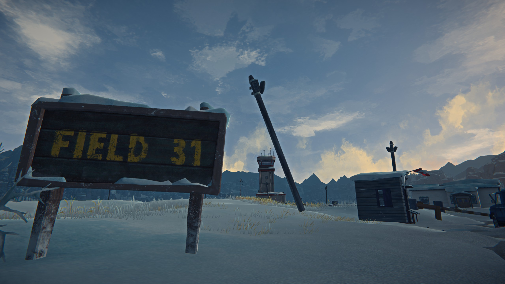

# Field 31

**Field 31**

| Property | Details |
| --- | --- |
|  |  / *Field\_31\_Sign.jpg* |
| **Location** |  |
| Region | [Forsaken Airfield](./Forsaken%20Airfield.md)\|- |
| Description | A small abandoned airfield in the Far Territory |
| **General** |  |
|  / *bed\_icon.png* | Has a bed |
|  / *forge\_icon\_green.png* | Has a forge\|- |
