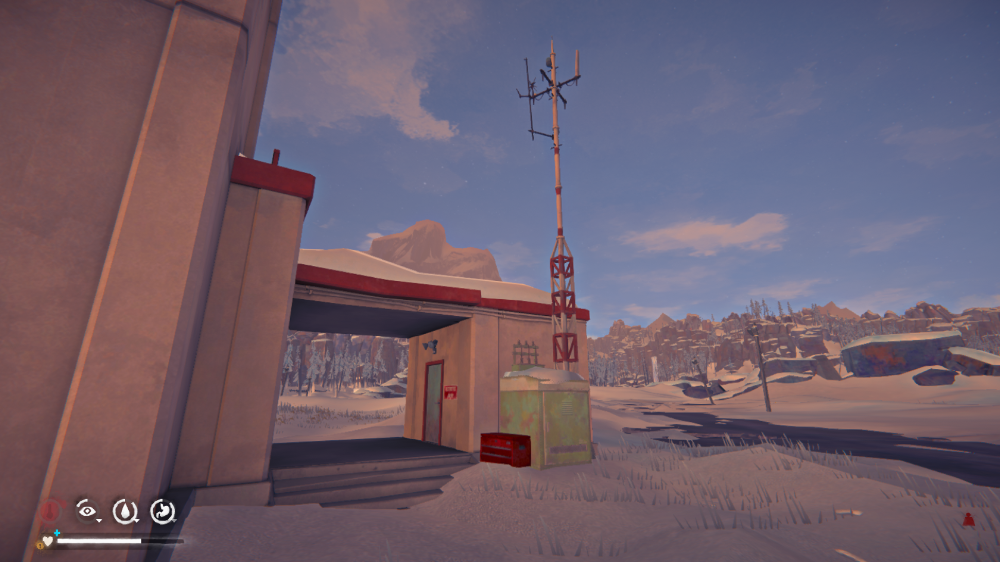
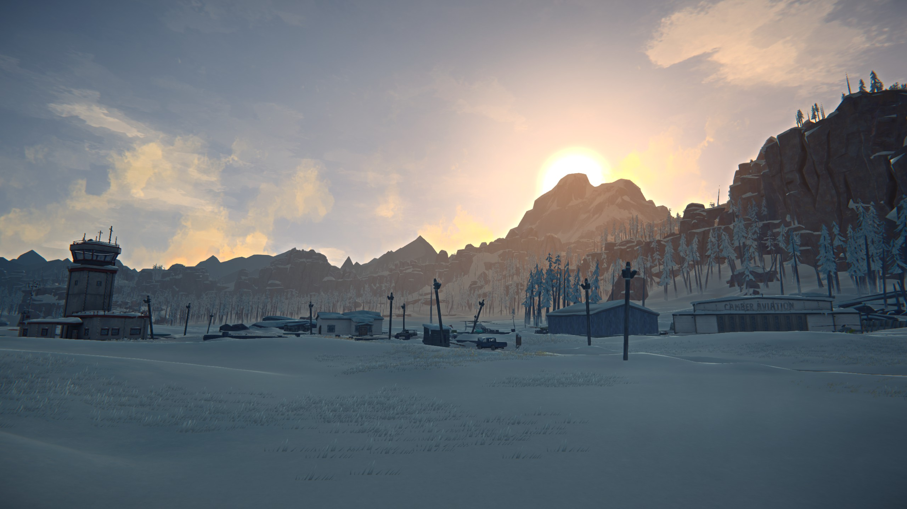
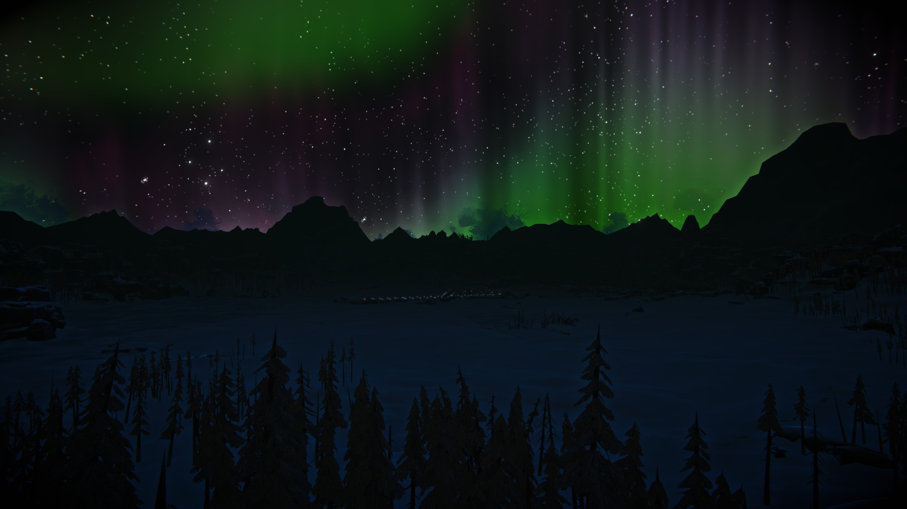

# Field 31

**Categories:** Indoor locations, Locations, Locations in Forsaken Airfield, Locations with a forge, Locations with a workbench · **Source:** [Fandom](https://thelongdark.fandom.com/wiki/Field_31)

**Field 31**

[Field 31 Sign](../assets/Field_31_Sign.jpg)

**Location**

**Region:** [Forsaken Airfield](./Forsaken%20Airfield.md)

**Description:** A small abandoned airfield in the Far Territory

**General**

[Bed icon](../assets/Bed_icon.png)

Has a bed

[Forge icon green](../assets/Forge_icon_green.png)

Has a forge

## Overview

**Field 31**, otherwise known as **Airfield 31**, is a small abandoned airport located deep within the The Far Territory of [Great Bear Island](./Great%20Bear%20Island.md), specifically in the [Forsaken Airfield](./Forsaken%20Airfield.md) region. Though long since abandoned, the airfield is notable for having the largest concentrated number of electronics and vehicles in any Region of Great Bear, making it a perfect area to scavenge for scrap metal and other tools and components.

The tarmacs and hangars are littered with nonfunctional rescue helicopters and bush planes, as well as your average abandoned terrestrial vehicles.

Despite all electronics being rendered destroyed by the [First Flare](./First%20Flare.md), Airfield 31 is occasionally revived to its former glory when the [Aurora](./Aurora.md) appears in the night sky, being visible for miles thanks to the various runway lights that will unfortunately never guide any new passenger planes to its tarmac again. The area is also occasionally plagued by [Glimmer Fog](./Glimmer%20Fog.md).

## Notable Landmarks

- [Main Hangar](./Main%20Hangar.md)
- [Hangar Basement](./Hangar%20Basement.md)
- [Control Tower](./Control%20Tower.md)
- [Terminal](./Terminal.md)
- [Cargomaster's Trailer](./Cargomaster%27s%20Trailer.md)

[Missing image: 20230520075647\_1.jpg]

_The sign in Transfer Pass pointing motorists to Field 31_
