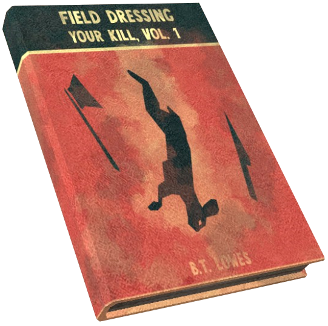
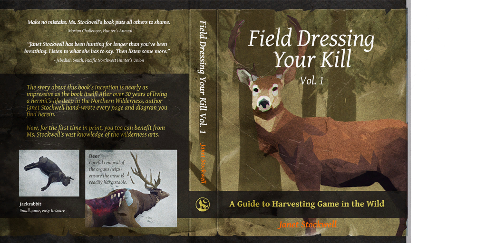

# Field Dressing Your Kill, Vol\. I

**Contents**

- [Research](#Research)
- [Fire Starting](#Fire_Starting)
- [Location](#Location)
- [Crumbling Highway](#Crumbling_Highway)
- [Forlorn Muskeg](#Forlorn_Muskeg)
- [Mountain Town](#Mountain_Town)
- [Mystery Lake](#Mystery_Lake)
- [Pleasant Valley](#Pleasant_Valley)
- [Trivia](#Trivia)
- [Gallery](#Gallery)
- [Update history](#Update_history)

<table class="infobox">
<caption>Field Dressing Your Kill, Vol. I</caption>
<colgroup>
<col style="width: 50%" />
<col style="width: 50%" />
</colgroup>
<tbody>
<tr>
<td colspan="2"><figure>

<figcaption>Field_Dressing_Your_Kill,_Vol._I_icon.png</figcaption>
</figure></td>
</tr>
<tr>
<td>
Release
</td>
<td>
<a href="./The%20Long%20Dark%20%E2%80%94%20Changelog.md#0.346" class="wikilink" title="23 June 2016">23 June 2016</a>
</td>
</tr>
<tr>
<td>
Wintermute
</td>
<td>
No
</td>
</tr>
<tr>
<td colspan="2" class="section">
<strong>Properties</strong>
</td>
</tr>
<tr>
<td>
Item type
</td>
<td>
<a href="./Fire%20Starting.md" class="wikilink" title="Fire Starting">Fire Starting</a><a href="./Tools.md" class="wikilink" title="Tools">Tools</a>|-
</td>
</tr>
<tr>
<td>
Stackable
</td>
<td>
No
</td>
</tr>
<tr>
<td>
Examine
</td>
<td>
Detailed information about the best way to butcher animal carcasses. Researching this will improve your Skill.
</td>
</tr>
<tr>
<td colspan="2" class="section">
<strong>Values</strong>
</td>
</tr>
<tr>
<td>
Weight
</td>
<td>
0.50 kg (1.1 lbs)
</td>
</tr>
<tr>
<td colspan="2" class="section">
<strong>Actions</strong>
</td>
</tr>
<tr>
<td>
Backpack
</td>
<td>
Research, Drop
</td>
</tr>
</tbody>
</table>

  
*For the version encountered in <a href="./Wintermute.md" class="wikilink" title="Wintermute">Wintermute</a>, see <a href="./Field%20Dressing%20Your%20Kill%2C%20Vol.%20I%20%28The%20Basics%20of%20Survival%29.md" class="wikilink" title="Field Dressing Your Kill, Vol. I (The Basics of Survival)">Field Dressing Your Kill, Vol. I (The Basics of Survival)</a>.*

**Field Dressing Your Kill, Vol. I** is a <a href="./Research%20Book.md" class="wikilink" title="Research Book">Research Book</a> used to improve the <a href="./Carcass%20Harvesting.md" class="wikilink" title="Carcass Harvesting">Carcass Harvesting</a> skill. It can also be used as Fuel when starting a <a href="./Fire.md" class="wikilink" title="Fire">Fire</a>.

## Research

*Field Dressing Your Kill, Vol. I* can be researched for 10 hours that can be broken into multiple 1-hour minimum research sessions. 10 <a href="./Carcass%20Harvesting.md#Skill_levels" class="wikilink" title="Carcass Harvesting skill points">Carcass Harvesting skill points</a> are awarded on completing the research. By selecting the Settled Mind <a href="./Feats.md" class="wikilink" title="Feat">Feat</a>, research time will be reduced by 20%, putting it at 8 hours.

Research can only be performed under the following conditions:

- There is light present to read
- <a href="./Warmth.md" class="wikilink" title="Warmth">Warmth</a>, <a href="./Fatigue.md" class="wikilink" title="Fatigue">Fatigue</a>, <a href="./Thirst.md" class="wikilink" title="Thirst">Thirst</a>, and <a href="./Hunger.md" class="wikilink" title="Hunger">Hunger</a> exceed 0%
- No negative <a href="./Afflictions.md" class="wikilink" title="Afflictions">Afflictions</a>

If the player's fatigue, thirst or hunger meters go down to zero or if the environment becomes dark during a research session, the session will be terminated instantly. The hour of research that was in progress will not be completed and any time that had already been spent will be wasted. For a multiple-hour research session, only the incomplete hour will be lost, all the previous hours will still count towards completion of the book.

## Fire Starting

<table class="infobox">
<caption>Field Dressing Your Kill, Vol. I</caption>
<thead>
<tr>
<th>
Type
</th>
<th>
Fuel
</th>
</tr>
</thead>
<tbody>
<tr>
<th colspan="2" class="section">
<strong>Statistics</strong>
</th>
</tr>
&#10;<tr>
<th>
Duration
</th>
<td>
 18 minutes
</td>
</tr>
<tr>
<th>
Start Chance
</th>
<td>
 +35%
</td>
</tr>
<tr>
<th>
Heat
</th>
<td>
 +2°C (+3.6°F)
</td>
</tr>
<tr>
<th>
Burn Density
</th>
<td>
0.6 hr/kg (0.27 hr/lb)
</td>
</tr>
</tbody>
</table>

## Location

#### Crumbling Highway

- In a backpack, inside the cave found between the <a href="./Abandoned%20Harris%20Home.md" class="wikilink" title="Basement">Basement</a> and the entrance to <a href="./No.%203%20Coal%20Mine.md" class="wikilink" title="Abandoned Coal Mine">Abandoned Coal Mine</a>.

#### Forlorn Muskeg

- Small nook-like cave (no loading zone) at <a href="./Marsh%20Ridge.md" class="wikilink" title="Marsh Ridge">Marsh Ridge</a>, next to the roots that lead up to the <a href="./Mountain%20Town.md" class="wikilink" title="Mountain Town">Mountain Town</a> transition

#### Mountain Town

- <a href="./Orca%20Gas%20Station.md" class="wikilink" title="Gas Station">Gas Station</a>

#### Mystery Lake

- <a href="./Camp%20Office.md" class="wikilink" title="Camp Office">Camp Office</a>

#### Pleasant Valley

- <a href="./Pleasant%20Valley%20Farmstead.md" class="wikilink" title="Farmstead">Farmstead</a>

## Trivia

- Attempting to burn a copy of *Field Dressing Your Kill, Vol. I* when it has not been fully read will give a confirmation warning before it can be burned.
- Once a copy of *Field Dressing Your Kill, Vol. I* (or any research book) is fully researched, it will no longer appear in the Tools section of the Backpack.

## Gallery

<table class="gallery">
<colgroup>
<col style="width: 50%" />
<col style="width: 50%" />
</colgroup>
<tbody>
<tr>
<td><figure>

<figcaption>3D Model</figcaption>
</figure></td>
<td><figure>

<figcaption>Old model</figcaption>
</figure></td>
</tr>
</tbody>
</table>

## Update history

- UPDATE **23 June 2016 (<a href="./The%20Long%20Dark%20%E2%80%94%20Early%20Access%20Changelog.md#.346" class="wikilink" title="Update">Update</a>):**
  - Added to game.

**Lua execution error in Module:Navbox function navbox** **Lua execution error in Module:Navbox function navbox**

