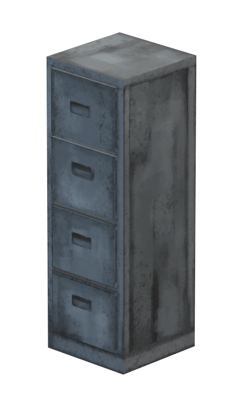

# File Cabinet

<table class="infobox">
<caption>File Cabinet</caption>
<colgroup>
<col style="width: 33%" />
<col style="width: 33%" />
<col style="width: 33%" />
</colgroup>
<tbody>
<tr>
<td colspan="2">
[[File:

<table class="gallery">
<colgroup>
<col style="width: 50%" />
<col style="width: 50%" />
</colgroup>
<tbody>
<tr>
<th><figure>

<figcaption>Regular</figcaption>
</figure></th>
<td><figure>
[Missing image: File_Cabinet_Rusty.jpg]
<figcaption>Rusty</figcaption>
</figure></td>
</tr>
</tbody>
</table></td>
<td>
250px]]
</td>
</tr>
<tr>
<td>
Release
</td>
<td>
TBD
</td>
<td></td>
</tr>
<tr>
<td>
Update
</td>
<td>
<a href="./The%20Long%20Dark%20%E2%80%94%20Changelog.md#0.00" class="wikilink" title="0.00">0.00</a>
</td>
<td></td>
</tr>
<tr>
<td>
Story item
</td>
<td>
No
</td>
<td></td>
</tr>
<tr>
<td colspan="2">
<strong>Container</strong>
</td>
<td></td>
</tr>
<tr>
<td>
Capacity
</td>
<td>
10.00 kg(22 lbs)
</td>
<td></td>
</tr>
<tr>
<td colspan="2">
<strong>Advanced data</strong>
</td>
<td></td>
</tr>
<tr>
<td>
Object key
</td>
<td>
GAMEPLAY_FileCabinet
</td>
<td></td>
</tr>
</tbody>
</table>

A **File Cabinet** is a stationary interactable object in <a href="./The%20Long%20Dark.md" class="wikilink" title="The Long Dark">The Long Dark</a>. It is most often found indoors, in workplaces and offices and sometime houses. They can contain many things, but they most commonly contain different variants of newspaper, candy bars, sodas and books. Being a container, they cannot be broken down. All filing cabinets have four different drawers, each being able to hold 10 kilograms apiece (22lbs).

In some cases, filing cabinets can have draws be open or missing, and thus are not searchable (but they still can have items inside). This is most common in larger locations, or in locations that are run-down, like <a href="./Carter%20Hydro%20Dam.md" class="wikilink" title="Carter Hydro Dam.">Carter Hydro Dam.</a>

## Loot

<table>
<colgroup>
<col style="width: 33%" />
<col style="width: 33%" />
<col style="width: 33%" />
</colgroup>
<thead>
<tr>
<th></th>
<th>
Item
</th>
<th>
Rarity
</th>
</tr>
</thead>
<tbody>
<tr>
<td><figure>

<figcaption>Stack_of_Papers_icon.png</figcaption>
</figure></td>
<td>
<a href="./Stack%20of%20Papers.md" class="wikilink" title="Stack of Papers">Stack of Papers</a>
</td>
<td>
9.43%
</td>
</tr>
<tr>
<td><figure>

<figcaption>Ketchup_Chips_icon.png</figcaption>
</figure></td>
<td>
<a href="./Ketchup%20Chips.md" class="wikilink" title="Ketchup Chips">Ketchup Chips</a>
</td>
<td>
6.29%
</td>
</tr>
<tr>
<td><figure>

<figcaption>Beef_Jerky_icon.png</figcaption>
</figure></td>
<td>
<a href="./Beef%20Jerky.md" class="wikilink" title="Beef Jerky">Beef Jerky</a>
</td>
<td>
6.29%
</td>
</tr>
<tr>
<td><figure>

<figcaption>Summit_Soda_icon.png</figcaption>
</figure></td>
<td>
<a href="./Summit%20Soda.md" class="wikilink" title="Summit Soda">Summit Soda</a>
</td>
<td>
6.29%
</td>
</tr>
<tr>
<td><figure>

<figcaption>Stacy's_Grape_Soda_icon.png</figcaption>
</figure></td>
<td>
<a href="./Stacy%27s%20Grape%20Soda.md" class="wikilink" title="Stacy&#39;s Grape Soda">Stacy's Grape Soda</a>
</td>
<td>
6.29%
</td>
</tr>
<tr>
<td><figure>

<figcaption>Newsprint_icon.png</figcaption>
</figure></td>
<td>
<a href="./Newsprint.md" class="wikilink" title="Newsprint">Newsprint</a>
</td>
<td>
6.29%
</td>
</tr>
<tr>
<td><figure>

<figcaption>Orange_Soda_icon.png</figcaption>
</figure></td>
<td>
<a href="./Orange%20Soda.md" class="wikilink" title="Orange Soda">Orange Soda</a>
</td>
<td>
5.66%
</td>
</tr>
<tr>
<td><figure>

<figcaption>Granola_Bar_icon.png</figcaption>
</figure></td>
<td>
<a href="./Granola%20Bar.md" class="wikilink" title="Granola Bar">Granola Bar</a>
</td>
<td>
5.66%
</td>
</tr>
<tr>
<td><figure>

<figcaption>Newsprint_Roll_icon.png</figcaption>
</figure></td>
<td>
<a href="./Newsprint%20Roll.md" class="wikilink" title="Newsprint Roll">Newsprint Roll</a>
</td>
<td>
5.03%
</td>
</tr>
<tr>
<td><figure>

<figcaption>Wood_Matches_icon.png</figcaption>
</figure></td>
<td>
<a href="./Wood%20Matches.md" class="wikilink" title="Wood Matches">Wood Matches</a>
</td>
<td>
4.4%
</td>
</tr>
<tr>
<td><figure>

<figcaption>Wool_Toque_icon.png</figcaption>
</figure></td>
<td>
<a href="./Wool%20Toque.md" class="wikilink" title="Wool Toque">Wool Toque</a>
</td>
<td>
4.4%
</td>
</tr>
<tr>
<td><figure>

<figcaption>Fleece_Mittens_icon.png</figcaption>
</figure></td>
<td>
<a href="./Fleece%20Mittens.md" class="wikilink" title="Fleece Mittens">Fleece Mittens</a>
</td>
<td>
4.4%
</td>
</tr>
<tr>
<td><figure>

<figcaption>Tin_of_Coffee_icon.png</figcaption>
</figure></td>
<td>
<a href="./Tin%20of%20Coffee.md" class="wikilink" title="Tin of Coffee">Tin of Coffee</a>
</td>
<td>
3.77%
</td>
</tr>
<tr>
<td><figure>

<figcaption>Cloth_icon.png</figcaption>
</figure></td>
<td>
<a href="./Cloth.md" class="wikilink" title="Cloth">Cloth</a>
</td>
<td>
3.14%
</td>
</tr>
<tr>
<td><figure>

<figcaption>Scrap_Metal_icon.png</figcaption>
</figure></td>
<td>
<a href="./Scrap%20Metal.md" class="wikilink" title="Scrap Metal">Scrap Metal</a>
</td>
<td>
3.14%
</td>
</tr>
<tr>
<td><figure>

<figcaption>Spray_Paint_icon.png</figcaption>
</figure></td>
<td>
<a href="./Spray%20Paint.md" class="wikilink" title="Spray Paint">Spray Paint</a>
</td>
<td>
3.14%
</td>
</tr>
<tr>
<td><figure>

<figcaption>Book_icon.png</figcaption>
</figure></td>
<td>
<a href="./Book.md" class="wikilink" title="Book">Book</a>
</td>
<td>
3.14%
</td>
</tr>
<tr>
<td><figure>

<figcaption>Chocolate_Bar_icon.png</figcaption>
</figure></td>
<td>
<a href="./Chocolate%20Bar.md" class="wikilink" title="Chocolate Bar">Chocolate Bar</a>
</td>
<td>
2.52%
</td>
</tr>
<tr>
<td><figure>

<figcaption>Sewing_Kit_icon.png</figcaption>
</figure></td>
<td>
<a href="./Sewing%20Kit.md" class="wikilink" title="Sewing Kit">Sewing Kit</a>
</td>
<td>
2.52%
</td>
</tr>
<tr>
<td><figure>

<figcaption>Herbal_Tea_icon.png</figcaption>
</figure></td>
<td>
<a href="./Herbal%20Tea.md" class="wikilink" title="Herbal Tea">Herbal Tea</a>
</td>
<td>
2.52%
</td>
</tr>
<tr>
<td><figure>

<figcaption>Painkillers_icon.png</figcaption>
</figure></td>
<td>
<a href="./Painkillers.md" class="wikilink" title="Painkillers">Painkillers</a>
</td>
<td>
1.89%
</td>
</tr>
<tr>
<td><figure>

<figcaption>Revolver_Cartridge_icon.png</figcaption>
</figure></td>
<td>
<a href="./Revolver%20Ammunition.md" class="wikilink" title="Revolver Cartridge">Revolver Cartridge</a>
</td>
<td>
1.26%
</td>
</tr>
<tr>
<td><figure>

<figcaption>Can_Opener_icon.png</figcaption>
</figure></td>
<td>
<a href="./Can%20Opener.md" class="wikilink" title="Can Opener">Can Opener</a>
</td>
<td>
1.26%
</td>
</tr>
<tr>
<td><figure>

<figcaption>Driving_Gloves_icon.png</figcaption>
</figure></td>
<td>
<a href="./Driving%20Gloves.md" class="wikilink" title="Driving Gloves">Driving Gloves</a>
</td>
<td>
1.26%
</td>
</tr>
</tbody>
</table>

**Lua execution error in Module:Navbox function navbox** <a href="ru:%D0%A8%D0%BA%D0%B0%D1%84_%D0%B4%D0%BB%D1%8F_%D0%B4%D0%BE%D0%BA%D1%83%D0%BC%D0%B5%D0%BD%D1%82%D0%BE%D0%B2" class="wikilink" title="ru:Шкаф для документов">ru:Шкаф для документов</a>

