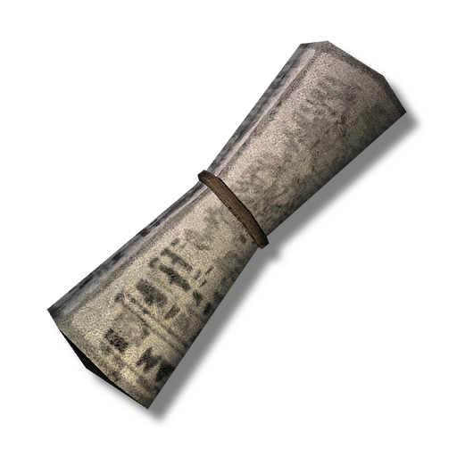

# File Cabinet

**Categories:** Interactable Objects, Interactable objects · **Source:** [Fandom](https://thelongdark.fandom.com/wiki/File_Cabinet)

**File Cabinet**

| Property | Details |
| --- | --- |
| \[\[File: /  / _Regular_ /  / _Rusty_ | 250px\]\] |
|  / _Regular_ |  / _Rusty_ |
| Release | TBD |
| Update | [0.00](./The%20Long%20Dark%20%E2%80%94%20Changelog.md#0.00) |
| Story item | No |
| **Container** |  |
| Capacity | 10.00 kg(22 lbs) |
| **Advanced data** |  |
| Object key | GAMEPLAY\_FileCabinet |

A **File Cabinet** is a stationary interactable object in [The Long Dark](./The%20Long%20Dark.md). It is most often found indoors, in workplaces and offices and sometime houses. They can contain many things, but they most commonly contain different variants of newspaper, candy bars, sodas and books. Being a container, they cannot be broken down. All filing cabinets have four different drawers, each being able to hold 10 kilograms apiece (22lbs).

In some cases, filing cabinets can have draws be open or missing, and thus are not searchable (but they still can have items inside). This is most common in larger locations, or in locations that are run-down, like [Carter Hydro Dam.](./Carter%20Hydro%20Dam.md)

## Loot

|  | Item | Rarity |
| --- | --- | --- |
|  / _Stack\_of\_Papers\_icon.png_ | [Stack of Papers](./Stack%20of%20Papers.md) | 9.43% |
|  / _Ketchup\_Chips\_icon.png_ | [Ketchup Chips](./Ketchup%20Chips.md) | 6.29% |
|  / _Beef\_Jerky\_icon.png_ | [Beef Jerky](./Beef%20Jerky.md) | 6.29% |
|  / _Summit\_Soda\_icon.png_ | [Summit Soda](./Summit%20Soda.md) | 6.29% |
|  / _Stacy's\_Grape\_Soda\_icon.png_ | [Stacy's Grape Soda](./Stacy%27s%20Grape%20Soda.md) | 6.29% |
|  / _Newsprint\_icon.png_ | [Newsprint](./Newsprint.md) | 6.29% |
|  / _Orange\_Soda\_icon.png_ | [Orange Soda](./Orange%20Soda.md) | 5.66% |
|  / _Granola\_Bar\_icon.png_ | [Granola Bar](./Granola%20Bar.md) | 5.66% |
|  / _Newsprint\_Roll\_icon.png_ | [Newsprint Roll](./Newsprint%20Roll.md) | 5.03% |
|  / _Wood\_Matches\_icon.png_ | [Wood Matches](./Wood%20Matches.md) | 4.4% |
|  / _Wool\_Toque\_icon.png_ | [Wool Toque](./Wool%20Toque.md) | 4.4% |
|  / _Fleece\_Mittens\_icon.png_ | [Fleece Mittens](./Fleece%20Mittens.md) | 4.4% |
|  / _Tin\_of\_Coffee\_icon.png_ | [Tin of Coffee](./Tin%20of%20Coffee.md) | 3.77% |
|  / _Cloth\_icon.png_ | [Cloth](./Cloth.md) | 3.14% |
|  / _Scrap\_Metal\_icon.png_ | [Scrap Metal](./Scrap%20Metal.md) | 3.14% |
|  / _Spray\_Paint\_icon.png_ | [Spray Paint](./Spray%20Paint.md) | 3.14% |
|  / _Book\_icon.png_ | [Book](./Book.md) | 3.14% |
|  / _Chocolate\_Bar\_icon.png_ | [Chocolate Bar](./Chocolate%20Bar.md) | 2.52% |
|  / _Sewing\_Kit\_icon.png_ | [Sewing Kit](./Sewing%20Kit.md) | 2.52% |
|  / _Herbal\_Tea\_icon.png_ | [Herbal Tea](./Herbal%20Tea.md) | 2.52% |
|  / _Painkillers\_icon.png_ | [Painkillers](./Painkillers.md) | 1.89% |
|  / _Revolver\_Cartridge\_icon.png_ | [Revolver Cartridge](./Revolver%20Ammunition.md) | 1.26% |
|  / _Can\_Opener\_icon.png_ | [Can Opener](./Can%20Opener.md) | 1.26% |
|  / _Driving\_Gloves\_icon.png_ | [Driving Gloves](./Driving%20Gloves.md) | 1.26% |
