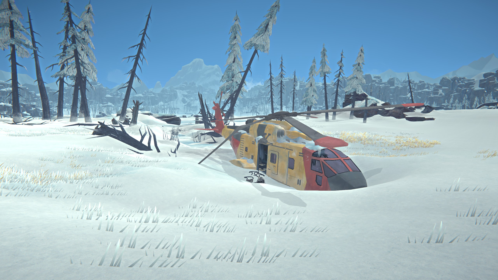
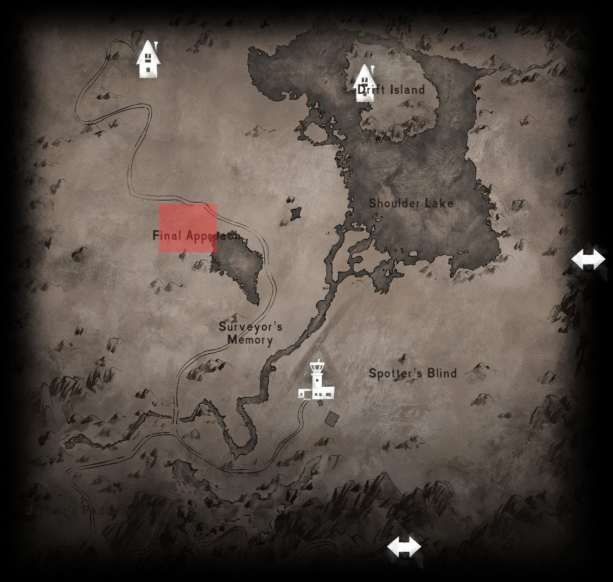
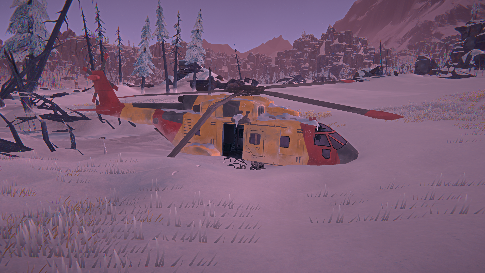
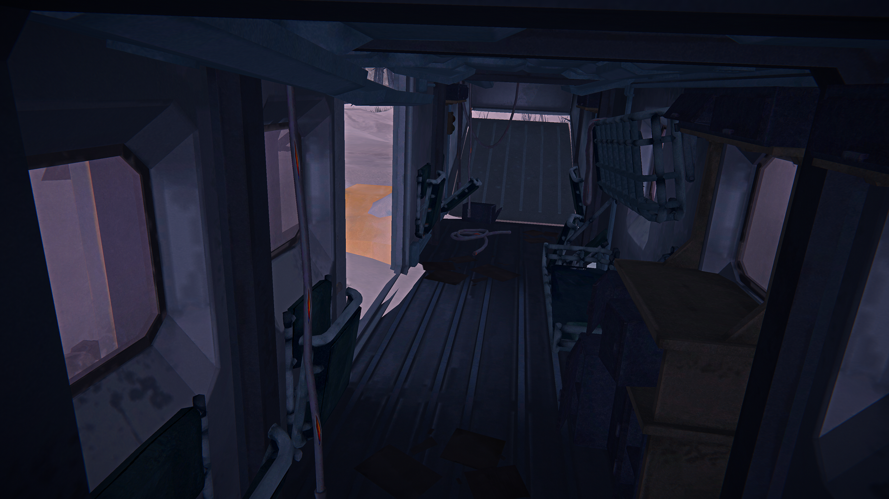
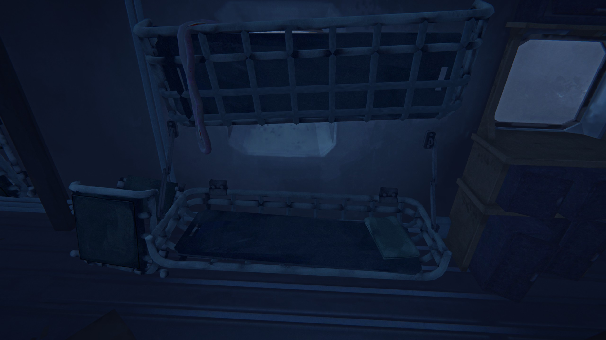

# Final Approach

**Final Approach**

| Property | Details |
| --- | --- |
|  |  / *Final\_Approach\_Close.jpg* |
| **Location** |  |
|  |  / *Final\_Approach\_Location.png* |
| Region | [Forsaken Airfield](./Forsaken%20Airfield.md)\|- |
| Description | A rescue helicopter crashed near a frozen pond |
| **General** |  |
| Type |  |
| Firebox |  |
|  / *bed\_icon.png* | Has a bed |
|  | Provides some shelter\|} / **Final Approach** is a crashed helicopter in [Forsaken Airfield](./Forsaken%20Airfield.md). / ## Overview / A dead body lay outside the helicopter's side door, which has been jammed wide open. Despite that, the location may be a precious small shelter against the weather and give a small warmth +5° C bonus. / An [Emergency Kit](./Emergency%20Kit.md) may spawn near the corpse outside and some of the small lockers onboard may contain mid-level loot. The helicopter wreck contains a bed in the form of a medical cot that provides a + 2 °C ( +3.6°F ) Warmth bonus, and the interior is useful in that you can build a fire shielded from the wind. / There is a small cave among the rocks south the helicopter close to the shoreline. A campfire and plastic container spawn there and a rabbit carcass spawns just outside the entrance. A bear cave can be found due west from this location. / A [Moose](./Moose.md) may spawn on the lake nearby. / ## Trivia / - Concept art of the Final Approach helicopter was used to market the [Tales from the Far Territory](./Tales%20from%20the%20Far%20Territory.md) expansion. / - The [Handheld Shortwave Radio](./Handheld%20Shortwave%20Radio.md) appears near the crashed chopper in the original teaser trailer for the Far Territory Expansion, but it's final location is found in the [Control Tower](./Control%20Tower.md). / ## Gallery / \| Column 1 \| Column 2 \| Column 3 \| Column 4 \| / \| --- \| --- \| --- \| --- \| / \|  / *Rescuehelicopter.png* \|  / *The interior of the helicopter* \|  / *Concept art of the crashed helicopter in the Tales from the Far Territory Expansion announcement.* \|  / *icon used in the advertising of the Far Territories Newsletter* \| / \|  / *The medical cot inside the helicopter* \|  / *The cockpit during an aurora* \|  \|  \| / **Lua execution error in Module:Navbox function navbox** [ru:Последний заход](ru:%D0%9F%D0%BE%D1%81%D0%BB%D0%B5%D0%B4%D0%BD%D0%B8%D0%B9_%D0%B7%D0%B0%D1%85%D0%BE%D0%B4) |
|  / *Rescuehelicopter.png* |  / *The interior of the helicopter* /  / *Concept art of the crashed helicopter in the Tales from the Far Territory Expansion announcement.* /  / *icon used in the advertising of the Far Territories Newsletter* |
|  / *The medical cot inside the helicopter* |  / *The cockpit during an aurora* |
