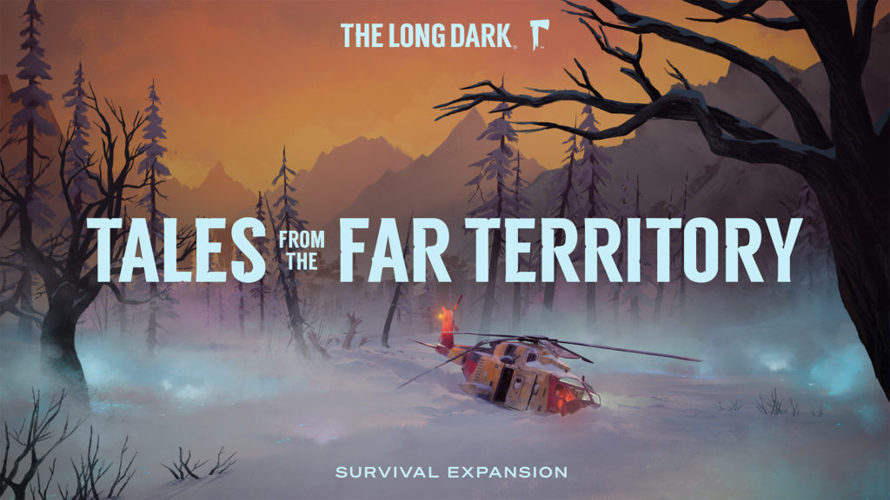
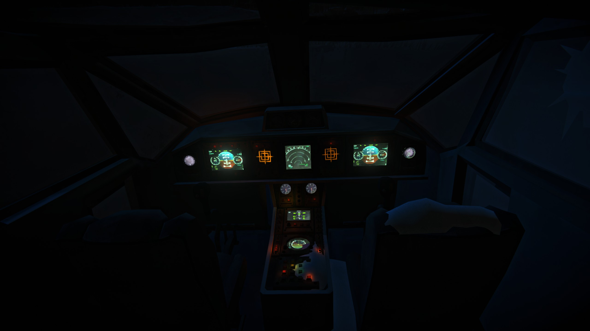

# Final Approach

**Categories:** Locations, Locations in Forsaken Airfield, Sheltered locations · **Source:** [Fandom](https://thelongdark.fandom.com/wiki/Final_Approach)

**Final Approach**

_Final\_Approach\_Close.jpg_

**Location**

_Final\_Approach\_Location.png_

**Region:** [Forsaken Airfield](./Forsaken%20Airfield.md)\|-

**Description:** A rescue helicopter crashed near a frozen pond

**General**

Type

Firebox

_bed\_icon.png_

Has a bed

_Rescuehelicopter.png_

_The interior of the helicopter_

_Concept art of the crashed helicopter in the Tales from the Far Territory Expansion announcement._

_icon used in the advertising of the Far Territories Newsletter_

_The medical cot inside the helicopter_

_The cockpit during an aurora_
