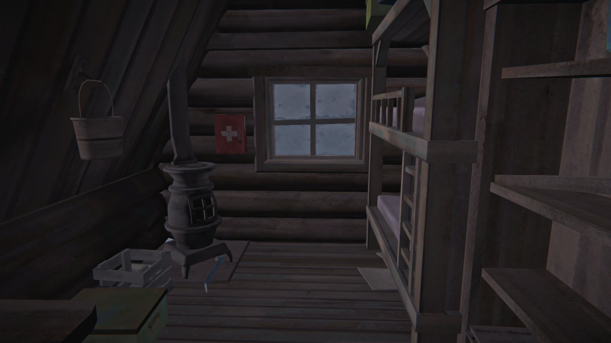
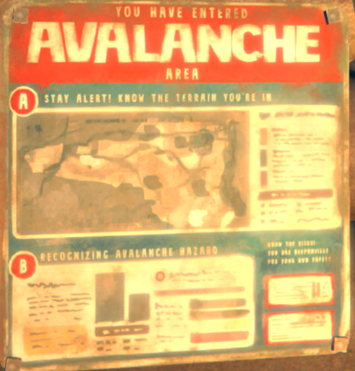
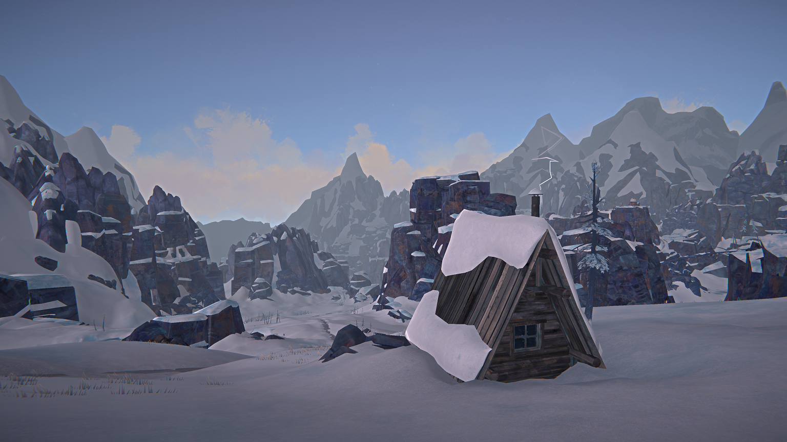

# Final Refuge

**Final Refuge**

| Property | Details |
| --- | --- |
|  |  / *Final\_Refuge.png* |
| **Location** |  |
|  |  / *Final\_Refuge\_Location.png* |
| Region | [Sundered Pass](./Sundered%20Pass.md)\|- |
| **General** |  |
| Type | Residential\|- |
|  / *bed\_icon.png* | Has a bed |
|  | Has an interior\|} / **Final Refuge** — is the location of Refuge Cabin C, the final cabin found on the mountain road in [Sundered Pass](./Sundered%20Pass.md). / ## Overview / The cabin can provide life-saving shelter if the weather conditions turn poor. It offers a small amount of loot and limited storage: / - A [Pot Belly Stove](./Pot%20Belly%20Stove.md) / - 2 [Beds](./Bed.md) (+2 C°) and 2 [Pillows](./Pillow.md) / - A [Table](./Table.md) / - A [Chair](./Chair.md) / - A [Crate](./Crate.md) / - A [Backpack](./Backpack.md) / - A [First Aid Kit](./First%20Aid%20Kit.md) on the wall. / - A [Note](./Notes.md) and [Polaroid](./Polaroids.md) can be found inside the cabin / - Several [Cardboard Boxes](./Cardboard%20Box.md) above the door entrance and under the bunkbed / - 3 Containers ([Metal](./Metal%20Container.md) and [Plastic](./Plastic%20Container.md)) on the shelf / This location can also spawn a [Prybar](./Prybar.md) and [Simple Tools](./Simple%20Tools.md). [Ptarmigans](./Ptarmigan.md) can spawn nearby (to the left side of the cabin looking from the direction of [Cabin B](./Placid%20Notch.md)) as well as a possible traveling [Bear](./Bear.md). / The road ahead is blocked off by an avalanche, [Unyielding Inundation](./Unyielding%20Inundation.md). / ## Gallery / \| Column 1 \| Column 2 \| Column 3 \| Column 4 \| / \| --- \| --- \| --- \| --- \| / \|  / *The inside of cabin C* \|  / *The road ahead blocked by [Unyielding Inundation](./Unyielding%20Inundation.md)* \|  / *An avalanche warning sign inside the cabin* \|  / *A view upon the valley from the Final Refuge* \| / **Lua execution error in Module:Navbox function navbox** [ru:Последнее убежище](ru:%D0%9F%D0%BE%D1%81%D0%BB%D0%B5%D0%B4%D0%BD%D0%B5%D0%B5_%D1%83%D0%B1%D0%B5%D0%B6%D0%B8%D1%89%D0%B5) |
|  / *The inside of cabin C* |  / *The road ahead blocked by [Unyielding Inundation](./Unyielding%20Inundation.md)* /  / *An avalanche warning sign inside the cabin* /  / *A view upon the valley from the Final Refuge* |
