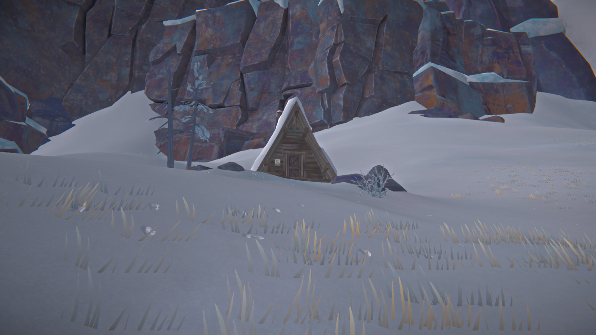

# Final Refuge

**Categories:** Indoor locations, Locations, Locations in Sundered Pass, Residential locations · **Source:** [Fandom](https://thelongdark.fandom.com/wiki/Final_Refuge)

**Final Refuge**

| Property | Details |
| --- | --- |
|  |  / _Final\_Refuge.png_ |
| **Location** |  |
|  |  / _Final\_Refuge\_Location.png_ |
| Region | [Sundered Pass](./Sundered%20Pass.md)\|- |
| **General** |  |
| Type | Residential\|- |
|  / _bed\_icon.png_ | Has a bed |

|  / _The inside of cabin C_ |  / _The road ahead blocked by [Unyielding Inundation](./Unyielding%20Inundation.md)_ /  / _An avalanche warning sign inside the cabin_ /  / _A view upon the valley from the Final Refuge_ |
