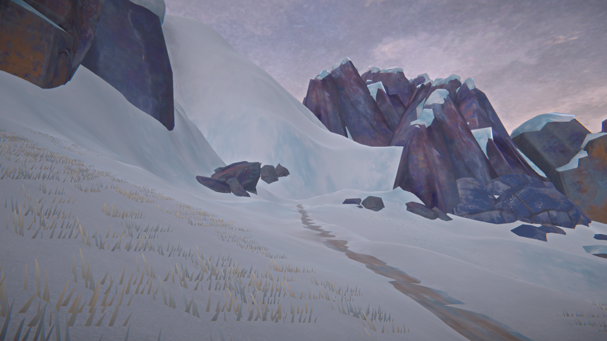

# Final Refuge

**Categories:** Indoor locations, Locations, Locations in Sundered Pass, Residential locations · **Source:** [Fandom](https://thelongdark.fandom.com/wiki/Final_Refuge)

**Final Refuge**

[Final Refuge](../assets/Final_Refuge.png)

**Location**

[Final Refuge Location](../assets/Final_Refuge_Location.png)

**Region:** [Sundered Pass](./Sundered%20Pass.md)

**General**

**Type:** Residential

[Bed icon](../assets/Bed_icon.png)

Has a bed

Has an interior **Final Refuge** — is the location of Refuge Cabin C, the final cabin found on the mountain road in [Sundered Pass](./Sundered%20Pass.md).

## Overview

The cabin can provide life-saving shelter if the weather conditions turn poor. It offers a small amount of loot and limited storage:

- A [Pot Belly Stove](./Pot%20Belly%20Stove.md)
- 2 [Beds](./Bed.md) (+2 C°) and 2 [Pillows](./Pillow.md)
- A [Table](./Table.md)
- A [Chair](./Chair.md)
- A [Crate](./Crate.md)
- A [Backpack](./Backpack.md)
- A [First Aid Kit](./First%20Aid%20Kit.md) on the wall.
- A [Note](./Notes.md) and [Polaroid](./Polaroids.md) can be found inside the cabin
- Several [Cardboard Boxes](./Cardboard%20Box.md) above the door entrance and under the bunkbed
- 3 Containers ([Metal](./Metal%20Container.md) and [Plastic](./Plastic%20Container.md)) on the shelf

This location can also spawn a [Prybar](./Prybar.md) and [Simple Tools](./Simple%20Tools.md). [Ptarmigans](./Ptarmigan.md) can spawn nearby (to the left side of the cabin looking from the direction of [Cabin B](./Placid%20Notch.md)) as well as a possible traveling [Bear](./Bear.md).

The road ahead is blocked off by an avalanche, [Unyielding Inundation](./Unyielding%20Inundation.md).

## Gallery

_The road ahead blocked by [Unyielding Inundation](./Unyielding%20Inundation.md)_

