# Fir Firewood

**Categories:** Fire Starting, Materials, Pages with update history · **Source:** [Fandom](https://thelongdark.fandom.com/wiki/Fir_Firewood)

**Contents**

- [Overview](#overview)
- [Fire Starting info](#fire-starting-info)
- [Obtaining](#obtaining)
- [Tips](#tips)
- [Products](#products)
- [Update history](#update-history)

**Fir Firewood**

_Fir\_Firewood\_icon.png_

**Release:** [12 June 2014](./The%20Long%20Dark%20%E2%80%94%20Changelog.md#0.01)

**Wintermute:** No

**Renewable:** Yes

**Properties**

**Item type:** [Fire Starting](./Fire%20Starting.md)

**Stackable:** yes

**Examine:** While not technically a hardwood, fir burns like one.

**Values**

**Weight:** 1.00 kg (2.2 lbs)

**Advanced data**

**Item key:** gear\_hardwood

**Fir Firewood** is a fuel for fires in _[The Long Dark](./The%20Long%20Dark.md)_, it also is a material for repairing the [Heavy Hammer](./Heavy%20Hammer.md).

## Overview

Fir Firewood can be harvested from downed Fir Limbs found outdoors with a [tool](./Tools.md). It can also be found inside of structures, firewood bins, rotten tree trunks, or near campfires and corpses. It can also be found by [Beachcombing](./Beachcombing.md). Fir has no bonus [fire-starting](./Fire%20Starting.md) chance, and is thus unfavorable for starting [Fire](./Fire.md) with.

## Fire Starting info

**Fir Firewood**

**Type:** Fuel

**Statistics**

**Duration:**  90 minutes

**Start Chance:**  0%

**Heat:**  +8°C (+14.4°F)

**Burn Density:** 1.5 hr/kg (0.68 hr/lb)

## Obtaining

- Fir Limbs respawn continually, making them a renewable resource and the [Heavy Hammer](./Heavy%20Hammer.md) a renewable tool.
- Small Fir Limbs yield 3 Fir Firewood with a [Hatchet](./Hatchet.md) (45 minutes and 2% condition loss on stalker difficulty), [Improvised Hatchet](./Improvised%20Hatchet.md) (58 minutes), or [Hacksaw](./Hacksaw.md) (90 minutes).
- Large Fir Limbs yield 4 Fir Firewood with a [Hatchet](./Hatchet.md) (60 minutes), but cannot be harvested with a Hacksaw.
- Large and Small Fir Limbs cost tools the same condition per use (4%), making Large limbs more tool-friendly to harvest, except with the Hacksaw which cannot harvest Large Cedar or Large Fir Limbs.

## Tips

Since a single piece of Fir Firewood has a fire duration of 1 hour and 30 minutes, so it's 90 min/kg is less efficient per weight than [Cedar Firewood](./Cedar%20Firewood.md) at 120 min/kg. However, Fir Firewood is more time-efficient to harvest compared to [Cedar Firewood](./Cedar%20Firewood.md), since each piece of Fir burns for 30 minutes longer. A small Fir Limb will burn for 4.5 hours(3 pieces of Fir) whereas a small [Cedar](./Cedar%20Firewood.md) Limb provides 3 hours of burn-time. This is specifically useful when the player decides to chop wood outside but has limited time to do so because of cold weather, maintaining [Fire](./Fire.md), etc.

## Products

| Item | Skills | Materials |
| --- | --- | --- |
|  [Bear Hide Bed](./Bear%20Hide%20Bed.md) | None | - 18 × [Fir Firewood](./Fir%20Firewood.md) / - 4 × [Cured Gut](./Cured%20Gut.md) / - 1 × [Cured Black Bear Hide](./Cured%20Black%20Bear%20Hide.md) / - 16 × [Ptarmigan Down](./Ptarmigan%20Down.md) |
| [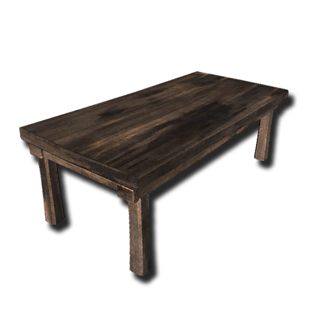](./Coffee%20Table.md) [Coffee Table](./Coffee%20Table.md) | None | - 6 × [Fir Firewood](./Fir%20Firewood.md) |
| [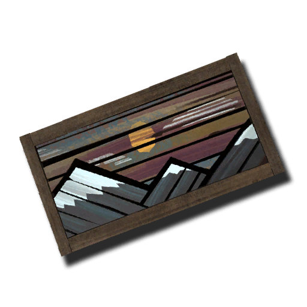](./Decorative%20Art.md) [Decorative Art](./Decorative%20Art.md) | None | - 2 × [Fir Firewood](./Fir%20Firewood.md) / - 1 × [Cedar Firewood](./Cedar%20Firewood.md) / - 1 × [Reclaimed Wood](./Reclaimed%20Wood.md) |
|  [Decorative Art (2)](./Decorative%20Art%20%282%29.md) | None | - 2 × [Fir Firewood](./Fir%20Firewood.md) / - 1 × [Cedar Firewood](./Cedar%20Firewood.md) / - 1 × [Reclaimed Wood](./Reclaimed%20Wood.md) |
| [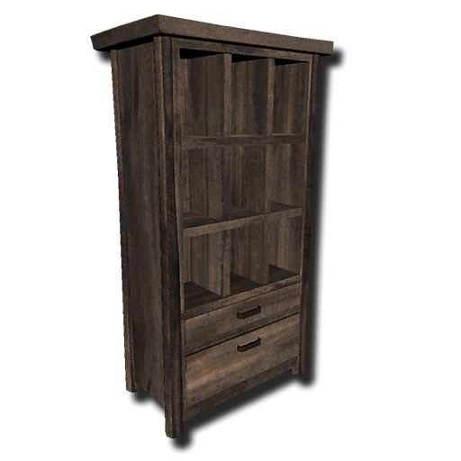](./Display%20Shelf.md) [Display Shelf](./Display%20Shelf.md) | None | - 12 × [Fir Firewood](./Fir%20Firewood.md) / - 4 × [Reclaimed Wood](./Reclaimed%20Wood.md) |
|  [Framed Hockey Jersey](./Framed%20Hockey%20Jersey.md) | None | - 2 × [Fir Firewood](./Fir%20Firewood.md) / - 1 × [Scrap Metal](./Scrap%20Metal.md) / - 1 × [Hockey Jersey](./Hockey%20Jersey.md) |
| [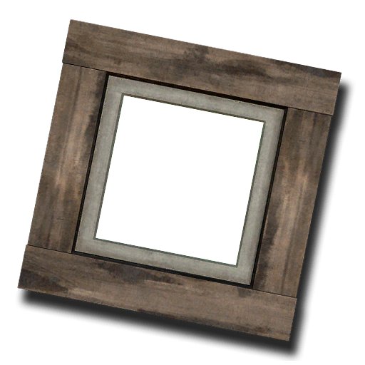](./Framed%20Photo.md) [Framed Photo](./Framed%20Photo.md) | None | - 1 × [Fir Firewood](./Fir%20Firewood.md) / - 1 × [Camera](./Camera.md) |
| [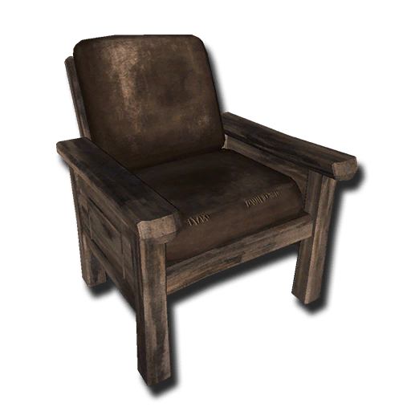](./Hide%20Chair.md) [Hide Chair](./Hide%20Chair.md) | None | - 8 × [Fir Firewood](./Fir%20Firewood.md) / - 2 × [Cured Deer Hide](./Cured%20Deer%20Hide.md) / - 8 × [Ptarmigan Down](./Ptarmigan%20Down.md) / - 3 × [Cured Gut](./Cured%20Gut.md) |
| [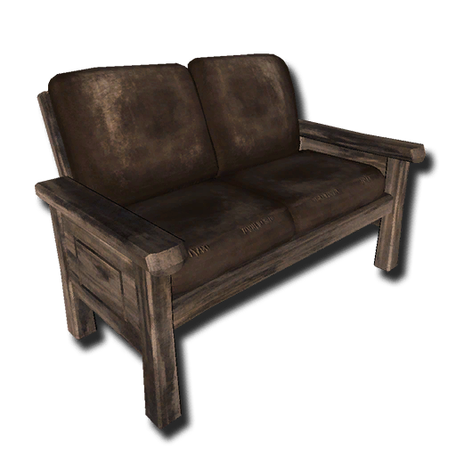](./Hide%20Couch.md) [Hide Couch](./Hide%20Couch.md) | None | - 15 × [Fir Firewood](./Fir%20Firewood.md) / - 4 × [Cured Deer Hide](./Cured%20Deer%20Hide.md) / - 16 × [Ptarmigan Down](./Ptarmigan%20Down.md) / - 5 × [Cured Gut](./Cured%20Gut.md) |
| [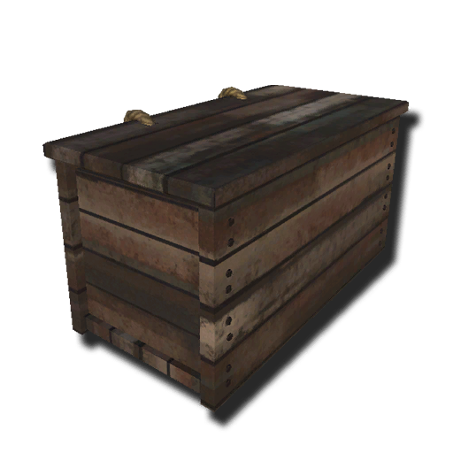](./Meat%20Curing%20Box.md) [Meat Curing Box](./Meat%20Curing%20Box.md) | None | - 10 × [Fir Firewood](./Fir%20Firewood.md) / - 8.00 kg × [Salt](./Salt.md) |
| [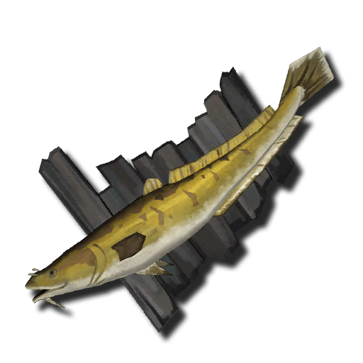](./Mounted%20Burbot.md) [Mounted Burbot](./Mounted%20Burbot.md) | None | - 1 × [Fir Firewood](./Fir%20Firewood.md) / - 1 × [Burbot (Raw)](./Burbot%20%28Raw%29.md) |
| [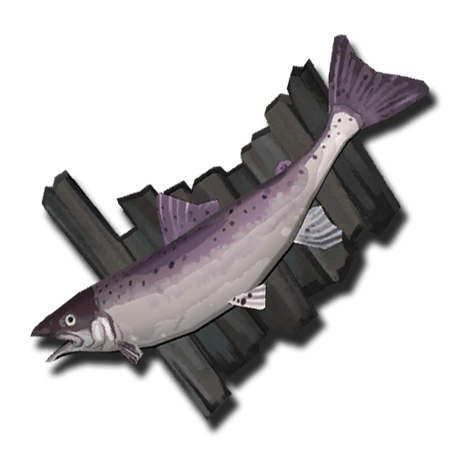](./Mounted%20Coho%20Salmon.md) [Mounted Coho Salmon](./Mounted%20Coho%20Salmon.md) | None | - 1 × [Fir Firewood](./Fir%20Firewood.md) / - 1 × [Coho Salmon (Raw)](./Coho%20Salmon%20%28Raw%29.md) |
| [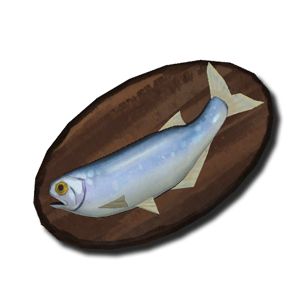](./Mounted%20Goldeye.md) [Mounted Goldeye](./Mounted%20Goldeye.md) | None | - 1 × [Fir Firewood](./Fir%20Firewood.md) / - 1 × [Goldeye (Raw)](./Goldeye%20%28Raw%29.md) |
| [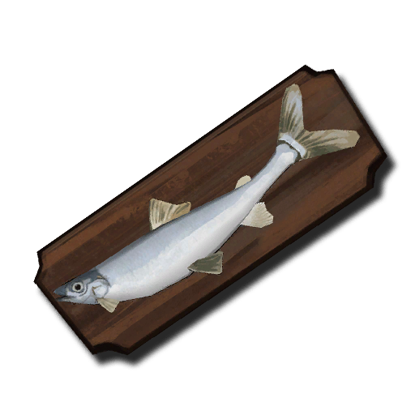](./Mounted%20Lake%20Whitefish.md) [Mounted Lake Whitefish](./Mounted%20Lake%20Whitefish.md) | None | - 1 × [Fir Firewood](./Fir%20Firewood.md) / - 1 × [Lake Whitefish (Raw)](./Lake%20Whitefish%20%28Raw%29.md) |
|  [Mounted Rainbow Trout](./Mounted%20Rainbow%20Trout.md) | None | - 1 × [Fir Firewood](./Fir%20Firewood.md) / - 1 × [Rainbow Trout (Raw)](./Rainbow%20Trout%20%28Raw%29.md) |
| [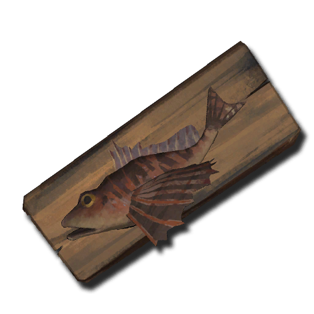](./Mounted%20Red%20Irish%20Lord.md) [Mounted Red Irish Lord](./Mounted%20Red%20Irish%20Lord.md) | None | - 1 × [Fir Firewood](./Fir%20Firewood.md) / - 1 × [Red Irish Lord (Raw)](./Red%20Irish%20Lord%20%28Raw%29.md) |
| [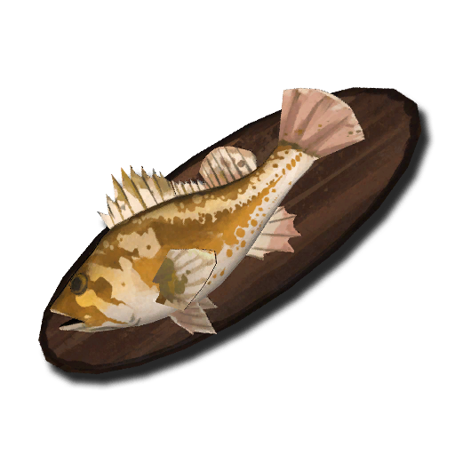](./Mounted%20Rockfish.md) [Mounted Rockfish](./Mounted%20Rockfish.md) | None | - 1 × [Fir Firewood](./Fir%20Firewood.md) / - 1 × [Rockfish (Raw)](./Rockfish%20%28Raw%29.md) |
| [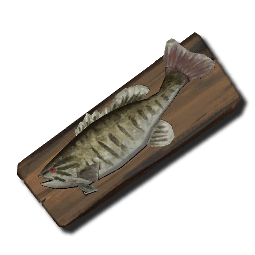](./Mounted%20Smallmouth%20Bass.md) [Mounted Smallmouth Bass](./Mounted%20Smallmouth%20Bass.md) | None | - 1 × [Fir Firewood](./Fir%20Firewood.md) / - 1 × [Smallmouth Bass (Raw)](./Smallmouth%20Bass%20%28Raw%29.md) |
| [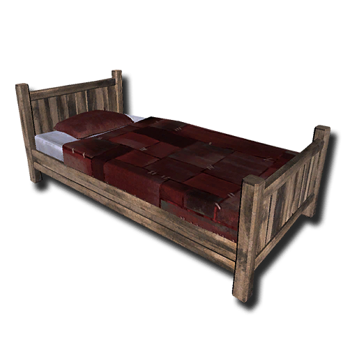](./Quilted%20Bed.md) [Quilted Bed](./Quilted%20Bed.md) | None | - 12 × [Fir Firewood](./Fir%20Firewood.md) / - 10 × [Cloth](./Cloth.md) / - 6 × [Cured Gut](./Cured%20Gut.md) / - 16 × [Ptarmigan Down](./Ptarmigan%20Down.md) |
| [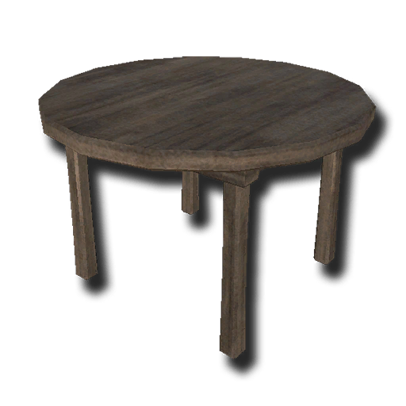](./Round%20Table.md) [Round Table](./Round%20Table.md) | None | - 12 × [Fir Firewood](./Fir%20Firewood.md) |
| [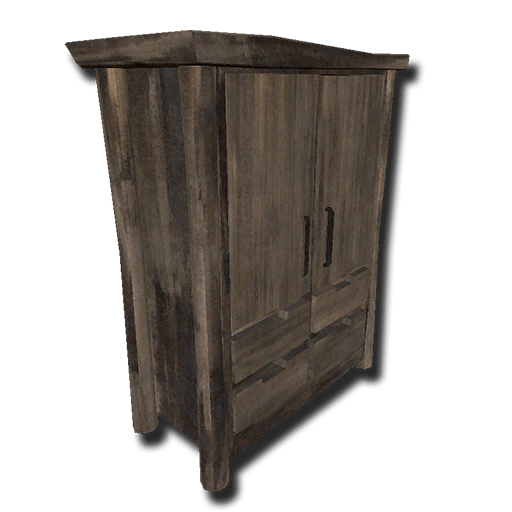](./Rustic%20Closet.md) [Rustic Closet](./Rustic%20Closet.md) | None | - 18 × [Fir Firewood](./Fir%20Firewood.md) / - 3 × [Reclaimed Wood](./Reclaimed%20Wood.md) / - 2 × [Scrap Metal](./Scrap%20Metal.md) |
| [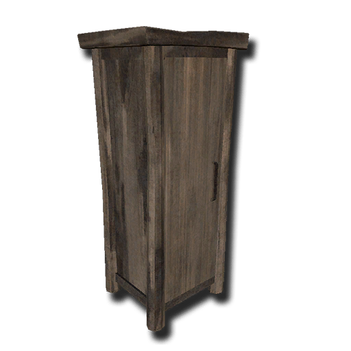](./Rustic%20Cupboard.md) [Rustic Cupboard](./Rustic%20Cupboard.md) | None | - 10 × [Fir Firewood](./Fir%20Firewood.md) / - 4 × [Reclaimed Wood](./Reclaimed%20Wood.md) / - 2 × [Scrap Metal](./Scrap%20Metal.md) |
| [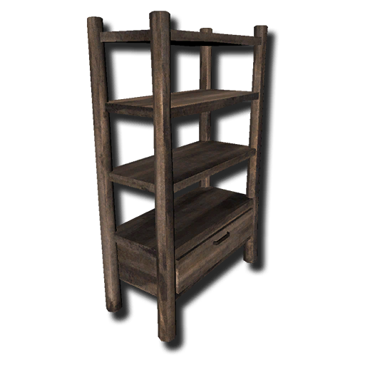](./Rustic%20Display%20Shelf.md) [Rustic Display Shelf](./Rustic%20Display%20Shelf.md) | None | - 10 × [Fir Firewood](./Fir%20Firewood.md) / - 2 × [Reclaimed Wood](./Reclaimed%20Wood.md) |
| [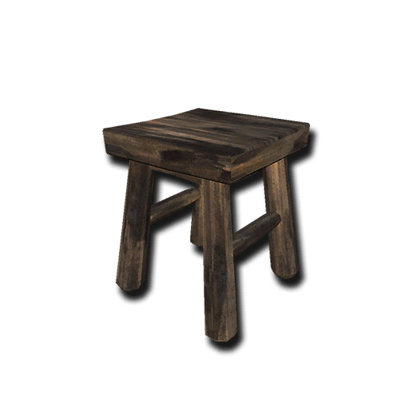](./Rustic%20Stool.md) [Rustic Stool](./Rustic%20Stool.md) | None | - 4 × [Fir Firewood](./Fir%20Firewood.md) |
| [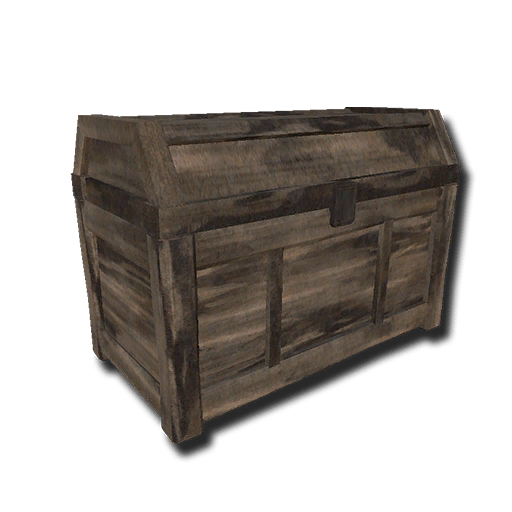](./Rustic%20Storage%20Trunk.md) [Rustic Storage Trunk](./Rustic%20Storage%20Trunk.md) | None | - 9 × [Fir Firewood](./Fir%20Firewood.md) |
| [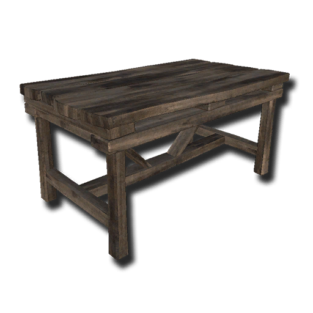](./Rustic%20Table.md) [Rustic Table](./Rustic%20Table.md) | None | - 10 × [Fir Firewood](./Fir%20Firewood.md) |
| [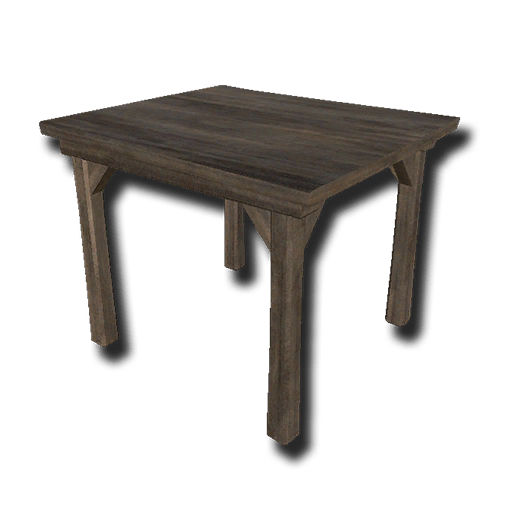](./Square%20Table.md) [Square Table](./Square%20Table.md) | None | - 8 × [Fir Firewood](./Fir%20Firewood.md) |
| [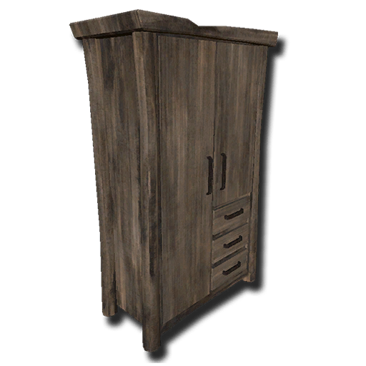](./Tall%20Rustic%20Closet.md) [Tall Rustic Closet](./Tall%20Rustic%20Closet.md) | None | - 24 × [Fir Firewood](./Fir%20Firewood.md) / - 4 × [Reclaimed Wood](./Reclaimed%20Wood.md) / - 2 × [Scrap Metal](./Scrap%20Metal.md) |
| [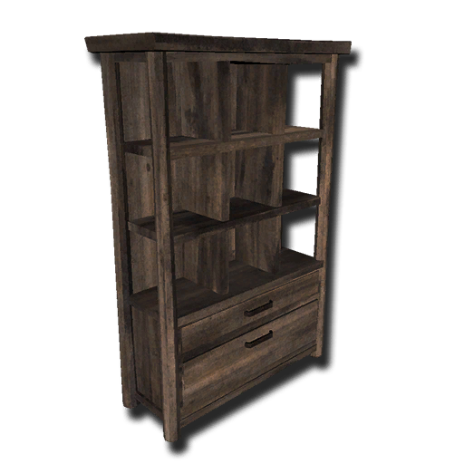](./Wide%20Display%20Shelf.md) [Wide Display Shelf](./Wide%20Display%20Shelf.md) | None | - 18 × [Fir Firewood](./Fir%20Firewood.md) / - 4 × [Reclaimed Wood](./Reclaimed%20Wood.md) |
| [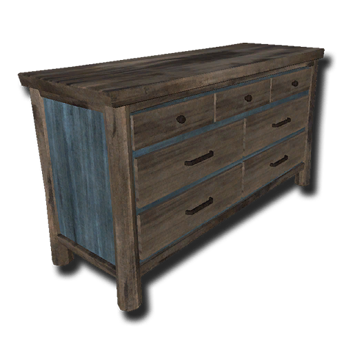](./Wide%20Dresser.md) [Wide Dresser](./Wide%20Dresser.md) | None | - 16 × [Fir Firewood](./Fir%20Firewood.md) / - 6 × [Reclaimed Wood](./Reclaimed%20Wood.md) |

## Update history

- UPDATE **31 July 2014 ([Update](./The%20Long%20Dark%20%E2%80%94%20Changelog.md#.073)):**
  - Fuel Sources: Increased the heating radius of Hardwood, Softwood, and Reclaimed Wood fuel types.
  - Tuned all Fuel sources. Hardwood, Softwood, and Reclaimed wood all now have reduced burn times, but are also lighter to carry. Wood Foraging has been tuned to be more generous. Net result is Fuel is easier to find and carry, but you need more of it.
- UPDATE **12 June 2014 ([Update](./The%20Long%20Dark%20%E2%80%94%20Changelog.md#.01)):**
  - Added to game.
