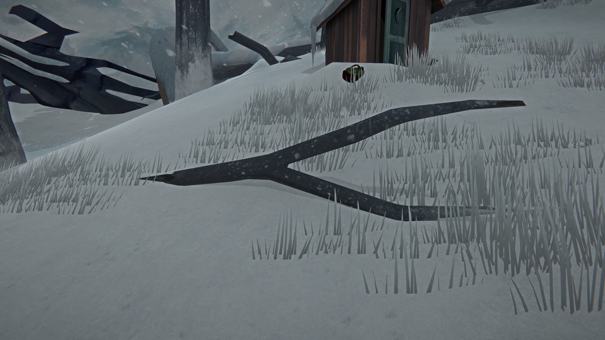
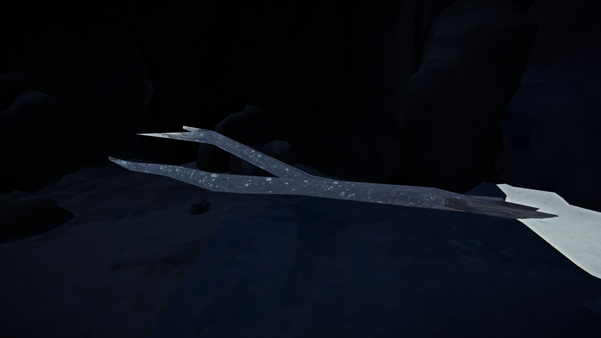

# Fir Limb

**Categories:** Interactable Objects, Story items · **Source:** [Fandom](https://thelongdark.fandom.com/wiki/Fir_Limb)

**Fir Limb**

\[\[File:

250px\]\]

**General**

Item Type

Wintermute

Yes|-

**Statistics**

Harvest

45-60 Minutes

Yields 3-4 [Fir Firewood](./Fir%20Firewood.md)

The **Fir Limb** is one of the many stationary interactable objects found in _[The Long Dark](./The%20Long%20Dark.md)_. They respawn randomly in the world over time under trees, making them a renewable [material](./Materials.md).

## Overview

There are two variants of this object: the small and the large. Both can be turned into [Fir Firewood](./Fir%20Firewood.md).

Compared to the [Cedar Limb](./Cedar%20Limb.md), the Fir Limb provides more minutes of fire per minute of harvesting time. Both limbs take 15 minutes to harvest per unit of firewood obtained from them, and Fir Firewood burns for 90 minutes per piece compared to Cedar's 60. The lower burn density of Fir, however, makes it less desirable for carrying around when travelling.

It's commonly believed that limbs respawn after strong winds or blizzards, but this is untrue. Radial spawns (sticks, branches, coal, stones ect.) simply spawn on a randomized timer, independent of any weather conditions.

### Small Limb

Small limbs will provide 3 firewood and can be cut up using a [Hatchet](./Hatchet.md) (45 min), [Improvised Hatchet](./Improvised%20Hatchet.md) (58 min), or [Hacksaw](./Hacksaw.md) (90 min). Unlike their [Cedar Limbs](./Cedar%20Limb.md), these limbs offer no [Tinder Plug](./Tinder%20Plug.md) when harvested.

| Fir Firewood | Time | Calories | Condition of Tool |
| --- | --- | --- | --- |
| 3 | 45 minutes | 135 | -2% Hatchet |
| 3 | 58 minutes | 176 | -2% Improvised Hatchet |
| 3 | 1 hour 30 minutes | 270 | -5% Hacksaw |

#### Large Limb

Large limbs cannot be cut up with a hacksaw, and take 60 min to harvest with a normal hatchet, or 77 min with an improvised tool. Large Fir Limbs are very rare and only appear in set locations:

- [Ravine Basin](./Ravine%20Basin.md) in [The Ravine](./The%20Ravine.md)
- Between [Trapper's Homestead](./Trapper%27s%20Homestead.md) and [Unnamed Pond](./Unnamed%20Pond.md) in [Mystery Lake](./Mystery%20Lake%20%28region%29.md)

| Fir Firewood | Tinder Plug | Time | Calories | Condition of Tool |
| --- | --- | --- | --- | --- |
| 4 | 1 | 1 Hour | 202 | -2% Hatchet |
| 4 | 1 |  |  | -2% Improvised Hatchet |
