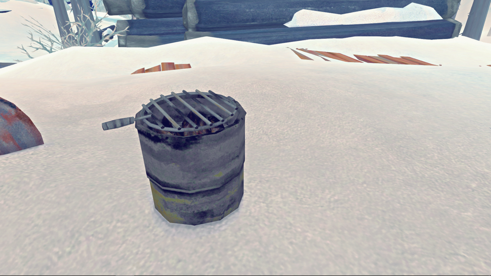

# Fire Barrel

**Contents**

- [Locations](#Locations)
- [Ash Canyon](#Ash_Canyon)
- [Blackrock](#Blackrock)
- [Bleak Inlet](#Bleak_Inlet)
- [Coastal Highway](#Coastal_Highway)
- [Desolation Point](#Desolation_Point)
- [Forlorn Muskeg](#Forlorn_Muskeg)
- [Mountain Town](#Mountain_Town)
- [Mystery Lake](#Mystery_Lake)
- [Pleasant Valley](#Pleasant_Valley)
- [Sundered Pass](#Sundered_Pass)

<table class="infobox">
<caption>Fire Barrel</caption>
<colgroup>
<col style="width: 50%" />
<col style="width: 50%" />
</colgroup>
<tbody>
<tr>
<td colspan="2"><figure>

<figcaption>Fire_barrel.png</figcaption>
</figure></td>
</tr>
<tr>
<td colspan="2" class="section">
<strong>General</strong>
</td>
</tr>
<tr>
<td>
Type
</td>
<td>
Fire Starting|-
</td>
</tr>
<tr>
<td>
Cooking slots
</td>
<td>
2
</td>
</tr>
</tbody>
</table>

The **fire barrel** is an immovable <a href="./Fire.md#Contained_fires" class="wikilink" title="contained fire">contained fire</a> in an open barrel. The fire barrel functions identically to other contained fires and player-made <a href="./Campfire.md" class="wikilink" title="campfire">campfire</a>. The fire barrel provides no advantage over other contained fires, but it does allow protection against wind, unlike the player-made campfire. It has two <a href="./Cooking.md" class="wikilink" title="cooking">cooking</a> slots.

The fire barrel can be re-lit indefinitely, though it requires fresh starter, tinder, and fuel each time.

## Locations

Fire barrels have fixed locations that do not change between games. They are found both indoors and outdoors.

### Ash Canyon

- At <a href="./Miner%27s%20Folly.md" class="wikilink" title="Miner&#39;s Folly">Miner's Folly</a> in the outdoor barn near the Work Bench. (Outdoors)
- North of <a href="./Angler%27s%20Den.md" class="wikilink" title="Angler&#39;s Den">Angler's Den</a>, towards the path that goes behind <a href="./Broad%20Falls.md" class="wikilink" title="Broad Falls">Broad Falls</a> (Outdoors)
- Near the entrance of <a href="./Gold%20Mine.md" class="wikilink" title="Gold Mine">Gold Mine</a> (Indoors)
- At the end of the Gold Mine, near the <a href="./Technical%20Backpack.md" class="wikilink" title="Technical Backpack">Technical Backpack</a> and <a href="./Crampons.md" class="wikilink" title="Crampons">Crampons</a> (Indoors)

### Blackrock

- Garage shed near <a href="./Steam%20Tunnels.md" class="wikilink" title="Steam Tunnels">Steam Tunnels</a> (Outdoors)
- In the <a href="./Steam%20Tunnels.md" class="wikilink" title="Steam Tunnels">Steam Tunnels</a>
- <a href="./Cook%27s%20Farm.md" class="wikilink" title="Cook&#39;s Farm">Cook's Farm</a> (Outdoors)
- In the room with the code to the <a href="./Keypad.md" class="wikilink" title="Keypad">Keypad</a> door in <a href="./Last%20Prospect.md" class="wikilink" title="Last Prospect">Last Prospect</a>, 2nd level where the <a href="./Detonators.md" class="wikilink" title="Detonators">Detonators</a> are found. (Indoors)
- <a href="./Jailer%27s%20Residence.md" class="wikilink" title="Jailer&#39;s Residence">Jailer's Residence</a> vehicle shed (Outdoors)

### Bleak Inlet

- Break room near Fishing Trawler at <a href="./Last%20Resort%20Cannery.md" class="wikilink" title="Last Resort Cannery">Last Resort Cannery</a> (Indoors)
- <a href="./Keypad.md" class="wikilink" title="Keypad">Keypad</a> Door leading to <a href="./Workshop.md" class="wikilink" title="Workshop">Workshop</a> at <a href="./Cannery%20Pier.md" class="wikilink" title="Cannery Pier">Cannery Pier</a> (Indoors)
- <a href="./Workshop.md" class="wikilink" title="Workshop">Workshop</a>

### Coastal Highway

- <a href="./Quonset%20Garage.md" class="wikilink" title="Quonset Gas Station">Quonset Gas Station</a> (Indoors)
- Near the elevator at the bottom of <a href="./Cinder%20Hills%20Coal%20Mine.md" class="wikilink" title="Cinder Hills Coal Mine">Cinder Hills Coal Mine</a> (Indoors)

### Desolation Point

- <a href="./Stone%20Church.md" class="wikilink" title="Stone Church">Stone Church</a> (Indoors)
- <a href="./Hibernia%20Processing.md" class="wikilink" title="Hibernia Processing">Hibernia Processing</a> (Indoors)
- Trailer behind Hibernia Processing (Outdoors)

### Forlorn Muskeg

- The cart at <a href="./Poacher%27s%20Camp.md" class="wikilink" title="Poacher&#39;s Camp">Poacher's Camp</a> (Indoors)

### Mountain Town

- <a href="./Trailer%20%28Mountain%20Town%20Region%29.md" class="wikilink" title="Trailer (Mountain Town Region)">Trailer (Mountain Town Region)</a> (Outdoors)
- <a href="./Orca%20Gas%20Station.md" class="wikilink" title="Orca Gas Station">Orca Gas Station</a> Convenience Store, in the back office (Indoors)

### Mystery Lake

- <a href="./Carter%20Hydro%20Dam.md" class="wikilink" title="Carter Hydro Dam">Carter Hydro Dam</a> upper level in generator room (Indoors)

### Pleasant Valley

- Outside at <a href="./Signal%20Hill.md" class="wikilink" title="Signal Hill">Signal Hill</a> (Outdoors)
- <a href="./Pleasant%20Valley%20Outbuildings.md" class="wikilink" title="Pleasant Valley Outbuildings">Pleasant Valley Outbuildings</a>, inside the Red Barn (Indoors)
- <a href="./Three%20Strikes%20Farmstead.md" class="wikilink" title="Three Strikes Farmstead">Three Strikes Farmstead</a> near shed (Outdoors)

### Sundered Pass

- <a href="./High%20Peak%20Plateau.md" class="wikilink" title="High Peak Plateau">High Peak Plateau</a> (Outdoors)
- Behind <a href="./Last%20Lonely%20House.md" class="wikilink" title="Last Lonely House">Last Lonely House</a>, near Work Bench (Outdoors)

**Lua execution error in Module:Navbox function navbox** **Lua execution error in Module:Navbox function navbox** <a href="ru:%D0%91%D0%BE%D1%87%D0%BA%D0%B0" class="wikilink" title="ru:Бочка">ru:Бочка</a> <a href="es:Barril_para_fuego" class="wikilink" title="es:Barril para fuego">es:Barril para fuego</a>

