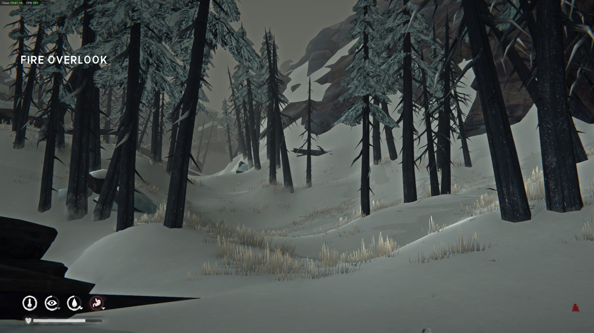
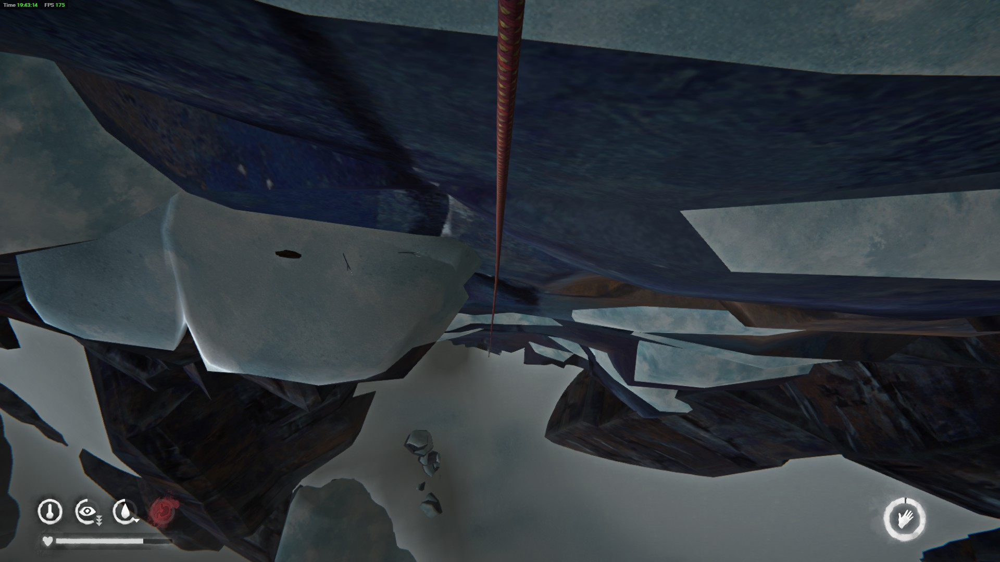

# Fire Overlook

**Categories:** Landmarks, Locations, Locations in Ash Canyon, Outdoor locations · **Source:** [Fandom](https://thelongdark.fandom.com/wiki/Fire_Overlook)

**Fire Overlook**

| Property | Details |
| --- | --- |
|  | [20201210005637 1](../assets/20201210005637_1.jpg) |
| **Location** |  |
|  | [Fire Overlook Location](../assets/Fire_Overlook_Location.png) |
| Region | [Ash Canyon](./Ash%20Canyon.md) |
| Description | An overlook over a canyon |
| **General** |  |
| Type | Landmark |
|  | Has no shelter |

**Fire Overlook** is a landmark just to the northwest of [Homesteader's Respite](./Homesteader%27s%20Respite.md).

## Overview

A climbing rope leads down here to travel to Homesteader's Respite. On a clear day (which is rare in Ash Canyon), the lookoff provides a view of much of the southeastern part of the region, all the way from [Bitter Marsh](./Bitter%20Marsh.md) to [Shattered Cove](./Shattered%20Cove.md).

## Resources Available

- 0-64 [Sticks](./Stick.md)
- 0-1 [Branches](./Branch.md)
- 0-5 [Cedar Limbs](./Cedar%20Limb.md)
- 0-3 [Birch Saplings](./Green%20Birch%20Sapling.md)
- 0-1 [Maple Saplings](./Green%20Maple%20Sapling.md)
- 0-2 [Deer Carcasses](./Deer.md)
- 0-3 [Rabbits](./Rabbit.md)

## Gallery

