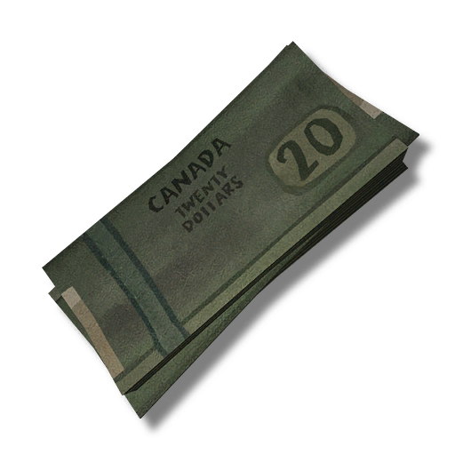
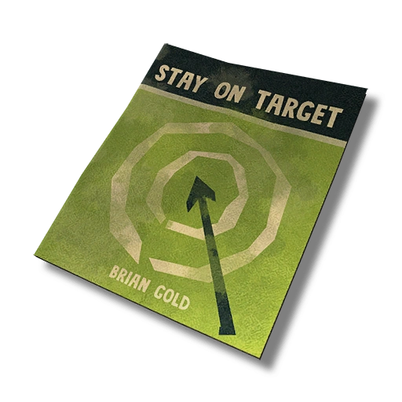
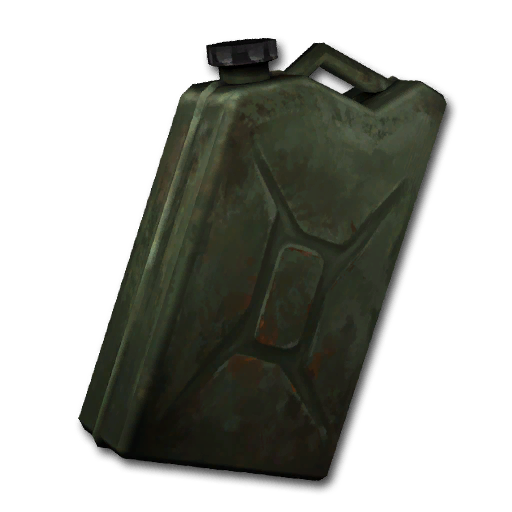
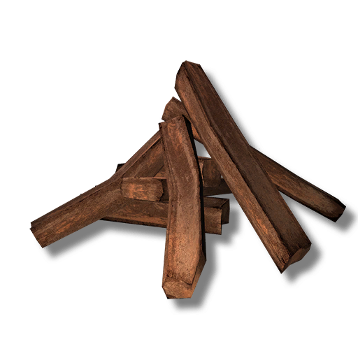

# Fire Starting

**Contents**

- [How to start a fire](#How_to_start_a_fire)
- [Chance of starting](#Chance_of_starting)
- [Attempting to start](#Attempting_to_start)
- [Failing to start](#Failing_to_start)
- [Equipment](#Equipment)
- [Starter](#Starter)
- [Tinder](#Tinder)
- [Fuel](#Fuel)
- [Cut Fuel](#Cut_Fuel)
- [Accelerant](#Accelerant)
- [Types of Fireboxes](#Types_of_Fireboxes)
- [Feats](#Feats)
- [Skill levels](#Skill_levels)

<table class="infobox">
<caption>Fire Starting</caption>
<colgroup>
<col style="width: 50%" />
<col style="width: 50%" />
</colgroup>
<tbody>
<tr>
<td colspan="2"><figure>

<figcaption>Fire_Starting_background.png</figcaption>
</figure></td>
</tr>
<tr>
<td>
Release
</td>
<td>
<a href="./The%20Long%20Dark%20%E2%80%94%20Early%20Access%20Changelog.md#0.346" class="wikilink" title="Penitent Scholar (v0.346)">Penitent Scholar (v0.346)</a>
</td>
</tr>
<tr>
<td>
Date
</td>
<td>
23 June 2016
</td>
</tr>
</tbody>
</table>

<figure>

<figcaption>Fire_Starting.png</figcaption>
</figure>

**Fire Starting** is a Survival <a href="./Skills.md" class="wikilink" title="Skill">Skill</a> that is used to start fires.

<a href="./Fire.md" class="wikilink" title="Fire">Fires</a> generate heat to restore and conserve <a href="./Warmth.md" class="wikilink" title="Warmth">Warmth</a>. Players can cook food, melt snow, and purify water on any fire started through the fire starting skill.

## How to start a fire

Fire Starting is one of the easiest skills to train in *<a href="./The%20Long%20Dark.md" class="wikilink" title="The Long Dark">The Long Dark</a>*, as players can increase their skill by lighting a new fire at any time during their playthrough.

To start a fire, players have to "use" an existing <a href="./Fire.md#Types_of_fires" class="wikilink" title="Firebox">Firebox</a> or fire or place a new campfire in an acceptable location. The player must then select an ignition source, tinder (optional at level 3 and higher), fuel, and an optional accelerant. At the top of the screen, the player's current fire starting skill and the chance of success with the currently selected materials are displayed.

### Chance of starting

The chance of a fire-starting attempt succeeding is calculated directly by adding the benefits of the character's skill and all materials being used in the attempt. Changing the materials can improve the chance of a successful start. Chances greater than 100% are rounded down to 100% and cannot fail.

### Attempting to start

Activating the start button on the bottom right will launch an attempt. A progress wheel will fill as the player character attempts to get the fire started. Normal attempts take 6 in-game minutes to achieve success. Attempts that include an accelerant take only 1 in-game minute. It is also possible to be interrupted in an attempt by aggressive <a href="./Wildlife.md" class="wikilink" title="Wildlife">Wildlife</a>. Interrupted attempts count as a failure.

### Failing to start

Failure, if it does occur by chance, will consume a random amount of time before canceling the progress bar and removing the campfire (unless the player is relighting an existing fireplace). Failing a starting chance consumes the tinder and any liquid used, but does not consume the fuel. Matches are consumed as ignition sources but torches and flares are not. Firestrikers suffer condition loss on every attempt, while a magnifying lens does not.

## Equipment

Players need one starter, one tinder, and one fuel before they can start fire starting. Player can start fires without a tinder after achieving level 3 in their fire starting skill.

### Starter

Players can select any starter currently carried in their inventory. They are sequenced alphabetically and further sorted by condition, highest to lowest. The condition of the starter does not affect the chance of success.

<table>
<colgroup>
<col style="width: 20%" />
<col style="width: 20%" />
<col style="width: 20%" />
<col style="width: 20%" />
<col style="width: 20%" />
</colgroup>
<thead>
<tr>
<th>
Image
</th>
<th>
Ignition Source
</th>
<th>
Benefit
</th>
<th>
Weight
</th>
<th>
Additional Info
</th>
</tr>
</thead>
<tbody>
<tr>
<td><figure>

<figcaption>Cardboard_Matches_icon.png</figcaption>
</figure></td>
<td>
<a href="./Cardboard%20Matches.md" class="wikilink" title="Cardboard Matches">Cardboard Matches</a>
</td>
<td>
+0% chance
</td>
<td>
0.005 kg 
(0.011 lb)
</td>
<td>
Consumed in attempt
</td>
</tr>
<tr>
<td><figure>

<figcaption>Firestriker_icon.png</figcaption>
</figure></td>
<td>
<a href="./Firestriker.md" class="wikilink" title="Firestriker">Firestriker</a>
</td>
<td>
+15% chance
</td>
<td>
0.10 kg 
(0.22 lb)
</td>
<td>
2% condition loss each attempt
</td>
</tr>
<tr>
<td><figure>

<figcaption>Flare_icon.png</figcaption>
</figure></td>
<td>
<a href="./Flare.md" class="wikilink" title="Flare">Flare</a> (lit)
</td>
<td>
+5% chance
</td>
<td>
0.25 kg 
(0.55 lb)
</td>
<td>
Attempt may succeed even if item burns out
</td>
</tr>
<tr>
<td><figure>

<figcaption>Magnifying_Lens_icon.png</figcaption>
</figure></td>
<td>
<a href="./Magnifying%20Lens.md" class="wikilink" title="Magnifying Lens">Magnifying Lens</a>
</td>
<td>
+5% chance
</td>
<td>
0.10 kg 
(0.22 lb)
</td>
<td>
Only effective outdoors with sunny weather <a href="#fn1" class="footnote-ref" id="fnref1" role="doc-noteref">1</a>
</td>
</tr>
<tr>
<td><figure>

<figcaption>Marine_Flare_icon.png</figcaption>
</figure></td>
<td>
<a href="./Marine%20Flare.md" class="wikilink" title="Marine Flare">Marine Flare</a> (lit)
</td>
<td>
+5% chance
</td>
<td>
0.25 kg 
(0.55 lb)
</td>
<td>
Attempt may succeed even if item burns out Beware of very short lifespan
</td>
</tr>
<tr>
<td><figure>

<figcaption>Torch_icon.png</figcaption>
</figure></td>
<td>
<a href="./Torch.md" class="wikilink" title="Torch">Torch</a> (lit)
</td>
<td>
+5% chance
</td>
<td>
0.30 kg 
(0.66 lb)
</td>
<td>
Attempt may succeed even if item burns out
</td>
</tr>
<tr>
<td><figure>

<figcaption>Wood_Matches_icon.png</figcaption>
</figure></td>
<td>
<a href="./Wood%20Matches.md" class="wikilink" title="Wood Matches">Wood Matches</a>
</td>
<td>
+5% chance
</td>
<td>
0.008 kg 
(0.018 lb)
</td>
<td>
Consumed in attempt
</td>
</tr>
</tbody>
</table>
<section id="footnotes" class="footnotes footnotes-end-of-document" role="doc-endnotes">

<ol>
<li id="fn1">Magnifying lens does not require direct exposure to sun. For instance, can be used to start fires in the stove inside fishing huts or underneath thick tree cover as long as the day is at least partly sunny.<a href="#fnref1" class="footnote-back" role="doc-backlink">↩︎</a></li>
</ol>
</section>

### Tinder

Players can select any tinder currently carried in their inventory. Currently, all tinders have equal buffs although their weight may vary. Heavier newsprint and newsprint rolls, as well as stacks of papers, can be broken down into Tinder Plugs. <a href="./Cardboard%20Box.md" class="wikilink" title="Cardboard Boxes">Cardboard Boxes</a> are often found as rubbish and can easily be broken down with or without a tool such as a <a href="./Hunting%20Knife.md" class="wikilink" title="Hunting Knife">Hunting Knife</a> for quick amounts of Tinder Plugs. Breaking down <a href="./Fir%20Limb.md" class="wikilink" title="Fir Limb">Fir Limb</a> and <a href="./Cedar%20Limb.md" class="wikilink" title="Cedar Limb">Cedar Limb</a> branches often provide a Tinder Plug. <a href="./Cat%20Tail.md" class="wikilink" title="Cat Tail">Cat Tail</a> plants always provide 1 Cat Tail Head and are quite plentiful.

Player can start fires without a tinder after achieving Fire Starting Level 3 in their fire starting skill.

<table>
<colgroup>
<col style="width: 25%" />
<col style="width: 25%" />
<col style="width: 25%" />
<col style="width: 25%" />
</colgroup>
<thead>
<tr>
<th>
Image
</th>
<th>
Tinder
</th>
<th>
Benefit
</th>
<th>
Weight
</th>
</tr>
</thead>
<tbody>
<tr>
<td><figure>

<figcaption>Birch_Bark_icon.png</figcaption>
</figure></td>
<td>
<a href="./Birch%20Bark.md" class="wikilink" title="Birch Bark">Birch Bark</a>
</td>
<td>
+0% chance
</td>
<td>
0.05 kg 
(0.11 lb)
</td>
</tr>
<tr>
<td><figure>

<figcaption>Cash_icon.png</figcaption>
</figure></td>
<td>
<a href="./Cash.md" class="wikilink" title="Cash">Cash</a>
</td>
<td>
+0% chance
</td>
<td>
0.05 kg 
(0.11 lb)
</td>
</tr>
<tr>
<td><figure>

<figcaption>Cat_Tail_Head_icon.png</figcaption>
</figure></td>
<td>
<a href="./Cat%20Tail%20Head.md" class="wikilink" title="Cat Tail Head">Cat Tail Head</a>
</td>
<td>
+0% chance
</td>
<td>
0.05 kg 
(0.11 lb)
</td>
</tr>
<tr>
<td><figure>

<figcaption>Newsprint_icon.png</figcaption>
</figure></td>
<td>
<a href="./Newsprint.md" class="wikilink" title="Newsprint">Newsprint</a>
</td>
<td>
+0% chance
</td>
<td>
0.10 kg 
(0.22 lb)
</td>
</tr>
<tr>
<td><figure>

<figcaption>Newsprint_Roll_icon.png</figcaption>
</figure></td>
<td>
<a href="./Newsprint%20Roll.md" class="wikilink" title="Newsprint Roll">Newsprint Roll</a>
</td>
<td>
+0% chance
</td>
<td>
0.10 kg 
(0.22 lb)
</td>
</tr>
<tr>
<td><figure>

<figcaption>Stack_of_Papers_icon.png</figcaption>
</figure></td>
<td>
<a href="./Stack%20of%20Papers.md" class="wikilink" title="Stack of Papers">Stack of Papers</a>
</td>
<td>
+0% chance
</td>
<td>
0.10 kg 
(0.22 lb)
</td>
</tr>
<tr>
<td><figure>

<figcaption>Tinder_Plug_icon.png</figcaption>
</figure></td>
<td>
<a href="./Tinder%20Plug.md" class="wikilink" title="Tinder Plug">Tinder Plug</a>
</td>
<td>
+0% chance
</td>
<td>
0.05 kg 
(0.11 lb)
</td>
</tr>
</tbody>
</table>

### Fuel

Players can select any fuel currently carried in their inventory. Each type of fuel differs in how much burn time it will add to a fire, how easy it is to light, and how much heat it will produce once burning. Attempting to burn an unfinished Research Book will issue a confirmation warning to the player before it can be burned.

The following table shows data assuming the environment temperature is -10 °C or warmer and the player's fire starting skill is 1.

Note that the burn time for a given fuel increases as the player's fire starting skill increases and the environment temperature decreases.

For example:

- At fire starting level 1 and the environment temperature of -10 °C or warmer, a stick will burn for 7.5 minutes (as listed below).
- At fire starting level 1 and the environment temperature of -30 °C or colder, a stick will burn for 15 minutes.
- At fire starting level 5 and the environment temperature of -10 °C or warmer, a stick will burn for 11.25 minutes.
- At fire starting level 5 and the environment temperature of -30 °C or colder, a stick will burn for 22.5 minutes.

<table style="width:100%;">
<colgroup>
<col style="width: 16%" />
<col style="width: 16%" />
<col style="width: 16%" />
<col style="width: 16%" />
<col style="width: 16%" />
<col style="width: 16%" />
</colgroup>
<thead>
<tr>
<th>
Image
</th>
<th>
Fuel
</th>
<th>
Benefit
</th>
<th>
Burn Time
</th>
<th>
Heat Bonus
</th>
<th>
Weight
</th>
</tr>
</thead>
<tbody>
<tr>
<td><figure>

<figcaption>Book_icon.png</figcaption>
</figure></td>
<td>
<a href="./Book.md" class="wikilink" title="Book">Book</a>
</td>
<td>
+35% chance
</td>
<td>
+18 minutes
</td>
<td>
+2 °C 
(3.6 °F)
</td>
<td>
0.50 kg 
(1.1 lb)
</td>
</tr>
<tr>
<td><figure>

<figcaption>Cedar_Firewood_icon.png</figcaption>
</figure></td>
<td>
<a href="./Cedar%20Firewood.md" class="wikilink" title="Cedar Firewood">Cedar Firewood</a>
</td>
<td>
+15% chance
</td>
<td>
+60 minutes
</td>
<td>
+6 °C 
(10.8 °F)
</td>
<td>
0.50 kg 
(1.1 lb)
</td>
</tr>
<tr>
<td><figure>

<figcaption>Coal_icon.png</figcaption>
</figure></td>
<td>
<a href="./Coal.md" class="wikilink" title="Coal">Coal</a>
</td>
<td>
+0% chance
</td>
<td>
+60 minutes
</td>
<td>
+20 °C 
(36 °F)
</td>
<td>
0.30 kg 
(0.66 lb)
</td>
</tr>
<tr>
<td><figure>

<figcaption>Fir_Firewood_icon.png</figcaption>
</figure></td>
<td>
<a href="./Fir%20Firewood.md" class="wikilink" title="Fir Firewood">Fir Firewood</a>
</td>
<td>
+0% chance
</td>
<td>
+90 minutes
</td>
<td>
+8 °C 
(14.4 °F)
</td>
<td>
1.00 kg 
(2.2 lb)
</td>
</tr>
<tr>
<td><figure>

<figcaption>Firelog_icon.png</figcaption>
</figure></td>
<td>
<a href="./Firelog.md" class="wikilink" title="Firelog">Firelog</a>
</td>
<td>
+7% chance
</td>
<td>
+120 minutes
</td>
<td>
+3 °C 
(5.4 °F)
</td>
<td>
2.00 kg 
(4.4 lb)
</td>
</tr>
<tr>
<td><figure>

<figcaption>Reclaimed_Wood_icon.png</figcaption>
</figure></td>
<td>
<a href="./Reclaimed%20Wood.md" class="wikilink" title="Reclaimed Wood">Reclaimed Wood</a>
</td>
<td>
-5% chance
</td>
<td>
+30 minutes
</td>
<td>
+3 °C 
(5.4 °F)
</td>
<td>
0.25 kg 
(0.55 lb)
</td>
</tr>
<tr>
<td><figure>

<figcaption>Research_Book_icon.png</figcaption>
</figure></td>
<td>
<a href="./Research%20Book.md" class="wikilink" title="Research Book">Research Book</a>
</td>
<td>
+35% chance
</td>
<td>
+18 minutes
</td>
<td>
+2 °C 
(3.6 °F)
</td>
<td>
0.50 kg 
(1.1 lb)
</td>
</tr>
<tr>
<td><figure>

<figcaption>Stick_icon.png</figcaption>
</figure></td>
<td>
<a href="./Stick.md" class="wikilink" title="Stick">Stick</a>
</td>
<td>
+15% chance
</td>
<td>
+7.5 minutes
</td>
<td>
+1 °C 
(1.8 °F)
</td>
<td>
0.15 kg 
(0.33 lb)
</td>
</tr>
<tr>
<td><figure>

<figcaption>Torch_icon.png</figcaption>
</figure></td>
<td>
<a href="./Torch.md" class="wikilink" title="Torch">Torch</a> (unlit)
</td>
<td>
+5% chance
</td>
<td>
+0-10 minutes
</td>
<td>
+1 °C 
(1.8 °F)
</td>
<td>
0.30 kg 
(0.66 lb)
</td>
</tr>
</tbody>
</table>

### Cut Fuel

Present in the game V1.00 for Wintermute but cut after V1.41 of the Redux update.

<table style="width:100%;">
<colgroup>
<col style="width: 16%" />
<col style="width: 16%" />
<col style="width: 16%" />
<col style="width: 16%" />
<col style="width: 16%" />
<col style="width: 16%" />
</colgroup>
<thead>
<tr>
<th>
Image
</th>
<th>
Fuel
</th>
<th>
Benefit
</th>
<th>
Burn Time
</th>
<th>
Heat Bonus
</th>
<th>
Weight
</th>
</tr>
</thead>
<tbody>
<tr>
<td></td>
<td></td>
<td></td>
<td></td>
<td></td>
<td></td>
</tr>
<tr>
<td><figure>

<figcaption>Jeremiah's_Papers_icon.png</figcaption>
</figure></td>
<td>
<a href="./Jeremiah%27s%20Papers.md" class="wikilink" title="Jeremiah&#39;s Papers">Jeremiah's Papers</a>
</td>
<td>
+35% chance
</td>
<td>
+6 minutes
</td>
<td>
+2 °C 
(3.6 °F)
</td>
<td>
0 kg 
(0 lb)
</td>
</tr>
</tbody>
</table>

### Accelerant

Players can optionally add any accelerant carried in their inventory. Accelerant increases the likelihood of success and shortens the start time for fire-starting to only one minute.

<table>
<colgroup>
<col style="width: 25%" />
<col style="width: 25%" />
<col style="width: 25%" />
<col style="width: 25%" />
</colgroup>
<thead>
<tr>
<th>
Image
</th>
<th>
Accelerant
</th>
<th>
Benefit
</th>
<th></th>
</tr>
</thead>
<tbody>
<tr>
<td><figure>

<figcaption>Accelerant_icon.png</figcaption>
</figure></td>
<td>
<a href="./Accelerant.md" class="wikilink" title="Accelerant">Accelerant</a>
</td>
<td>
+40% chance
</td>
<td>
0.10 kg 
(0.22 lb)
</td>
</tr>
<tr>
<td><figure>

<figcaption>Can_of_Gunpowder_icon.png</figcaption>
</figure></td>
<td>
<a href="./Can%20of%20Gunpowder.md" class="wikilink" title="Can of Gunpowder">Can of Gunpowder</a>
</td>
<td>
+40% chance
</td>
<td>
0.50 kg 
(1.1 lb)
</td>
</tr>
<tr>
<td><figure>

<figcaption>Jerry_Can_icon.png</figcaption>
</figure></td>
<td>
<a href="./Jerry%20Can.md" class="wikilink" title="Jerry Can">Jerry Can</a>
</td>
<td>
+40% chance
</td>
<td>
3.30 kg 
(7.26 lb)
</td>
</tr>
<tr>
<td><figure>

<figcaption>Lantern_Fuel_icon.png</figcaption>
</figure></td>
<td>
<a href="./Lantern%20Fuel.md" class="wikilink" title="Lantern Fuel">Lantern Fuel</a>
</td>
<td>
+40% chance
</td>
<td>
0.50 kg 
(1.1 lb)
</td>
</tr>
</tbody>
</table>

## Types of Fireboxes

When lit, a firebox will increase nearby Warmth, dry <a href="./Clothing.md" class="wikilink" title="Clothing">Clothing</a>, and most have <a href="./Cooking.md" class="wikilink" title="Cooking">Cooking</a> slots.

<table>
<colgroup>
<col style="width: 20%" />
<col style="width: 20%" />
<col style="width: 20%" />
<col style="width: 20%" />
<col style="width: 20%" />
</colgroup>
<thead>
<tr>
<th>
Image
</th>
<th>
Firebox
</th>
<th>
Benefit
</th>
<th>
Cooking Slots
</th>
<th>
Additional Use(s)
</th>
</tr>
</thead>
<tbody>
<tr>
<td><figure>
[Missing image: Ammunition_Forge.png]
<figcaption>Ammunition_Forge.png</figcaption>
</figure></td>
<td>
<a href="./Ammunition%20Forge.md" class="wikilink" title="Ammunition Forge">Ammunition Forge</a>
</td>
<td>
Wind proof
</td>
<td>
0
</td>
<td>
Can craft <a href="./Bullet.md" class="wikilink" title="Bullet">Bullets</a> from <a href="./Scrap%20Lead.md" class="wikilink" title="Scrap Lead">Scrap Lead</a>.
</td>
</tr>
<tr>
<td><figure>

<figcaption>Fire_radial_icon.png</figcaption>
</figure></td>
<td>
<a href="./Campfire.md" class="wikilink" title="Campfire">Campfire</a>
</td>
<td>
Can be placed at the player's discretion Deters predators

Can be blown out by strong winds
</td>
<td>
2
</td>
<td>
Has 2 cooking slots.
</td>
</tr>
<tr>
<td><figure>

<figcaption>Fire_barrel.png</figcaption>
</figure></td>
<td>
<a href="./Fire%20Barrel.md" class="wikilink" title="Fire Barrel">Fire Barrel</a>
</td>
<td>
Wind proof
</td>
<td>
2
</td>
<td>
None.
</td>
</tr>
<tr>
<td><figure>

<figcaption>Fire_place.png</figcaption>
</figure></td>
<td>
<a href="./Fireplace.md" class="wikilink" title="Fireplace">Fireplace</a>
</td>
<td>
Wind proof
</td>
<td>
2
</td>
<td>
None.
</td>
</tr>
<tr>
<td><figure>

<figcaption>Forge.png</figcaption>
</figure></td>
<td>
<a href="./Furnace.md" class="wikilink" title="Furnace">Furnace</a>
</td>
<td>
Wind proof
</td>
<td>
1
</td>
<td>
Heats the <a href="./Forge.md" class="wikilink" title="Forge">Forge</a>.
</td>
</tr>
<tr>
<td><figure>
[Missing image: Pot_belly_stove.png]
<figcaption>Pot_belly_stove.png</figcaption>
</figure></td>
<td>
<a href="./Pot%20Belly%20Stove.md" class="wikilink" title="Pot Belly Stove">Pot Belly Stove</a>
</td>
<td>
Wind proof
</td>
<td>
1
</td>
<td>
Only 1 cooking slot.
</td>
</tr>
<tr>
<td><figure>

<figcaption>Screen_ab2c5b97-8817-4398-a5b1-fb4b96024b93_hi.png</figcaption>
</figure></td>
<td>
<a href="./Rim%20Grill.md" class="wikilink" title="Rim Grill">Rim Grill</a>
</td>
<td>
Wind proof
</td>
<td>
2
</td>
<td>
None.
</td>
</tr>
<tr>
<td><figure>

<figcaption>Stove.png</figcaption>
</figure></td>
<td>
<a href="./Stove.md" class="wikilink" title="Stove">Stove</a>
</td>
<td>
Wind proof
</td>
<td>
6
</td>
<td>
Has 6 cooking slots.
</td>
</tr>
<tr>
<td><figure>

<figcaption>Wood_stove.png</figcaption>
</figure></td>
<td>
<a href="./Wood%20Stove.md" class="wikilink" title="Wood Stove">Wood Stove</a>
</td>
<td>
Wind proof
</td>
<td>
2
</td>
<td>
None.
</td>
</tr>
</tbody>
</table>

## Feats

Players who have unlocked the Fire Master <a href="./Feats.md" class="wikilink" title="Feat">Feat</a> are able to activate it to start a new game with a Level 3 Fire-Starting skill.

<table>
<colgroup>
<col style="width: 25%" />
<col style="width: 25%" />
<col style="width: 25%" />
<col style="width: 25%" />
</colgroup>
<thead>
<tr>
<th>
Image
</th>
<th>
Feat
</th>
<th>
Requirement
</th>
<th>
Effect
</th>
</tr>
</thead>
<tbody>
<tr>
<td><figure>

<figcaption>Badge_feat_firemaster.png</figcaption>
</figure></td>
<td>
Fire Master
</td>
<td>
Start 1000 fires
</td>
<td>
Survivors start with a Level 3 Fire Starting skill
</td>
</tr>
</tbody>
</table>

## Skill levels

Players can increase their fire starting skill by starting any fire. It is possible to increase fire starting skill by lighting a torch, then using the torch to start new fires, which allows for many skill points to be gained with a single match.

A limited increase can be obtained from the <a href="./Research%20Book.md" class="wikilink" title="Research Book">Research Book</a> *Survive the Outdoors!*, which allows players to increase their fire starting skill by 10 skill points with 5 hours of research.

Once players have reached a new skill level, they unlock a new bonus/bonuses get better.

\<table-progress-tracking table-id="5" unique-column-index="1"\>

<table>
<colgroup>
<col style="width: 20%" />
<col style="width: 20%" />
<col style="width: 20%" />
<col style="width: 20%" />
<col style="width: 20%" />
</colgroup>
<thead>
<tr>
<th>
Level
</th>
<th>
Skill points needed
</th>
<th>
Points to next level
</th>
<th style="text-align: left; width: 30%;">
Effects
</th>
<th>
Flavor text
</th>
</tr>
</thead>
<tbody>
<tr>
<td>
1
</td>
<td>
0
</td>
<td>
20
</td>
<td style="text-align: left;"><ul>
<li>40% chance to start fires</li>
</ul></td>
<td>
You have no special knowledge or skill at starting fires, yet.
</td>
</tr>
<tr>
<td>
2
</td>
<td>
20
</td>
<td>
30
</td>
<td style="text-align: left;"><ul>
<li>55% chance to start fires</li>
<li>Fires last 10% longer</li>
</ul></td>
<td>
You're quite good at starting fires now. Your fires start better and last longer.
</td>
</tr>
<tr>
<td>
3
</td>
<td>
50
</td>
<td>
50
</td>
<td style="text-align: left;"><ul>
<li>65% chance to start fires</li>
<li>Fires last 10% longer</li>
<li>Can start fires without tinder.</li>
</ul></td>
<td>
You have well above-average experience in starting fires now. You're becoming very capable.
</td>
</tr>
<tr>
<td>
4
</td>
<td>
100
</td>
<td>
100
</td>
<td style="text-align: left;"><ul>
<li>75% chance to start fires</li>
<li>Fires last 25% longer</li>
<li>Can start fires without tinder.</li>
</ul></td>
<td>
Very few can match your skill. Your fires burn faster and for longer. You have woodsmoke in your veins.
</td>
</tr>
<tr>
<td>
5
</td>
<td>
200
</td>
<td>
Max level
</td>
<td style="text-align: left;"><ul>
<li>90% chance to start fires</li>
<li>Fires start 50% faster</li>
<li>Fires last 50% longer</li>
<li>Can start fires without tinder.</li>
</ul></td>
<td>
You have a spark at your fingertips. Your skills are legendary. You're the fire whisperer.
</td>
</tr>
</tbody>
</table>

\</table-progress-tracking\>

**Lua execution error in Module:Navbox function navboxLua execution error in Module:Navbox function navbox** <a href="es:Hacer_fuego" class="wikilink" title="es:Hacer_fuego">es:Hacer_fuego</a> <a href="ru:%D0%A0%D0%B0%D0%B7%D0%B2%D0%B5%D0%B4%D0%B5%D0%BD%D0%B8%D0%B5_%D0%BE%D0%B3%D0%BD%D1%8F" class="wikilink" title="ru:Разведение огня">ru:Разведение огня</a> <a href="fr:Allumage_de_feu" class="wikilink" title="fr:Allumage de feu">fr:Allumage de feu</a>

## Notes

