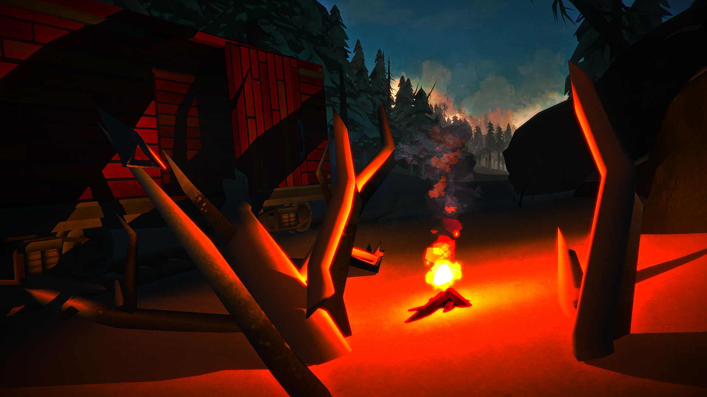
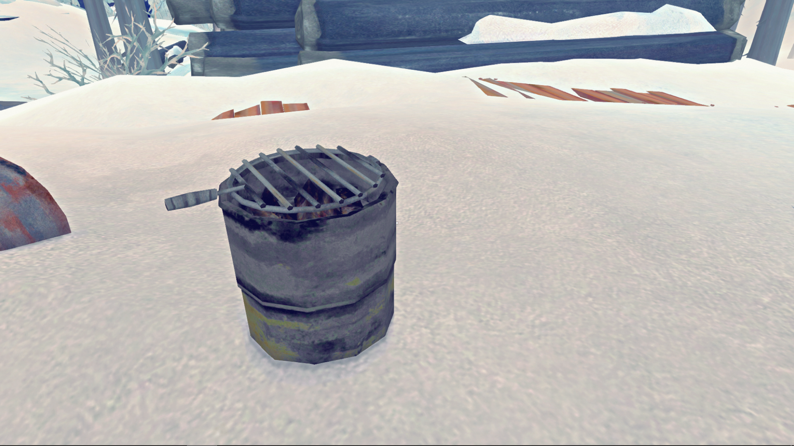
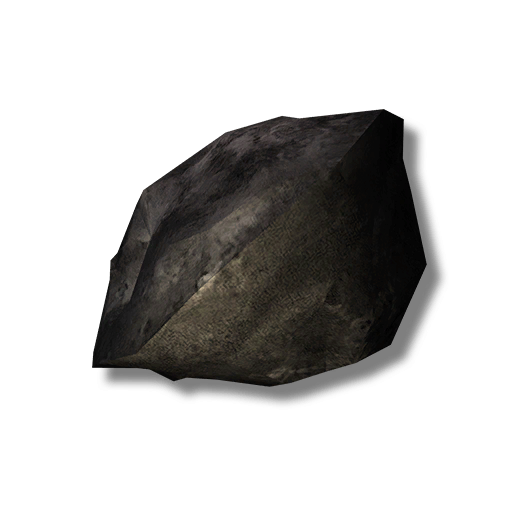
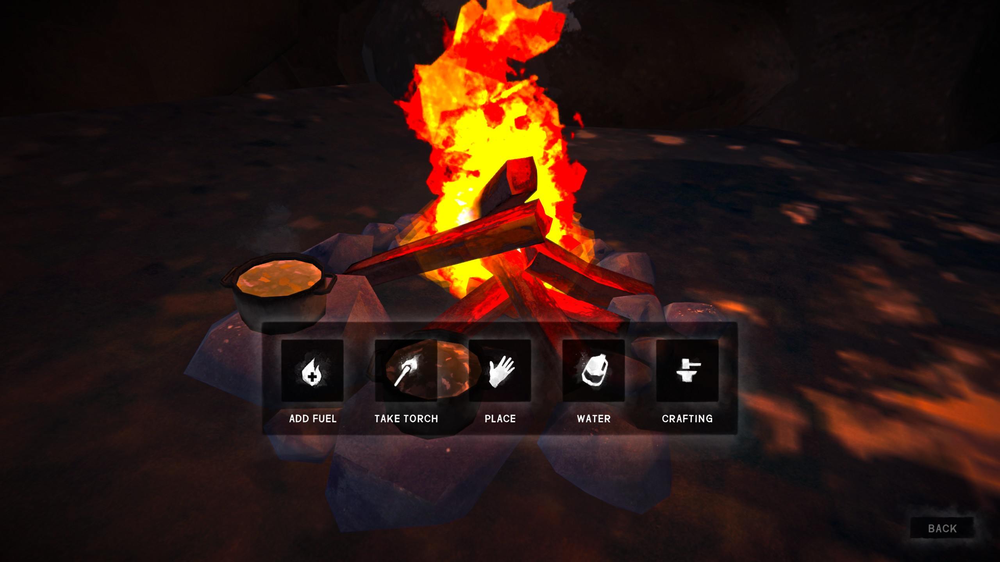
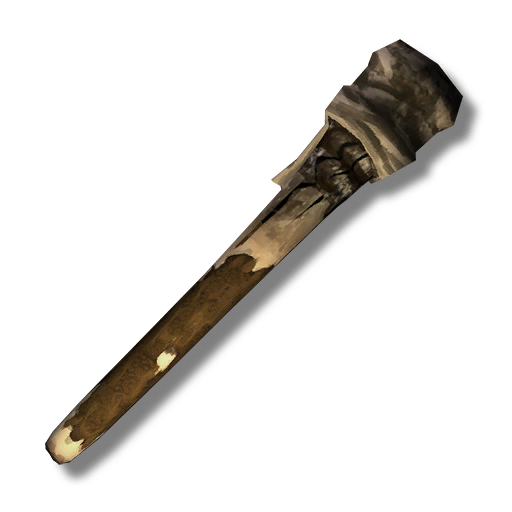
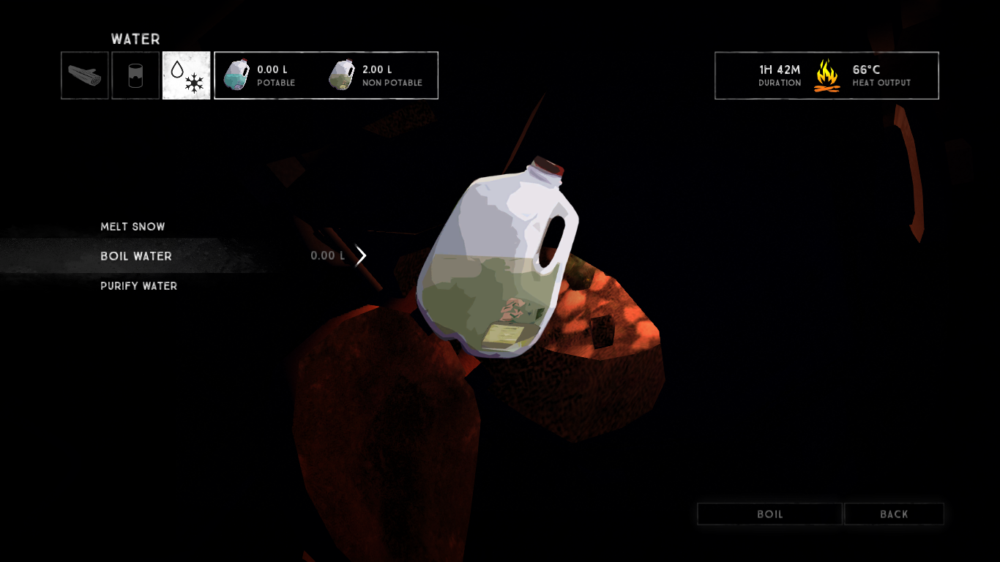

# Fire

**Categories:** Gameplay · **Source:** [Fandom](https://thelongdark.fandom.com/wiki/Fire)

**Contents**

- [Fire Starting](#fire-starting)
- [Types of Fuel](#types-of-fuel)
- [Types of Fires](#types-of-fires)
- [Campfires](#campfires)
- [Contained fires](#contained-fires)
- [Fire Mechanics](#fire-mechanics)
- [Fire duration](#fire-duration)
- [Embers](#embers)
- [Fire temperature](#fire-temperature)
- [Outdoor fire bonus](#outdoor-fire-bonus)
- [Adding Coal](#adding-coal)
- [Fire Menu](#fire-menu)
- [Start Fire](#start-fire)
- [Add Fuel](#add-fuel)
- [Taking Torches](#taking-torches)
- [Place](#place)
- [Water](#water)
- [Crafting](#crafting)
- [Take Charcoal](#take-charcoal)
- [Break Down](#break-down)
- [Predators](#predators)

\[Missing image: Fire\_icon.png\]

_XTHUMB_

"_Use the Campfire option in the Radial Menu. You'll need all the fixings: a Firestarter, Tinder, and Fuel. Accelerant speeds up the process. Fuel types impact burn time and heat production. An active fire can be used to Cook and Boil Water, as well as keeping you from freezing to death._"

— In-game description

A **Fire** is a pile of burning fuel that has been lit using the [Fire Starting](./Fire%20Starting.md) [Survival Skill](./Skills.md). To make a fire, players need a starter, tinder (optional with Fire Starting skill 3), and fuel. Though optional, an [Accelerant](./Accelerant.md) or [Lantern Fuel](./Lantern%20Fuel.md) can also be used in an emergency to bypass the slow waiting time when first igniting fires in order to get a fire up and running quickly. Fires provide and restore [Warmth](./Warmth.md) to the player. Uncooked foods can be [cooked](./Cooking.md) directly on cooking slots near fires or on the ground nearby (in the case of canned foods), and snow can be melted and boiled into [potable water](./Water%20%28Potable%29.md).

## Fire Starting

_Main article: [Fire Starting](./Fire%20Starting.md)_

To start a fire, players have to "use" an existing [firebox](#contained-fires) or [campfire](#campfires) and press the "Start Fire" hotkey. Players can also build a campfire using [Radial Menu](./Radial%20Menu.md) &gt; Campcraft &gt; Fire. The fire-starting interface presents four slots: an ignition source (starter), tinder, fuel, and accelerant (optional). At the top of the screen, the player's current fire starting skill, duration of fire, and the chance of success with the currently selected materials are displayed. Coal cannot be used to start a fire.

## Types of Fuel

| Fuel | Burn Time (no skill bonus) | Fire Start Chance Bonus | Temperature Increase | Weight | Burn Time Per Weight | Temperature Increase Per Weight |
| --- | --- | --- | --- | --- | --- | --- |
| [Book](./Book.md) | 18 mins | +35% | 2.0 °C / _(3.6 °F)_ | 0.5 kg / _(1.1 lb)_ | 0.6 hr/kg (0.27 hr/lb) | 4 °C/kg / _(3.27 °F/lb)_ |
| [Cedar Firewood](./Cedar%20Firewood.md) | 60 mins | +15% | 6.0 °C / _(10.8 °F)_ | 0.5 kg / _(1.1 lb)_ | 2 hr/kg (0.91 hr/lb) | 12 °C/kg / _(9.8 °F/lb)_ |
| [Coal](./Coal.md) | 60 mins | N/A | 20.0 °C / _(36 °F)_ | 0.3 kg / _(0.66 lb)_ | 3.33 hr/kg (1.51 hr/lb) | 66.67 °C/kg / _(54.43 °F/lb)_ |
| [Fir Firewood ](./Fir%20Firewood.md) | 90 mins | 0% | 9.0 °C / _(16.2 °F)_ | 1.0 kg / _(2.2 lb)_ | 1.5 hr/kg (0.68 hr/lb) | 9 °C/kg / _(7.35 °F/lb)_ |
| [Firelog](./Firelog.md) | 120 mins | +7% | 12.0 °C / _(21.6 °F)_ | 2.0 kg / _(4.4 lb)_ | 1 hr/kg (0.45 hr/lb) | 10.5 °C/kg / _(8.57 °F/lb)_ |
| [Reclaimed Wood](./Reclaimed%20Wood.md) | 30 mins | -5% | 3.0 °C / _(5.4 °F)_ | 0.25 kg / _(0.55 lb)_ | 2 hr/kg (0.91 hr/lb) | 12 °C/kg / _(9.8 °F/lb)_ |
| [Stick](./Stick.md) | 7.5 mins | +15% | 1.0 °C / _(1.8 °F)_ | 0.15 kg / _(0.33 lb)_ | 0.83 hr/kg (0.38 hr/lb) | 6.67 °C/kg / _(5.44 °F/lb)_ |

Burn times are increased with higher levels of the [Fire Starting](./Fire%20Starting.md) skill, shown below (times rounded to nearest half-minute).

| Column 1 | Column 2 | Column 3 | Column 4 | Column 5 |
| --- | --- | --- | --- | --- |
| Fuel / Firestarting Level | Level 1 | Level 2-3 (+10%) | Level 4 (+25%) | Level 5 (+50%) |
| [Book](./Book.md) | 18 mins | 20 mins | 22.5 mins | 27 mins |
| [Cedar Firewood](./Cedar%20Firewood.md) | 60 mins | 66 mins | 1 hr 15 mins | 1 hr 30 mins |
| [Coal](./Coal.md) | 60 mins | 66 mins | 1 hr 15 mins | 1 hr 30 mins |
| [Fir Firewood ](./Fir%20Firewood.md) | 1 hr 30 mins | 1 hr 39 mins | 1 hr 52.5 mins | 2 hr 15 mins |
| [Firelog](./Firelog.md) | 2 hr | 2 hr 12 mins | 2 hr 30 mins | 3 hr |
| [Reclaimed Wood](./Reclaimed%20Wood.md) | 30 mins | 33 mins | 37.5 mins | 45 mins |
| [Stick](./Stick.md) | 7.5 mins | 8 mins | 9 mins | 11 mins |

## Types of Fires

### Campfires

_Main article: [Campfire](./Campfire.md)_

A campfire is an open fire that can be placed into the world at the player's discretion. Players are limited in where fires can be placed, and campfires are subject to becoming [windblown](./Campfire.md#Windblown), depending on the weather. If the player has sufficient resources to start another fire, [burnt out](./Campfire.md#Burnt_out) campfires can be relit.

### Contained fires

 Contained fires offer the benefits of relatively safe firestarting positions in unlikely places, such as indoors. Contained fires cannot become windblown and are unaffected by the weather.

| Column 1 | Column 2 | Column 3 |
| --- | --- | --- |
| Firebox | Cooking slots | Location(s) |
| [Campfire](./Campfire.md) | 2 | Placed by the player indoors, [St. Christopher's Church](./St.%20Christopher%27s%20Church.md), inside some caves |
| [Ammunition Forge](./Ammunition%20Forge.md) | 0 | [Workshop](./Workshop.md), [Blackrock Prison](./Blackrock%20Prison.md) |
| [Pot Belly Stove](./Pot%20Belly%20Stove.md) | 1 | [Fishing Huts](./Fishing%20Hut.md), [Camp Office](./Camp%20Office.md), [Lonely Lighthouse](./Lonely%20Lighthouse.md), [Anglers Den](./Angler%27s%20Den.md), [Station Bunkhouse](./Station%20Bunkhouse.md) |
| [Forge](./Forge.md) | 1 | [The Riken](./The%20Riken.md), [Old Spence Family Homestead](./Old%20Spence%20Family%20Homestead.md), [Maintenance Yard](./Maintenance%20Yard.md), [Hangar Basement](./Hangar%20Basement.md) |
| [Fire Barrel](./Fire%20Barrel.md) | 2 | [Carter Hydro Dam](./Carter%20Hydro%20Dam.md), [Quonset Garage](./Quonset%20Garage.md), [Signal Hill](./Signal%20Hill.md), [Hibernia Processing](./Hibernia%20Processing.md), [Maintenance Yard](./Maintenance%20Yard.md), outside the [Pleasant Valley Farmstead](./Pleasant%20Valley%20Farmstead.md) |
| [Wood Stove](./Wood%20Stove.md) | 2 | [Camp Office](./Camp%20Office.md), [Trapper's Homestead](./Trapper%27s%20Homestead.md), inside some ruined houses |
| [Fireplace](./Fireplace.md) | 2 | [Mountaineer's Hut](./Mountaineer%27s%20Hut.md), [Hunting Lodge](./Hunting%20Lodge.md), inside some larger houses. |
| [Rim Grill](./Rim%20Grill.md) | 2 | [Bleak Inlet](./Bleak%20Inlet.md) (inside a [Cabin](./Cabin.md)), [Indolent Hoppers](./Indolent%20Hoppers.md), [Pump House](./Pump%20House.md) |
| [Stove](./Stove.md) | 6 | [Pleasant Valley Farmstead](./Pleasant%20Valley%20Farmstead.md), [Community Hall](./Community%20Hall.md), [Hunting Lodge](./Hunting%20Lodge.md), [Milton House (Grey Mother's)](./Milton%20House%20%28Grey%20Mother%27s%29.md), [Paradise Meadows Farm](./Paradise%20Meadows%20Farm.md), [Fallen Lighthouse](./Fallen%20Lighthouse.md), [Idle Camp](./Idle%20Camp.md) |

## Fire Mechanics

### Fire duration

Campfires have a maximum duration of 12 hours. You cannot add fuel to a fire if it would exceed 12 hours of burn time.

Fire duration is calculated from the moment the fire was first lit, so a fire started without accelerant will have already used 5 minutes of life before it can be interacted with. Example: A fire lit from a book (+18 min) will only have 13 minutes of life remaining when starting is complete.

Wind can seriously dampen campfire duration, reducing it to only 9 minutes, regardless of how much duration it had left See campfires (above).

### Embers

When a fire's duration reaches zero, it does not immediately go out. Rather, it lingers on in a state called embers. How long the embers last will not be visible. Typically embers burn out within 5 minutes, but they may last up to 10 minutes. Embers remain as hot as the original fire. They can be even be used to complete cooking or processing water.

### Fire temperature

In Pilgrim and Voyageur difficulties, being next to any fire prevents the character from losing [Condition](./Condition.md) due to [freezing](./Warmth.md). Stalker must get the fire hot enough to get [Feels Like](./Feels%20Like.md) greater than 0°C to stop freezing.

The [Forge](./Forge.md) has a unique temperature cap of 200°C that only pertains to coal.

### Outdoor fire bonus

Fires that are started in outdoor locations offer an outdoor fire bonus. This means that the Duration listed on the fire is inaccurate, and the fire will actually last up to 100% longer depending on the temperature. Colder temperatures will yield a longer-lasting fire, up until the bonus caps at -30°C, starting at -10°C. The bonus is determined based on air temperature (before factoring in the fire) at the survivor's position, meaning that if you go inside your outdoor fire will no longer receive the outdoor fire bonus. Even fires in pseudo-indoor areas like Mountaineer's Hut receive the burn duration bonus.

In regards to fire bonus, outdoor caves have a line separating the warm and cold sections. Standing at the back of the cave, a fire will receive a reduced bonus, down to 0% if the air temperature in the back of the cave reaches positive values. Utilizing this bonus, you can use significantly less wood to keep an overnight fire burning in a cave by standing in the cold section of the cave when interacting with your bedroll. Note that you will be subjected to the colder outdoor cave temperatures during your sleep, so consider your fire temperature accordingly.

### Adding Coal

 [Coal](./Coal.md) cannot be used to start a fire. It can only be burnt in an already active fire. Coal is an important component for forging as it is the only fuel that can raise the fire temperature above 80°C (only at a forge). When coal is added to the [furnace](./Furnace.md), it is not restricted by the 12-hour fuel cap and can be added repeatedly. The temperature will rise for each coal added, up to the furnace temperature cap of 200°C, though the time cap stands, and any burn duration in excess of 12 hours is lost.

## Fire Menu

_The 5 options that appear during an active fire._ A successful [Fire Starting](./Fire%20Starting.md) attempt will result in an active fire. Interacting with the active fire will result in 5 options appearing in regards to the active fire.

### Start Fire

The fire starting portion if a fire. The option to take charcoal is also present in this menu.

### Add Fuel

Adding more fuel will both keep a fire alive for longer and raise the active temperature around it.

### Taking Torches

 A [Torch](./Torch.md) can be taken out of any active fire, regardless of what material was used to create it, by activating the button on the bottom right, which reduces the fire by 10 minutes duration and 1°C and exits the fire page with the torch in hand. The "Take Torch" button only appears when a fire has at least 10 minutes of duration remaining. Torches taken from fire will have 25-50% condition and can be extinguished right away for later use. Torches can also be used as fuel for the fire, but taken torches will not fully refund the amount of fuel time lost.

### Place

The Place menu option allows any cooking container/canned goods/teas in the player's inventory to be directly placed onto any cooking slot of the fire without having to manually go into the inventory and manually place cooking containers into the game world. The player can then select which item they want placed onto the firebox. If all cooking slots are already occupied, this option will not do anything.

### Water

_The water processing old menu_ Water is obtained from fires through melting and boiling snow by first placing a Recycled Can, Cooking Skillet, or Cooking Pot on the heat source. Snow is provided whenever boiling snow is melted, even if the active fire is currently indoors or underground:

- [Recycled Can](./Recycled%20Can.md) holds 0.50L of water
- [Cooking Skillet](./Cooking%20Skillet.md) holds 0.50L to 1.00L of water
- [Cooking Pot](./Cooking%20Pot.md) holds 0.50L to 2.00L of water

Snow will actively melt into [Water (Unsafe)](./Water%20%28Unsafe%29.md) if it is not fully melted. Higher amounts of snow/water being melted/boiled takes longer periods of time than smaller quantities:

- Melting snow for 19 minutes in a Recycled Can. 15 minutes for a Cooking Pot or Cooking Skillet) produces 0.50L [Water (Unsafe)](./Water%20%28Unsafe%29.md)
- Boiling 0.50L [Water (Unsafe)](./Water%20%28Unsafe%29.md) for 19 minutes in a Recycled Can (15 for a Cooking Pot or Cooking Skillet) produces 0.50L [Water (Potable)](./Water%20%28Potable%29.md)

Higher levels of [Cooking](./Cooking.md) Skill reduce both melting and boiling times:

- Level 3 Cooking times reduced by 10%
- Level 4 Cooking times reduced by 20%
- Level 5 Cooking times reduced by 30%

### Crafting

A unique crafting menu, Fire Crafting, is only accessible at an active fire. At present, only one recipe is available to craft at an active fire, [Fire Hardened Arrow](./Fire%20Hardened%20Arrow.md).

### Take Charcoal

This option appears only at inactive fireboxes, and is used to take Charcoal from the fire for personal use.

### Break Down

This option only appears at an inactive Campfire, and is used to remove the object from the game world. Any items not taken from the Campfire will be returned to the player's inventory, such as cooking containers and Charcoal.

## Predators

[Wolves](./Wolf.md) will halt upon reaching a campfire, holding their ground. Should the player go closer to the Wolf it will attack the player instead, it's advised to go a bit farther away or closer to the fire to prevent the Wolf from attacking. Aiming a an item at the Wolf (be it a weapon, a rock, or the [Camera](./Camera.md)) will cause it to flee for a short time. Successfully throwing a Torch at the Wolf will cause it to flee for an extended period of time. Contained fires with no visual contact with the predator (be it a Bear or a Wolf) will not act as a deterrent because the predator will be too close, and once the Wolf starts charging you will have 2 options: run away from the fire and return back if you are light enough or take the risk and aim, UNLESS the predator is a bear.

Auroras will make all predators completely aggressive, thus torches, fires, and flares _WILL NOT STOP OR DETER_ any predator from charging at you. [ru:Костёр](ru:%D0%9A%D0%BE%D1%81%D1%82%D1%91%D1%80) [de:Feuer](de:Feuer)
