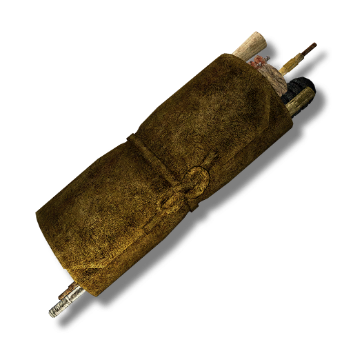

# Firearm Cleaning Kit

<table class="infobox">
<caption>Firearm Cleaning Kit</caption>
<colgroup>
<col style="width: 50%" />
<col style="width: 50%" />
</colgroup>
<tbody>
<tr>
<td colspan="2"><figure>

<figcaption>Firearm_Cleaning_Kit_icon.png</figcaption>
</figure></td>
</tr>
<tr>
<td>
Release
</td>
<td>
<a href="./The%20Long%20Dark%20%E2%80%94%20Changelog.md#0.298" class="wikilink" title="16 December 2015">16 December 2015</a>
</td>
</tr>
<tr>
<td>
Wintermute
</td>
<td>
No
</td>
</tr>
<tr>
<td>
Renewable
</td>
<td>
Yes (Rare <a href="./Beachcombing.md" class="wikilink" title="Beachcombing">Beachcombing</a> and <a href="./Trader.md" class="wikilink" title="Trader">Trader</a>)
</td>
</tr>
<tr>
<td colspan="2" class="section">
<strong>Properties</strong>
</td>
</tr>
<tr>
<td>
Item type
</td>
<td>
<a href="./Tools.md" class="wikilink" title="Tools">Tools</a>|-
</td>
</tr>
<tr>
<td>
Stackable
</td>
<td>
No
</td>
</tr>
<tr>
<td>
Examine
</td>
<td>
Compact tool kit used to keep a Rifle or Revolver in good working order.
</td>
</tr>
<tr>
<td colspan="2" class="section">
<strong>Values</strong>
</td>
</tr>
<tr>
<td>
Weight
</td>
<td>
0.10 kg (0.22 lbs)
</td>
</tr>
</tbody>
</table>

The **Firearm Cleaning Kit** is a Tool for cleaning the <a href="./Hunting%20Rifle.md" class="wikilink" title="Hunting Rifle">Hunting Rifle</a> and the <a href="./Revolver.md" class="wikilink" title="Revolver">Revolver</a> (or their variants).

## Overview

The Firearm Cleaning Kit, in conjunction with the <a href="./Cleaning.md" class="wikilink" title="Cleaning">Cleaning</a> Skill, is used for cleaning guns to keep them in optimal condition. Worn-out firearms can be also be fixed at a <a href="./Milling%20Machine.md" class="wikilink" title="Milling Machine">Milling Machine</a> using <a href="./Scrap%20Metal.md" class="wikilink" title="Scrap Metal">Scrap Metal</a> during the Aurora.

## Trivia

- <a href="./Firearm%20Cleaning%20Kit.md" class="wikilink" title="Firearm Cleaning Kit">Firearm Cleaning Kit</a> was previously named **Rifle Cleaning Kit** prior to the introduction of the <a href="./Revolver.md" class="wikilink" title="Revolver">Revolver</a>.

## Update history

- UPDATE **6 May 2019 (<a href="./The%20Long%20Dark%20%E2%80%94%20Early%20Access%20Changelog.md#1.48" class="wikilink" title="Update">Update</a>):**
  - Renamed to "Firearm Cleaning Kit".
- UPDATE **16 December 2015 (<a href="./The%20Long%20Dark%20%E2%80%94%20Early%20Access%20Changelog.md#0.298" class="wikilink" title="Update">Update</a>):**
  - Added to game.

**Lua execution error in Module:Navbox function navbox** <a href="ru:%D0%9D%D0%B0%D0%B1%D0%BE%D1%80_%D0%B4%D0%BB%D1%8F_%D1%87%D0%B8%D1%81%D1%82%D0%BA%D0%B8_%D0%BE%D0%B3%D0%BD%D0%B5%D1%81%D1%82%D1%80%D0%B5%D0%BB%D1%8C%D0%BD%D0%BE%D0%B3%D0%BE_%D0%BE%D1%80%D1%83%D0%B6%D0%B8%D1%8F" class="wikilink" title="ru:Набор для чистки огнестрельного оружия">ru:Набор для чистки огнестрельного оружия</a>

