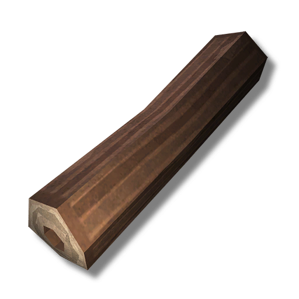
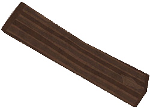

# Firelog

**Contents**

- [Overview](#overview)
- [Fire Starting info](#fire-starting-info)
- [Obtaining](#obtaining)
- [Gallery](#gallery)
- [Update history](#update-history)

**Firelog**

| Property | Details |
| --- | --- |
|  |  / *Firelog\_icon.png* |
| Release | [12 June 2014](./The%20Long%20Dark%20%E2%80%94%20Changelog.md#0.01) |
| Wintermute | No |
| Renewable | No |
| **Properties** |  |
| Item type | [Fire Starting](./Fire%20Starting.md)\|- |
| Stackable | yes |
| Examine | Firelog made of chemicals and compressed shavings. Doesn't throw off much heat. |
| **Values** |  |
| Weight | 2.00 kg (4.4 lbs) |

**Firelogs** are one of the many sources of fuel that can be found on Great Bear Island.

## Overview

The Firelog burns for two hours and increases the probability of successfully lighting a fire by 7%. However, they are not very weight-efficient at only 60 min/kg, and have the lowest emitted heat to burn time ratio of any fuel source in the game by a wide margin. Overall, firelogs are not outstanding forms of fuel. If a long-lived fire is desired, [Cedar Firewood](./Cedar%20Firewood.md) is a more efficient option choice, and, if a particularly hot fire is desired, Coal is the best choice. Both are renewable and convenient to use.

## Fire Starting info

**Firelog**

| Property | Details |
| --- | --- |
| Type | Fuel |
| **Statistics** |  |
| Duration |  120 minutes |
| Start Chance |  7% |
| Heat |  +3°C (+5.4°F) |
| Burn Density | 1 hr/kg (0.45 hr/lb) |

## Obtaining

Firelogs can be uncommonly found across Great Bear, usually near fireboxes in buildings. They can also occasionally be found near burned out campfires outside. Players who wish to collect firelogs may wish to start searching locations such as [Camp Office](./Camp%20Office.md), various [Ice Fishing Huts](./Ice%20Fishing.md), [Coastal House](./Coastal%20House.md), the [Hunting Lodge](./Hunting%20Lodge.md), or [Milton House (Grey Mother's)](./Milton%20House%20%28Grey%20Mother%27s%29.md), among others. Many [Prepper Caches](./Prepper%20Cache.md) contain large quantities of Firelogs, up to 10 hours worth of fuel.

## Gallery

| Column 1 |
| --- |
|  / *Old model.* |

## Update history

- UPDATE **12 June 2014 ([Update](./The%20Long%20Dark%20%E2%80%94%20Changelog.md#.01)):**
  - Added to game.

**Lua execution error in Module:Navbox function navbox** [ru:Полено](ru:%D0%9F%D0%BE%D0%BB%D0%B5%D0%BD%D0%BE)
