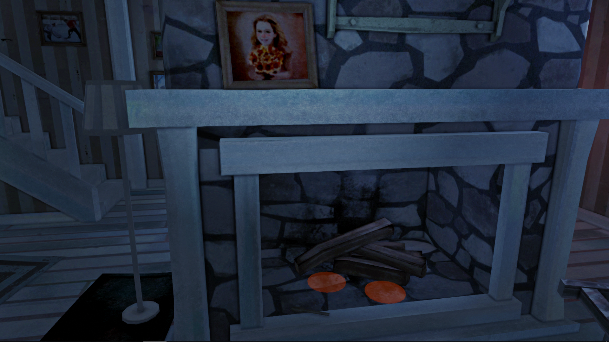

# Fireplace

<table class="infobox">
<caption>Fireplace</caption>
<colgroup>
<col style="width: 50%" />
<col style="width: 50%" />
</colgroup>
<tbody>
<tr>
<td colspan="2"><figure>

<figcaption>Fire_place.png</figcaption>
</figure></td>
</tr>
<tr>
<td colspan="2" class="section">
<strong>General</strong>
</td>
</tr>
<tr>
<td>
Type
</td>
<td>
Fire Starting|-
</td>
</tr>
<tr>
<td>
Cooking slots
</td>
<td>
2
</td>
</tr>
</tbody>
</table>

The **fire place** is an immovable <a href="./Fire.md#Contained_fires" class="wikilink" title="contained fire">contained fire</a>. The fire place functions identically to other contained fires and player-made <a href="./Campfire.md" class="wikilink" title="campfire">campfire</a>. The fire place provides no advantage over other contained fires, but it does allow protection against wind, unlike the player-made campfire. It has two <a href="./Cooking.md" class="wikilink" title="cooking">cooking</a> slots.

The fire place can be re-lit indefinitely, though it requires fresh starter, tinder, and fuel each time.

## Location

Fire places have fixed locations that do not change between games. They are found in many indoor locations in *The Long Dark*, including houses, trailers, and huts.

In Wintermute story mode <a href="./Episode%201%20-%20Do%20Not%20Go%20Gentle.md" class="wikilink" title="Episode 1">Episode 1</a>, the fireplace in Grey Mother's house is infinite and can be used by the player without needed to be lit or fueled. In <a href="./Episode%203%20-%20Crossroads%20Elegy.md" class="wikilink" title="Episode 3">Episode 3</a>, the same is true for the fireplace in the <a href="./Thomson%27s%20Crossing.md" class="wikilink" title="Thomson&#39;s Crossing">Thomson's Crossing</a> <a href="./Community%20Hall.md" class="wikilink" title="Community Hall">Community Hall</a>.**Lua execution error in Module:Navbox function navbox** **Lua execution error in Module:Navbox function navbox**

<a href="ru:%D0%9A%D0%B0%D0%BC%D0%B8%D0%BD" class="wikilink" title="ru:Камин">ru:Камин</a>

