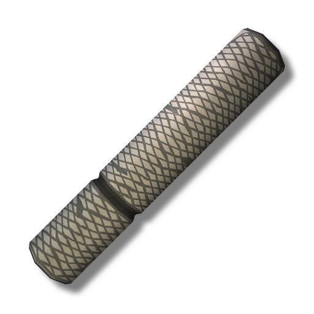

# Firestriker

**Contents**

- [Overview](#Overview)
- [Spawn Locations](#Spawn_Locations)
- [Timberwolf Mountain](#Timberwolf_Mountain)
- [Coastal Highway](#Coastal_Highway)
- [Pleasant Valley](#Pleasant_Valley)
- [Forlorn Muskeg](#Forlorn_Muskeg)
- [Tips](#Tips)
- [Trivia](#Trivia)
- [Game History](#Game_History)

<table class="infobox">
<caption>Firestriker</caption>
<colgroup>
<col style="width: 50%" />
<col style="width: 50%" />
</colgroup>
<tbody>
<tr>
<td colspan="2"><figure>

<figcaption>firestriker_icon.png</figcaption>
</figure></td>
</tr>
<tr>
<td colspan="2" class="section">
<strong>General</strong>
</td>
</tr>
<tr>
<td>
Item Type
</td>
<td>
Fire Starting|-
</td>
</tr>
<tr>
<td>
Renewable
</td>
<td>
Yes (<a href="./Trader.md" class="wikilink" title="Trader">Trader</a> only)
</td>
</tr>
<tr>
<td>
Firestarting Slot
</td>
<td>
Starter
</td>
</tr>
<tr>
<td colspan="2" class="section">
<strong>Statistics</strong>
</td>
</tr>
<tr>
<td>
Weight
</td>
<td>
0.10 kg(0.22 lbs)
</td>
</tr>
<tr>
<td>
Bonus chance
</td>
<td>
+15%
</td>
</tr>
</tbody>
</table>

<table>
<colgroup>
<col style="width: 33%" />
<col style="width: 33%" />
<col style="width: 33%" />
</colgroup>
<tbody>
<tr>
<td style="vertical-align: top; font-size: 3em; color: #5d5980; padding-right: 10px">
“
</td>
<td>
Metal tool designed to help start fires in the wilderness.

&#10;

In-game description

</td>
<td style="vertical-align: bottom; font-size: 3em; color: #5d5980; padding-left: 10px">
”
</td>
</tr>
</tbody>
</table>

The **Firestriker** is a tool for lighting <a href="./Fire.md" class="wikilink" title="fire">fires</a>.

## Overview

A powerful, reusable fire starter, this tool increases the probability of lighting a fire by 15%.

Discovered in random states of condition. Each try to light a fire or a <a href="./Torch.md" class="wikilink" title="Torch">Torch</a> reduces its condition by 2% so a new Firestriker can be used 50 times before it breaks down. Firestrikers cannot be repaired.

## Spawn Locations

### Timberwolf Mountain

- Commonly inside the fire-starting <a href="./Cargo%20Container.md" class="wikilink" title="Cargo Container">Cargo Containers</a> on <a href="./Timberwolf%20Mountain.md" class="wikilink" title="Timberwolf Mountain">Timberwolf Mountain</a>.

### Coastal Highway

- Inside <a href="./Quonset%20Garage.md" class="wikilink" title="Quonset Garage">Quonset Garage</a>.

### Pleasant Valley

- Inside the radio control building at <a href="./Signal%20Hill.md" class="wikilink" title="Signal Hill">Signal Hill</a>.

### Forlorn Muskeg

- Inside a Cave to the Far South by Southwest of Forlorn Muskeg. The one near the fallen Signal Tower.

Mystery Lake

- Inside the train derailment car
- Inside the Hydro Dam, next to the Boxes by the Elevator

Rarely spawns on shelves or tables in place of more common <a href="./Lantern%20Fuel.md" class="wikilink" title="Lantern Fuel">Lantern Fuel</a>. Rare discovered while searching large toolbox drawers. Found in one of the randomly occurring <a href="./Prepper%20Cache.md" class="wikilink" title="Prepper Cache">Prepper Caches</a> that is dedicated to fire and fire starting implements.

## Tips

- Firestrikers are preferable to <a href="./Wood%20Matches.md" class="wikilink" title="Matches">Matches</a> at low <a href="./Skills.md#Fire_Starting" class="wikilink" title="Firestarting Skill">Firestarting Skill</a>. This will likely save matches from failed fires, thanks to the firestriker's higher Bonus Chance.
- Using a lit <a href="./Torch.md" class="wikilink" title="Torch">Torch</a> to start <a href="./Campfire.md" class="wikilink" title="Campfires">Campfires</a> is an effective way to save Matches/Firestriker durability.
- Firestrikers are more weight-efficient than wood matches at 20% durability and higher (10 matches weighs 0.10kg), and less weight efficient below 20% durability.

## Trivia

- Modeled after ferrocerium-and-steel type fire starters that provide oxidizing cerium sparks as a temporary ignition source. Popular amongst outdoorsmen and survivalists due to their compact size, durability, and resistance to water.
- The Firestriker is based off the Aurora Fire Starter 440C.
- In real life, modern ferrocerium firestrikers can typically be used several thousands of times, as each strike only scrapes off a very small amount of material.
- An item that was unreleased for the Pre Alpha versions of the game, <a href="./Cut%20%E2%80%94%20Discontinued%20Content.md#Flint_and_Steel" class="wikilink" title="Flint and Steel">Flint and Steel</a>, was eventually cut and replaced with the Firestriker.

## Game History

- UPDATE **16 October 2015 (<a href="./The%20Long%20Dark%20%E2%80%94%20Early%20Access%20Changelog.md#0.280" class="wikilink" title="Update">Update</a>):**
  - Non-stackable Firestarting tools (ex. Firestriker) now show their Condition value, vs. simply saying "None", in the Firestarting UI.

<!-- -->

- UPDATE **17 December 2014 (<a href="./The%20Long%20Dark%20%E2%80%94%20Early%20Access%20Changelog.md#0.181" class="wikilink" title="Update">Update</a>):**
  - Reduce per-use decay on the Firestriker Tool.

**Lua execution error in Module:Navbox function navbox**

<a href="ru:%D0%9E%D0%B3%D0%BD%D0%B8%D0%B2%D0%BE" class="wikilink" title="ru:Огниво">ru:Огниво</a>

