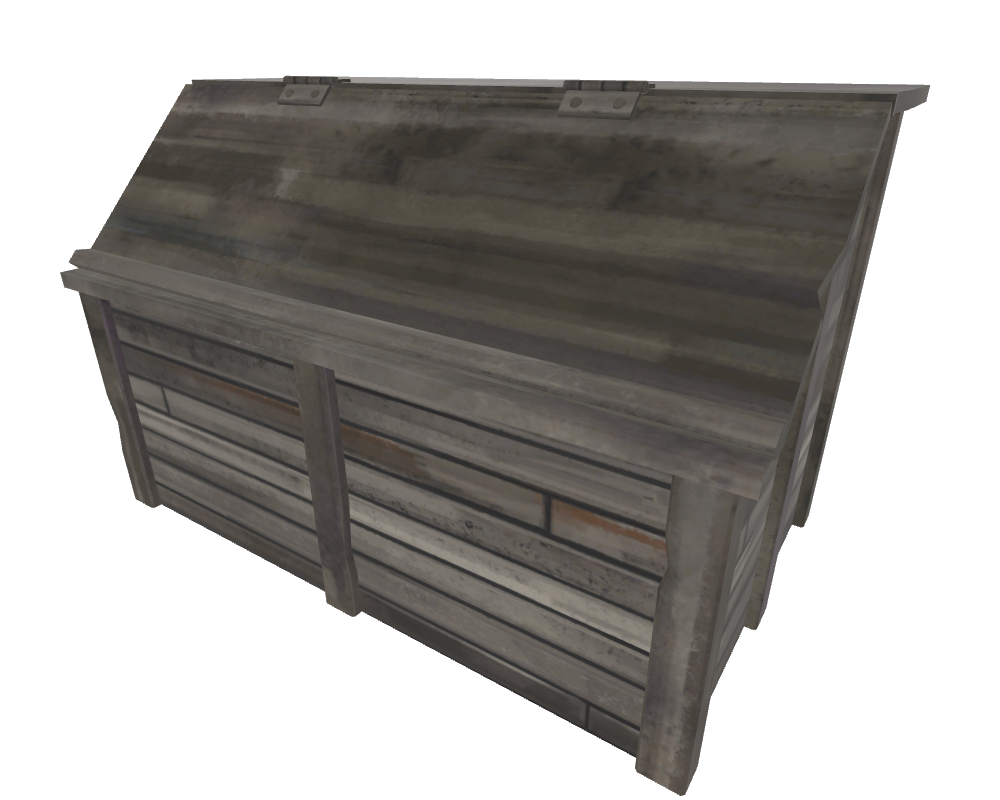

# Firewood Bin

<table class="infobox">
<caption>Firewood Bin</caption>
<colgroup>
<col style="width: 50%" />
<col style="width: 50%" />
</colgroup>
<tbody>
<tr>
<td colspan="2"><figure>

<figcaption>Firewood_Bin.png</figcaption>
</figure></td>
</tr>
<tr>
<td>
Release
</td>
<td>
TBD
</td>
</tr>
<tr>
<td>
Update
</td>
<td>
<a href="./The%20Long%20Dark%20%E2%80%94%20Changelog.md#0.00" class="wikilink" title="0.00">0.00</a>
</td>
</tr>
<tr>
<td>
Story item
</td>
<td>
No
</td>
</tr>
<tr>
<td colspan="2" class="section">
<strong>Container</strong>
</td>
</tr>
<tr>
<td>
Capacity
</td>
<td>
30.00 kg(66 lbs)
</td>
</tr>
</tbody>
</table>

A **Firewood Bin** is a fuel storage bin found next to many homes. Searching one can often yield high value fuel items such as <a href="./Coal.md" class="wikilink" title="Coal">Coal</a>, <a href="./Fir%20Firewood.md" class="wikilink" title="Fir Firewood">Fir Firewood</a>, and <a href="./Cedar%20Firewood.md" class="wikilink" title="Cedar Firewood">Cedar Firewood</a>. It is mostly found near remote cabins:

- <a href="./Cabin.md" class="wikilink" title="Cabin">Cabin</a> in Bleak Inlet
- <a href="./Last%20Resort%20Cannery.md" class="wikilink" title="Last Resort Cannery">Last Resort Cannery</a>
- <a href="./Hermit%27s%20Cabin.md" class="wikilink" title="Hermit&#39;s Cabin">Hermit's Cabin</a>
- <a href="./Hunting%20Lodge.md" class="wikilink" title="Hunting Lodge">Hunting Lodge</a>

**Lua execution error in Module:Navbox function navbox**

