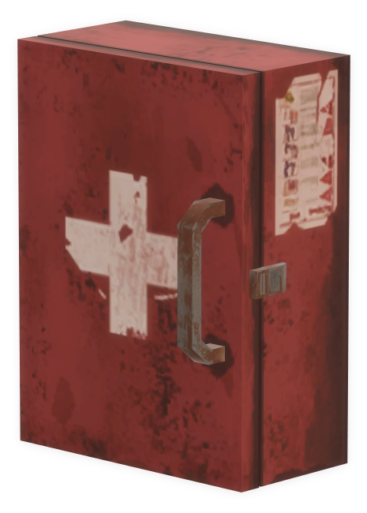

# First Aid Kit

**Template:for**

**First Aid Kit**

| Property | Details |
| --- | --- |
|  |  / *First\_Aid\_Kit.png* |
| Story item | No |
| **Container** |  |
| Capacity | 5.00 kg(11 lbs) |
| **Advanced data** |  |
| Object key | GAMEPLAY\_FirstAidKit |

The **First Aid Kit** is a type of container which only contains [First Aid](./First%20Aid.md) items such as [Antiseptic](./Antiseptic.md), [Bandages](./Bandage.md), [Antibiotics](./Antibiotics.md), and [Water Purification Tablets](./Water%20Purification%20Tablets.md). First aid kits may also contain [Energy Bars](./Energy%20Bar.md). and sewing kits

## Overview

A first aid kit is a common type of container which can be found in most buildings, as well as outside on the ground.

## Loot

|  | Item | Rarity |
| --- | --- | --- |
|  / *Bandage\_icon.png* | [Bandage](./Bandage.md) | 22.73% |
|  / *Antiseptic\_icon.png* | [Antiseptic](./Antiseptic.md) | 15.91% |
|  / *Antibiotics\_icon.png* | [Antibiotics](./Antibiotics.md) | 11.36% |
|  / *Painkillers\_icon.png* | [Painkillers](./Painkillers.md) | 11.36% |
|  / *Energy\_Bar\_icon.png* | [Energy Bar](./Energy%20Bar.md) | 11.36% |
|  / *Sewing\_Kit\_icon.png* | [Sewing Kit](./Sewing%20Kit.md) | 9.09% |
|  / *Water\_Purification\_Tablets\_icon.png* | [Water Purification Tablets](./Water%20Purification%20Tablets.md) | 9.09% |
|  / *Emergency\_Stim\_icon.png* | [Emergency Stim](./Emergency%20Stim.md) | 9.09% |

## Gallery

| Column 1 |
| --- |
|  / *A first aid kit on the wall of [Trapper's Homestead](./Trapper%27s%20Homestead.md)* |

**Lua execution error in Module:Navbox function navbox** [ru:Аптечка](ru:%D0%90%D0%BF%D1%82%D0%B5%D1%87%D0%BA%D0%B0)
