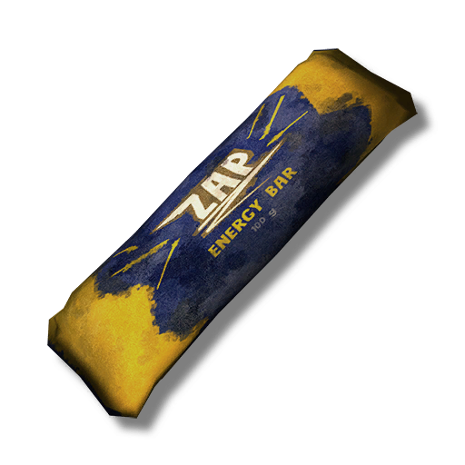

# First Aid Kit

**Template:for**

<table class="infobox">
<caption>First Aid Kit</caption>
<colgroup>
<col style="width: 50%" />
<col style="width: 50%" />
</colgroup>
<tbody>
<tr>
<td colspan="2"><figure>

<figcaption>First_Aid_Kit.png</figcaption>
</figure></td>
</tr>
<tr>
<td>
Story item
</td>
<td>
No
</td>
</tr>
<tr>
<td colspan="2" class="section">
<strong>Container</strong>
</td>
</tr>
<tr>
<td>
Capacity
</td>
<td>
5.00 kg(11 lbs)
</td>
</tr>
<tr>
<td colspan="2" class="section">
<strong>Advanced data</strong>
</td>
</tr>
<tr>
<td>
Object key
</td>
<td>
GAMEPLAY_FirstAidKit
</td>
</tr>
</tbody>
</table>

The **First Aid Kit** is a type of container which only contains <a href="./First%20Aid.md" class="wikilink" title="First Aid">First Aid</a> items such as <a href="./Antiseptic.md" class="wikilink" title="Antiseptic">Antiseptic</a>, <a href="./Bandage.md" class="wikilink" title="Bandages">Bandages</a>, <a href="./Antibiotics.md" class="wikilink" title="Antibiotics">Antibiotics</a>, and <a href="./Water%20Purification%20Tablets.md" class="wikilink" title="Water Purification Tablets">Water Purification Tablets</a>. First aid kits may also contain <a href="./Energy%20Bar.md" class="wikilink" title="Energy Bars">Energy Bars</a>. and sewing kits

## Overview

A first aid kit is a common type of container which can be found in most buildings, as well as outside on the ground.

## Loot

<table>
<colgroup>
<col style="width: 33%" />
<col style="width: 33%" />
<col style="width: 33%" />
</colgroup>
<thead>
<tr>
<th></th>
<th>
Item
</th>
<th>
Rarity
</th>
</tr>
</thead>
<tbody>
<tr>
<td><figure>

<figcaption>Bandage_icon.png</figcaption>
</figure></td>
<td>
<a href="./Bandage.md" class="wikilink" title="Bandage">Bandage</a>
</td>
<td>
22.73%
</td>
</tr>
<tr>
<td><figure>

<figcaption>Antiseptic_icon.png</figcaption>
</figure></td>
<td>
<a href="./Antiseptic.md" class="wikilink" title="Antiseptic">Antiseptic</a>
</td>
<td>
15.91%
</td>
</tr>
<tr>
<td><figure>

<figcaption>Antibiotics_icon.png</figcaption>
</figure></td>
<td>
<a href="./Antibiotics.md" class="wikilink" title="Antibiotics">Antibiotics</a>
</td>
<td>
11.36%
</td>
</tr>
<tr>
<td><figure>

<figcaption>Painkillers_icon.png</figcaption>
</figure></td>
<td>
<a href="./Painkillers.md" class="wikilink" title="Painkillers">Painkillers</a>
</td>
<td>
11.36%
</td>
</tr>
<tr>
<td><figure>

<figcaption>Energy_Bar_icon.png</figcaption>
</figure></td>
<td>
<a href="./Energy%20Bar.md" class="wikilink" title="Energy Bar">Energy Bar</a>
</td>
<td>
11.36%
</td>
</tr>
<tr>
<td><figure>

<figcaption>Sewing_Kit_icon.png</figcaption>
</figure></td>
<td>
<a href="./Sewing%20Kit.md" class="wikilink" title="Sewing Kit">Sewing Kit</a>
</td>
<td>
9.09%
</td>
</tr>
<tr>
<td><figure>

<figcaption>Water_Purification_Tablets_icon.png</figcaption>
</figure></td>
<td>
<a href="./Water%20Purification%20Tablets.md" class="wikilink" title="Water Purification Tablets">Water Purification Tablets</a>
</td>
<td>
9.09%
</td>
</tr>
<tr>
<td><figure>

<figcaption>Emergency_Stim_icon.png</figcaption>
</figure></td>
<td>
<a href="./Emergency%20Stim.md" class="wikilink" title="Emergency Stim">Emergency Stim</a>
</td>
<td>
9.09%
</td>
</tr>
</tbody>
</table>

## Gallery

<table class="gallery">
<colgroup>
<col style="width: 100%" />
</colgroup>
<tbody>
<tr>
<td><figure>
[Missing image: First_aid_kit_on_wall.jpg]
<figcaption>A first aid kit on the wall of <a href="./Trapper%27s%20Homestead.md" class="wikilink" title="Trapper&#39;s Homestead">Trapper's Homestead</a></figcaption>
</figure></td>
</tr>
</tbody>
</table>

**Lua execution error in Module:Navbox function navbox** <a href="ru:%D0%90%D0%BF%D1%82%D0%B5%D1%87%D0%BA%D0%B0" class="wikilink" title="ru:Аптечка">ru:Аптечка</a>

