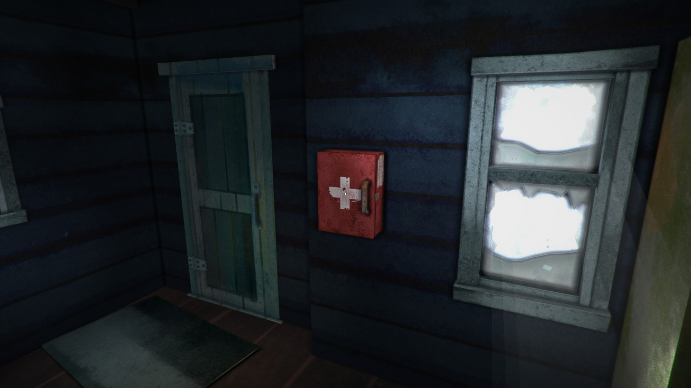

# First Aid Kit

**Categories:** Interactable Objects · **Source:** [Fandom](https://thelongdark.fandom.com/wiki/First_Aid_Kit)

**Template:for**

**First Aid Kit**

| Property | Details |
| --- | --- |
|  |  / _First\_Aid\_Kit.png_ |
| Story item | No |
| **Container** |  |
| Capacity | 5.00 kg(11 lbs) |
| **Advanced data** |  |
| Object key | GAMEPLAY\_FirstAidKit |

The **First Aid Kit** is a type of container which only contains [First Aid](./First%20Aid.md) items such as [Antiseptic](./Antiseptic.md), [Bandages](./Bandage.md), [Antibiotics](./Antibiotics.md), and [Water Purification Tablets](./Water%20Purification%20Tablets.md). First aid kits may also contain [Energy Bars](./Energy%20Bar.md). and sewing kits

## Overview

A first aid kit is a common type of container which can be found in most buildings, as well as outside on the ground.

## Loot

|  | Item | Rarity |
| --- | --- | --- |
|  / _Bandage\_icon.png_ | [Bandage](./Bandage.md) | 22.73% |
|  / _Antiseptic\_icon.png_ | [Antiseptic](./Antiseptic.md) | 15.91% |
|  / _Antibiotics\_icon.png_ | [Antibiotics](./Antibiotics.md) | 11.36% |
|  / _Painkillers\_icon.png_ | [Painkillers](./Painkillers.md) | 11.36% |
|  / _Energy\_Bar\_icon.png_ | [Energy Bar](./Energy%20Bar.md) | 11.36% |
|  / _Sewing\_Kit\_icon.png_ | [Sewing Kit](./Sewing%20Kit.md) | 9.09% |
|  / _Water\_Purification\_Tablets\_icon.png_ | [Water Purification Tablets](./Water%20Purification%20Tablets.md) | 9.09% |
|  / _Emergency\_Stim\_icon.png_ | [Emergency Stim](./Emergency%20Stim.md) | 9.09% |

## Gallery

_A first aid kit on the wall of [Trapper's Homestead](./Trapper%27s%20Homestead.md)_
