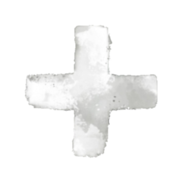
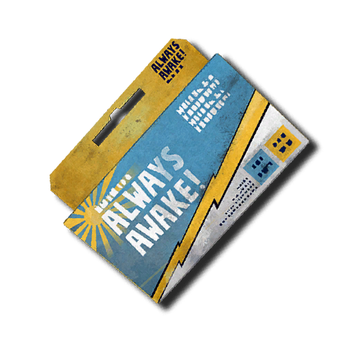
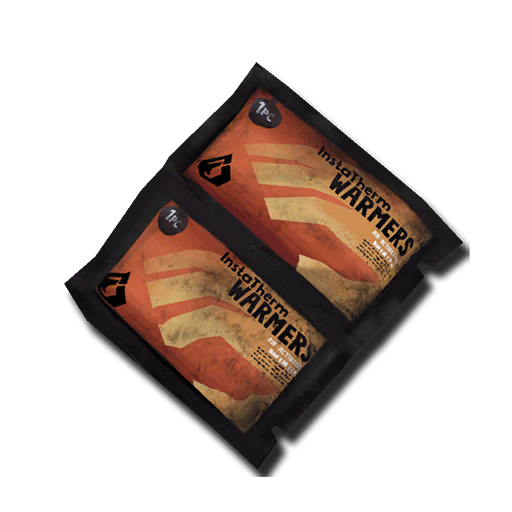
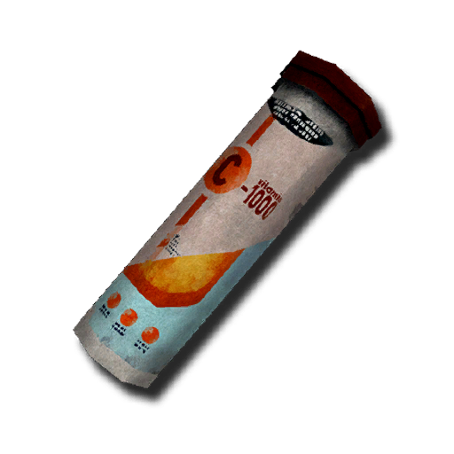
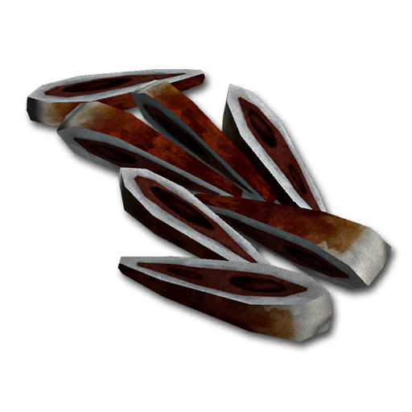
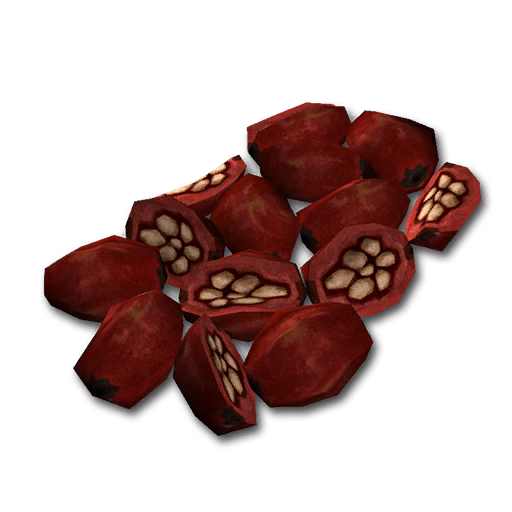
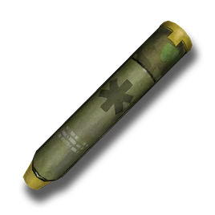
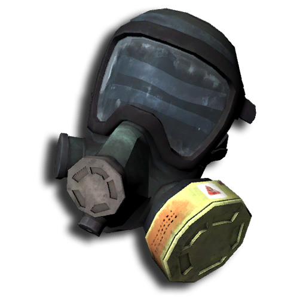
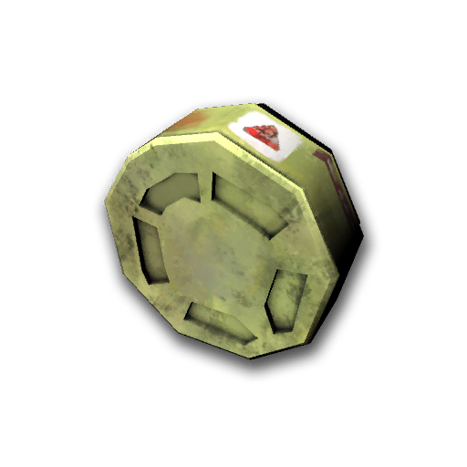

# First Aid

**Contents**

- [Afflictions](#Afflictions)
- [Injuries](#Injuries)
- [Diseases](#Diseases)
- [Administering First Aid](#Administering_First_Aid)
- [First Aid types](#First_Aid_types)
- [Preventative](#Preventative)
- [Prepared Plants](#Prepared_Plants)
- [Treatment](#Treatment)
- [Equipment](#Equipment)

<table>
<colgroup>
<col style="width: 33%" />
<col style="width: 33%" />
<col style="width: 33%" />
</colgroup>
<tbody>
<tr>
<td style="vertical-align: top; font-size: 3em; color: #5d5980; padding-right: 10px">
“
</td>
<td>
Study Your Treatments and Learn to Triage 
There are many ways to die in the wilderness. Medical treatments -- man-made or harvested from the natural world -- will save your life. Use the Status screen to check on your health. Apply a Treatment using the First Aid Radial menu. You can also use Treatments from your Pack menu.

&#10;

What I Know description

</td>
<td style="vertical-align: bottom; font-size: 3em; color: #5d5980; padding-left: 10px">
”
</td>
</tr>
</tbody>
</table>

**First Aid** is both a term and category used for items that can be consumed to prevent or treat injuries and diseases to the player throughout their playthrough. They have their own dedicated section within the <a href="./Radial%20Menu.md" class="wikilink" title="Radial Menu">Radial Menu</a>.

## Afflictions

  
*Main article: <a href="./Afflictions.md" class="wikilink" title="Afflictions">Afflictions</a>*

Negative afflictions cause <a href="./Condition.md" class="wikilink" title="Condition">Condition</a> loss and/or otherwise impede the player. There are currently 39 types of negative afflictions, which can be classified into two types: injuries and diseases.

### Injuries

Injuries are caused by falling, <a href="./Struggle.md" class="wikilink" title="animal attacks">animal attacks</a>, or exposure to the elements. The names of injuries that can affect a player will be briefly displayed on screen when they occur. Additionally, the player character will usually cry out in pain.

### Diseases

Prior to contracting diseases, players are able to view their risk for the disease in the status menu. Certain actions taken by the player, such as consuming raw carnivore meat or drinking unsafe water, dramatically increase the risk that the player will contract the related disease. Once the disease has been contracted, treatment is required to remove the negative effects.

## Administering First Aid

Administering First Aid to treat an injury or disease is done primarily using the first aid interface from the Radial Menu. Current afflictions are listed and selectable on the left side of the screen. First Aid items can also be consumed directly from the inventory. Although, since the game does not pause in the inventory menu, the additional steps might waste precious time.

After selecting the first aid item, a menu with the player's current afflictions allows the player to direct the treatment to the specific affliction. Using the wrong treatment on the wrong affliction, however, *will* still consume the item without curing the affliction. The player will need to apply the correct treatment on the right affliction to begin recovering.

It is possible to have multiple instances of similar afflictions. Each must be treated individually. Many afflictions will have two different possible treatments; regardless, treatments are only selectable when the necessary items are in the inventory. Many afflictions also require a resting or waiting period to completely cure after the treatment is applied.

Afflictions disappear when they are cured. Some afflictions will disappear without treatment once sufficient time has passed, while others slowly drain condition and can kill they player if not cured quickly enough.

## First Aid types

### Preventative

<table style="width:100%;">
<colgroup>
<col style="width: 14%" />
<col style="width: 14%" />
<col style="width: 14%" />
<col style="width: 14%" />
<col style="width: 14%" />
<col style="width: 14%" />
<col style="width: 14%" />
</colgroup>
<thead>
<tr>
<th class="unsortable" style="border-style: solid none solid solid"><figure>

<figcaption>First_Aid.png</figcaption>
</figure></th>
<th style="border-style: solid solid solid none">
Item
</th>
<th>
Prevents
</th>
<th>
Effect
</th>
<th>
Dose
</th>
<th>
Weight
</th>
<th>
Renewable
</th>
</tr>
</thead>
<tbody>
<tr>
<td><figure>

<figcaption>Antiseptic_icon.png</figcaption>
</figure></td>
<td>
<a href="./Antiseptic.md" class="wikilink" title="Antiseptic">Antiseptic</a>
</td>
<td>
[Missing image: Infection_risk_icon.png] <a href="./Infection.md" class="wikilink" title="Infection">Infection</a>
</td>
<td>
Reduces the risk of infection from an animal attack by 40%
</td>
<td>
0.10 liters
</td>
<td>
0.14 kg 
(0.308 lb)
</td>
<td>
Artificial
</td>
</tr>
<tr>
<td><figure>

<figcaption>Caffeine_Pills_icon.png</figcaption>
</figure></td>
<td>
<a href="./Caffeine%20Pills.md" class="wikilink" title="Caffeine Pills">Caffeine Pills</a>
</td>
<td>
Reduces 
</td>
<td>
gives 25 <a href="./Fatigue.md" class="wikilink" title="Fatigue">Fatigue</a> and <a href="./Fatigue%20Reduced.md" class="wikilink" title="Fatigue Reduced">Fatigue Reduced</a> for 4 hours Also gives <a href="./Headache.md" class="wikilink" title="Headache">Headache</a> for 3 hours
</td>
<td>
1 pill (5 pills/pack)
</td>
<td>
0.10 kg 
(0.22 lb)
</td>
<td>
Artificial
</td>
</tr>
<tr>
<td><figure>

<figcaption>Heat_Pack_icon.png</figcaption>
</figure></td>
<td>
<a href="./Heat%20Pack.md" class="wikilink" title="Heat Pack">Heat Pack</a>
</td>
<td>
Raises
</td>
<td>
Raises <a href="./Warmth.md" class="wikilink" title="Warmth">Warmth</a> by +5C for 6 hours
</td>
<td>
1 pack
</td>
<td>
0.10 kg 
(0.22 lb)
</td>
<td>
Artificial
</td>
</tr>
<tr>
<td><figure>

<figcaption>Old_Man's_Beard_Wound_Dressing_icon.png</figcaption>
</figure></td>
<td>
<a href="./Old%20Man%27s%20Beard%20Wound%20Dressing.md" class="wikilink" title="Old Man&#39;s Beard Wound Dressing">Old Man's Beard Wound Dressing</a>
</td>
<td>
[Missing image: Infection_risk_icon.png] <a href="./Infection.md" class="wikilink" title="Infection">Infection</a>
</td>
<td>
Reduces the risk of infection from an animal attack by 40%
</td>
<td>
1 item
</td>
<td>
0.10 kg 
(0.22 lb)
</td>
<td>
Natural
</td>
</tr>
<tr>
<td><figure>

<figcaption>Vitamin-C_Pills_icon.png</figcaption>
</figure></td>
<td>
<a href="./Vitamin-C%20Pills.md" class="wikilink" title="Vitamin-C Pills">Vitamin-C Pills</a>
</td>
<td>
Reduces [Missing image: Scurvy_icon.png]
</td>
<td>
Reduces <a href="./Scurvy%20Risk.md" class="wikilink" title="Scurvy Risk">Scurvy Risk</a>/<a href="./Scurvy.md" class="wikilink" title="Scurvy">Scurvy</a> by 125 units per pill
</td>
<td>
1 pill (5 pills/bottle)
</td>
<td>
0.10 kg 
(0.22 lb)
</td>
<td>
Artificial
</td>
</tr>
<tr>
<td><figure>

<figcaption>Water_Purification_Tablets_icon.png</figcaption>
</figure></td>
<td>
<a href="./Water%20Purification%20Tablets.md" class="wikilink" title="Water Purification Tablets">Water Purification Tablets</a>
</td>
<td>
[Missing image: Dysentery_icon.png] <a href="./Dysentery.md" class="wikilink" title="Dysentery">Dysentery</a>
</td>
<td>
Purifies 1.00 liter of <a href="./Water%20%28Unsafe%29.md" class="wikilink" title="unsafe water">unsafe water</a>, allowing the player to drink without risk of Dysentery
</td>
<td>
1 tablet
</td>
<td>
0.06 kg 
(0.132 lb)
</td>
<td>
Artificial
</td>
</tr>
</tbody>
</table>

### Prepared Plants

<table>
<colgroup>
<col style="width: 25%" />
<col style="width: 25%" />
<col style="width: 25%" />
<col style="width: 25%" />
</colgroup>
<thead>
<tr>
<th class="unsortable" style="border-style: solid none solid solid"><figure>

<figcaption>First_Aid.png</figcaption>
</figure></th>
<th style="border-style: solid solid solid none">
Item
</th>
<th>
Cooked into
</th>
<th>
Weight per dose
</th>
</tr>
</thead>
<tbody>
<tr>
<td><figure>

<figcaption>Prepared_Birch_Bark_icon.png</figcaption>
</figure></td>
<td>
<a href="./Prepared%20Birch%20Bark.md" class="wikilink" title="Prepared Birch Bark">Prepared Birch Bark</a>
</td>
<td>
 <a href="./Birch%20Bark%20Tea.md" class="wikilink" title="Birch Bark Tea">Birch Bark Tea</a>
</td>
<td>
0.05 kg 
(0.11 lb)
</td>
</tr>
<tr>
<td><figure>

<figcaption>Prepared_Burdock_icon.png</figcaption>
</figure></td>
<td>
<a href="./Prepared%20Burdock.md" class="wikilink" title="Prepared Burdock">Prepared Burdock</a>
</td>
<td>
Can be consumed as food or boiled into  <a href="./Burdock%20Tea.md" class="wikilink" title="Burdock Tea">Burdock Tea</a>
</td>
<td>
0.15 kg 
(0.33 lb)
</td>
</tr>
<tr>
<td><figure>

<figcaption>Prepared_Reishi_Mushrooms_icon.png</figcaption>
</figure></td>
<td>
<a href="./Prepared%20Reishi%20Mushrooms.md" class="wikilink" title="Prepared Reishi Mushrooms">Prepared Reishi Mushrooms</a>
</td>
<td>
 <a href="./Reishi%20Tea.md" class="wikilink" title="Reishi Tea">Reishi Tea</a>
</td>
<td>
0.05 kg 
(0.11 lb)
</td>
</tr>
<tr>
<td><figure>

<figcaption>Prepared_Rose_Hips_icon.png</figcaption>
</figure></td>
<td>
<a href="./Prepared%20Rose%20Hips.md" class="wikilink" title="Prepared Rose Hips">Prepared Rose Hips</a>
</td>
<td>
 <a href="./Rose%20Hip%20Tea.md" class="wikilink" title="Rose Hip Tea">Rose Hip Tea</a>
</td>
<td>
0.05 kg 
(0.11 lb)
</td>
</tr>
</tbody>
</table>

### Treatment

<table style="width:100%;">
<colgroup>
<col style="width: 16%" />
<col style="width: 16%" />
<col style="width: 16%" />
<col style="width: 16%" />
<col style="width: 16%" />
<col style="width: 16%" />
</colgroup>
<thead>
<tr>
<th class="unsortable" style="border-style: solid none solid solid"><figure>

<figcaption>First_Aid.png</figcaption>
</figure></th>
<th style="border-style: solid solid solid none">
Item
</th>
<th>
Treats/Restores
</th>
<th>
Dose size
</th>
<th>
Weight per dose
</th>
<th>
Renewable
</th>
</tr>
</thead>
<tbody>
<tr>
<td><figure>

<figcaption>Antibiotics_icon.png</figcaption>
</figure></td>
<td>
<a href="./Antibiotics.md" class="wikilink" title="Antibiotics">Antibiotics</a>
</td>
<td>
[Missing image: Dysentery_icon.png] <a href="./Dysentery.md" class="wikilink" title="Dysentery">Dysentery</a> [Missing image: Food_poisoning_icon.png] <a href="./Food%20Poisoning.md" class="wikilink" title="Food Poisoning">Food Poisoning</a> 
[Missing image: Infection_icon.png] <a href="./Infection.md" class="wikilink" title="Infection">Infection</a> 
[Missing image: Intestinal_parasites_icon.png] <a href="./Intestinal%20Parasites.md" class="wikilink" title="Intestinal Parasites">Intestinal Parasites</a>
</td>
<td>
2 pills
</td>
<td>
0.03 kg 
(0.066 lb)
</td>
<td>
Artificial
</td>
</tr>
<tr>
<td><figure>

<figcaption>Bandage_icon.png</figcaption>
</figure></td>
<td>
<a href="./Bandage.md" class="wikilink" title="Bandage">Bandage</a>
</td>
<td>
[Missing image: Blood_loss_icon.png] <a href="./Blood%20Loss.md" class="wikilink" title="Blood loss">Blood loss</a> 
[Missing image: Broken_ribs_icon.png] <a href="./Broken%20Ribs.md" class="wikilink" title="Broken Ribs">Broken Ribs</a> [Missing image: Burns_icon.png] <a href="./Burns.md" class="wikilink" title="Burns">Burns</a> 
[Missing image: Sprained_ankle_icon.png] <a href="./Sprained%20Ankle.md" class="wikilink" title="Sprained Ankle">Sprained Ankle</a>

[Missing image: Sprained_wrist_icon.png] <a href="./Sprained%20Wrist.md" class="wikilink" title="Sprained Wrist">Sprained Wrist</a>
</td>
<td>
1
</td>
<td>
0.10 kg 
(0.22 lb)
</td>
<td>
Artificial
</td>
</tr>
<tr>
<td><figure>

<figcaption>Birch_Bark_Tea_icon.png</figcaption>
</figure></td>
<td>
<a href="./Birch%20Bark%20Tea.md" class="wikilink" title="Birch Bark Tea">Birch Bark Tea</a>
</td>
<td>
[Missing image: Restore_Condition_icon.png]<a href="./Restore%20Condition.md" class="wikilink" title="Restore Condition">Restore Condition</a>
</td>
<td>
1
</td>
<td>
0.10 kg 
(0.22 lb)
</td>
<td>
Natural
</td>
</tr>
<tr>
<td><figure>

<figcaption>Burdock_Tea_icon.png</figcaption>
</figure></td>
<td>
<a href="./Burdock%20Tea.md" class="wikilink" title="Burdock Tea">Burdock Tea</a>
</td>
<td>
[Missing image: Dysentery_icon.png] <a href="./Dysentery.md" class="wikilink" title="Dysentery">Dysentery</a> [Missing image: Food_poisoning_icon.png] <a href="./Food%20Poisoning.md" class="wikilink" title="Food Poisoning">Food Poisoning</a> 
[Missing image: Infection_icon.png] <a href="./Infection.md" class="wikilink" title="Infection">Infection</a> 
[Missing image: Intestinal_parasites_icon.png] <a href="./Intestinal%20Parasites.md" class="wikilink" title="Intestinal Parasites">Intestinal Parasites</a>
</td>
<td>
1
</td>
<td>
0.10 kg 
(0.22 lb)
</td>
<td>
Natural
</td>
</tr>
<tr>
<td><figure>

<figcaption>Emergency_Stim_icon.png</figcaption>
</figure></td>
<td>
<a href="./Emergency%20Stim.md" class="wikilink" title="Emergency Stim">Emergency Stim</a>
</td>
<td>
[Missing image: Sprained_ankle_icon.png] <a href="./Sprained%20Ankle.md" class="wikilink" title="Sprained Ankle">Sprained Ankle</a> 
[Missing image: Restore_Condition_icon.png]<a href="./Restore%20Condition.md" class="wikilink" title="Restore Condition">Restore Condition</a> (15) 
[Missing image: Energy_Boost_icon.png] Give unlimited <a href="./Stamina.md" class="wikilink" title="Stamina">Stamina</a> for a limited time (before total depletion)
</td>
<td>
1
</td>
<td>
0.10 kg 
(0.22 lb)
</td>
<td>
Artificial
</td>
</tr>
<tr>
<td><figure class="thumb">

</figure></td>
<td>
<a href="./Military%20Stim.md" class="wikilink" title="Military Stim">Military Stim</a>
</td>
<td>
[Missing image: Fatigue_reduced_icon.png] Restores <a href="./Fatigue.md" class="wikilink" title="Fatigue">Fatigue</a> (75%)[Missing image: Restore_Condition_icon.png]<a href="./Restore%20Condition.md" class="wikilink" title="Restore Condition">Restore Condition</a> (60%)
</td>
<td>
1
</td>
<td>
0.10 kg 
(0.22 lb)
</td>
<td>
Artificial
</td>
</tr>
<tr>
<td><figure>

<figcaption>Go!_Energy_Drink_icon.png</figcaption>
</figure></td>
<td>
<a href="./Go!%20Energy%20Drink.md" class="wikilink" title="Go! Energy Drink">Go! Energy Drink</a>
</td>
<td>
[Missing image: Fatigue_reduced_icon.png] Restores <a href="./Fatigue.md" class="wikilink" title="Fatigue">Fatigue</a> (for a limited time before depletion) and gives <a href="./Fatigue%20Reduced.md" class="wikilink" title="Fatigue Reduced">Fatigue Reduced</a> [Missing image: Energy_Boost_icon.png] Gives <a href="./Energy%20Boost.md" class="wikilink" title="Energy Boost">Energy Boost</a> (for a limited time before depletion)

[Missing image: Headache_icon.png] Gives <a href="./Headache.md" class="wikilink" title="Headache">Headache</a> after awhile
</td>
<td>
1
</td>
<td>
0.25 kg 
(0.55 lb)
</td>
<td>
Artificial
</td>
</tr>
<tr>
<td><figure>

<figcaption>Painkillers_icon.png</figcaption>
</figure></td>
<td>
<a href="./Painkillers.md" class="wikilink" title="Painkillers">Painkillers</a>
</td>
<td>
[Missing image: Broken_ribs_icon.png] <a href="./Broken%20Ribs.md" class="wikilink" title="Broken Ribs">Broken Ribs</a> [Missing image: Burns_icon.png] <a href="./Burns.md" class="wikilink" title="Burns">Burns</a> 
[Missing image: Pain_icon.png] <a href="./Pain.md" class="wikilink" title="Pain">Pain</a>
</td>
<td>
2 pills
</td>
<td>
0.03 kg 
(0.066 lb)
</td>
<td>
Artificial
</td>
</tr>
<tr>
<td><figure>

<figcaption>Reishi_Tea_icon.png</figcaption>
</figure></td>
<td>
<a href="./Reishi%20Tea.md" class="wikilink" title="Reishi Tea">Reishi Tea</a>
</td>
<td>
[Missing image: Dysentery_icon.png] <a href="./Dysentery.md" class="wikilink" title="Dysentery">Dysentery</a> [Missing image: Food_poisoning_icon.png] <a href="./Food%20Poisoning.md" class="wikilink" title="Food Poisoning">Food Poisoning</a> 
[Missing image: Infection_icon.png] <a href="./Infection.md" class="wikilink" title="Infection">Infection</a> 
[Missing image: Intestinal_parasites_icon.png] <a href="./Intestinal%20Parasites.md" class="wikilink" title="Intestinal Parasites">Intestinal Parasites</a>
</td>
<td>
1
</td>
<td>
0.10 kg 
(0.22 lb)
</td>
<td>
Natural
</td>
</tr>
<tr>
<td><figure>

<figcaption>Rose_Hip_Tea_icon.png</figcaption>
</figure></td>
<td>
<a href="./Rose%20Hip%20Tea.md" class="wikilink" title="Rose Hip Tea">Rose Hip Tea</a>
</td>
<td>
[Missing image: Broken_ribs_icon.png] <a href="./Broken%20Ribs.md" class="wikilink" title="Broken Ribs">Broken Ribs</a> [Missing image: Burns_icon.png] <a href="./Burns.md" class="wikilink" title="Burns">Burns</a> 
[Missing image: Pain_icon.png] <a href="./Pain.md" class="wikilink" title="Pain">Pain</a>
</td>
<td>
1
</td>
<td>
0.10 kg 
(0.22 lb)
</td>
<td>
Natural
</td>
</tr>
</tbody>
</table>

### Equipment

<table>
<colgroup>
<col style="width: 25%" />
<col style="width: 25%" />
<col style="width: 25%" />
<col style="width: 25%" />
</colgroup>
<thead>
<tr>
<th class="unsortable" style="border-style: solid none solid solid"><figure>

<figcaption>First_Aid.png</figcaption>
</figure></th>
<th style="border-style: solid solid solid none">
Item
</th>
<th>
Prevents/Use
</th>
<th>
Weight
</th>
</tr>
</thead>
<tbody>
<tr>
<td><figure>

<figcaption>Respirator_icon.png</figcaption>
</figure></td>
<td>
<a href="./Respirator.md" class="wikilink" title="Respirator">Respirator</a> (only in <a href="./Tales%20from%20the%20Far%20Territory.md" class="wikilink" title="Tales from the Far Territory">Tales from the Far Territory</a> expansion)
</td>
<td>
[Missing image: Chemical_Poisoning_icon.png]<a href="./Chemical%20Poisoning.md" class="wikilink" title="Chemical Poisoning">Chemical Poisoning</a> at <a href="./Chemical%20Hazard.md" class="wikilink" title="Chemical Spills">Chemical Spills</a> [Missing image: Suffocation_icon.png]<a href="./Suffocation.md" class="wikilink" title="Suffocation">Suffocation</a>
</td>
<td>
0.00 kg 
(0 lb)
</td>
</tr>
<tr>
<td><figure>

<figcaption>Canister_icon.png</figcaption>
</figure></td>
<td>
<a href="./Canister.md" class="wikilink" title="Canister">Canister</a> (only in <a href="./Tales%20from%20the%20Far%20Territory.md" class="wikilink" title="Tales from the Far Territory">Tales from the Far Territory</a> expansion)
</td>
<td>
Used to make a Respirator functional
</td>
<td>
0.20 kg 
(0.44 lb)
</td>
</tr>
</tbody>
</table>

**Lua execution error in Module:Navbox function navbox**

<a href="es:Primeros_auxilios" class="wikilink" title="es:Primeros auxilios">es:Primeros auxilios</a> <a href="fr:Premiers_Secours" class="wikilink" title="fr:Premiers Secours">fr:Premiers Secours</a>

