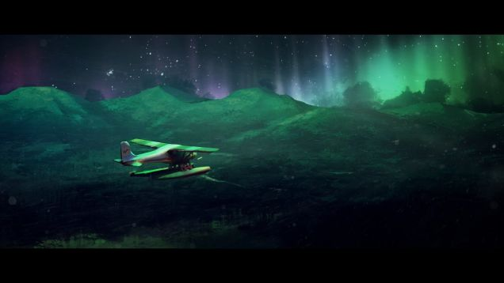

# First Flare

**Categories:** Story · **Source:** [Fandom](https://thelongdark.fandom.com/wiki/First_Flare)

_Will Mackenzie and Dr. Astrid Greenwood witness the First Flare moments before their plane crashes_
> **The lights in the sky are a reckoning. The wonder of humanity and all its creations, laid bare. Her warnings went unheeded... The signs were there, for those willing to see them. This has all happened before. Soon we'll all be tested. We'll all have to choose how far we'll go to survive.**
>
>
> — [Methuselah](./Methuselah.md) explaining the First Flare

The **First Flare**refers to the first appearance of an intense [Aurora](./Aurora.md) in _The Long Dark_'s Story Mode [Wintermute](./Wintermute.md). It is the primary cause of the so-called "quiet apocalypse" seen in both Wintermute and [Survival Mode](./Survival%20Mode.md).

## History

According to the [Prison Transport Manifest](./Prison%20Transport%20Manifest.md), the First Flare specifically took place on the night of Thursday, November XX, 20XX. The First Flare event took place at least 10 years after [The Collapse](./The%20Collapse.md), the colloquial name for the economic collapse of the Canadian - and wider North American - economy, based on conversations between [Grey Mother](./Grey%20Mother.md) and [Will Mackenzie](./Will%20Mackenzie.md) (Grey Mother mentions that Milton needed help 10 years ago, but this information has since been removed in the Redux [Episode 1: Do Not Go Gentle](./Episode%201%20-%20Do%20Not%20Go%20Gentle.md) release. It is unknown if the 10 years is still canon).

## Cause &amp; Effects

The cause of the First Flare and subsequent Aurora has been labelled as a [geomagnetic storm](https://en.wikipedia.org/wiki/Geomagnetic_storm). Its most immediate effect was the widespread disruption of electronic devices; including lights, cell phones, computers, televisions, radios, power plants, and vehicles. One of the Flare's slower but more devastating effects is the destabilization of weather patterns and wildlife behavior, leading to extreme weather and unusual animal activity in many areas.

Due to the loss of worldwide communication and the isolation of the game's setting of [Great Bear Island](./Great%20Bear%20Island.md), it is impossible to determine the exact scope of the First Flare's destruction; however given the widespread electronic EMP devastation visible throughout the Island, the First Flare was most likely a [Carrington Class](https://en.m.wikipedia.org/wiki/Carrington_Event) Coronal Mass Ejection Event that struck Earth. It can thus be inferred that the entire world has been affected, leading to the collapse of human civilization and a much "louder apocalypse" for those currently residing in major human settlements.

## Notable Incidents Caused by the First Flare

- Electronic devices across northern [Canada](./The%20Collapse.md) and presumably the rest of the world (not mentioned, confirmed or refuted by Wintermute story) stop working, leading to total blackouts and loss of communication, and possibly the collapse of most nation states.
- Wildlife behavior is disrupted. Predators that once avoided humans now stalk or attack them on sight. Bears are roused from their hibernation and begin roaming the area. Wildlife that normally sleep at night (such as birds) become active when the Aurora is out at night.
- Disruption of weather patterns, extremely cold temperatures, and brutal snowstorms occur frequently across many regions of Great Bear Island and presumably the rest of northern Canada. Reoccurring Auroras and [Electrostatic Fog](./Glimmer%20Fog.md) begins to plague certain areas of the world, occasionally reviving technology and [computers](./Buffer%20Memories.md). (Earth's magnetic polarity fields may have been damaged, explaining the sudden shifts in weather and the longer winter in the northern pole.)
- Loss of electricity, severe weather, and food/water shortages leads to widespread looting and violence throughout many of the affected areas. It can be inferred that law and order in cities across the planet has also presumably broken down for the time being.
- An unusual amount of earthquakes begin to rock various sections of Great Bear Island (although it is implied to have occurred during the aftermath of the Collapse, and not as a result of the First Flare), causing landslides and avalanches to bury most of the island's infrastructure. Seamless connections to other regions are now made impossible to travel between via working vehicles or foot travel. Travelers are forced to use dangerous abandoned mineshafts, caves systems, and other side passages to navigate around major or even basic obstructions. Rope climbing across steep cliffs is required to leave or enter certain isolated locations, such as Milton.
- Dozens of motorists are stranded on highways and roads after their cars stopped working. Refugees from the highways begin to make their way toward towns and cities.
- Pilot [Will Mackenzie](./Will%20Mackenzie.md) and [Dr. Astrid Greenwood](./Astrid%20Greenwood.md) crash in the mountains outside of Milton following the total loss of power to [Mackenzie's Plane](./Mackenzie%27s%20Crashed%20Plane.md).
- A prison bus carrying several inmates to [Blackrock Federal Penitentiary](./Blackrock%20Prison.md) crashes into a collapsed tunnel outside Milton. Some of the inmates survive, [Hobbs](./Hobbs.md) among them, and proceed to [Milton](./Milton.md), where they hold residents hostage in the [Old Schoolhouse](./Old%20Schoolhouse.md). The residents are killed by a fire from a subsequent Aurora event and the Convicts scatter. Wolves begin to overtake the town shortly after, due to a lack of humans.
- The [Prisoners](./Convicts.md) of Blackrock Federal Penitentiary break out of their cells and execute the prison's staff, turning the prison into their own personal fortress and using it as a base of operations to begin looting nearby locales as they see fit.

- A motorist named Matt loses control of [his truck](./Matt%27s%20Truck.md) and drives off a bridge in [Desolation Point](./Desolation%20Point.md). _(Survival mode; unconfirmed for Wintermute)_
- A passenger plane crashes near [Skeeter's Ridge](./Skeeter%27s%20Ridge.md) in Pleasant Valley. Many do not make it and the remaining survivors make their way to [Thomson's Crossing](./Thomson%27s%20Crossing.md), though some become lost along the way.
- Several helicopters and [planes crash](./Plane%20Crashes.md) across various sections of the island.
- Many fishing boats around the coast of Great Bear lose power and break down. The Fukattsu Maru picks up some survivors, but subsequent Auroras eventually cause the crew and passengers to lose their sanity and jump overboard.
- A disease outbreak in [Perseverance Mills](./Perseverance%20Mills.md) worsens, with sufferers getting dementia-like symptoms. Many people end up wandering off and drowning near water.
