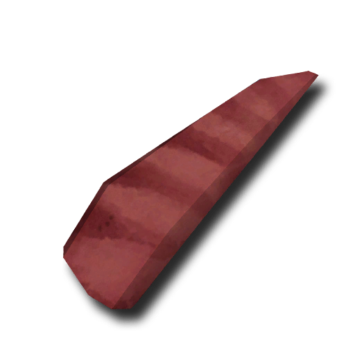

# Fishing Bait

<table class="infobox">
<caption>Fishing Bait</caption>
<colgroup>
<col style="width: 50%" />
<col style="width: 50%" />
</colgroup>
<tbody>
<tr>
<td colspan="2"><figure>

<figcaption>Fishing_Bait_icon.png</figcaption>
</figure></td>
</tr>
<tr>
<td>
Release
</td>
<td>
<a href="./The%20Long%20Dark%20%E2%80%94%20Changelog.md#2.17" class="wikilink" title="21 June 2023">21 June 2023</a>
</td>
</tr>
<tr>
<td>
Wintermute
</td>
<td>
No
</td>
</tr>
<tr>
<td>
Renewable
</td>
<td>
Yes
</td>
</tr>
<tr>
<td colspan="2" class="section">
<strong>Properties</strong>
</td>
</tr>
<tr>
<td>
Item type
</td>
<td>
<a href="./Tools.md" class="wikilink" title="Tools">Tools</a>|-
</td>
</tr>
<tr>
<td>
Stackable
</td>
<td>
Yes
</td>
</tr>
<tr>
<td>
Examine
</td>
<td>
Basic fish bait. Useful for catching larger fish.
</td>
</tr>
<tr>
<td colspan="2" class="section">
<strong>Values</strong>
</td>
</tr>
<tr>
<td>
Weight
</td>
<td>
0.05 kg (0.11 lbs)
</td>
</tr>
<tr>
<td colspan="2" class="section">
<strong>Actions</strong>
</td>
</tr>
<tr>
<td>
Backpack
</td>
<td>
Use, Actions, Drop
</td>
</tr>
<tr>
<td>
On ground
</td>
<td>
Take It, Leave It
</td>
</tr>
<tr>
<td colspan="2" class="section">
<strong>Advanced data</strong>
</td>
</tr>
<tr>
<td>
Item key
</td>
<td>
GAMEPLAY_FishingBait
</td>
</tr>
</tbody>
</table>

**Fishing Bait** is a Tool used for <a href="./Ice%20Fishing.md" class="wikilink" title="Ice Fishing">Ice Fishing</a> in *The Long Dark*. It released in the free update of Part 3: Frontier Comforts for the <a href="./Tales%20from%20the%20Far%20Territory.md" class="wikilink" title="Tales from the Far Territory">Tales from the Far Territory</a> expansion.

## Overview

Bait is not necessary to catch fish, but can be used when fishing to increase the weight of fish caught by Ice Fishing by 50%. Bait is harvested from any raw fish, and yields a number of units per kg of fish which was harvested. When fishing manually with <a href="./Fishing%20Tackle.md" class="wikilink" title="Fishing Tackle">Fishing Tackle</a> or with <a href="./Fishing%20Tip-Up.md" class="wikilink" title="Fishing Tip-Ups">Fishing Tip-Ups</a>, Bait may be selected (as can <a href="./Fishing%20Lure%20%28Acorns%29.md" class="wikilink" title="Fishing Lures">Fishing Lures</a>).

- Using Bait increases the weight (minimum and maximum) of caught fish by 50%.
- Bait is consumed each time a fish is caught, or when the fishing line breaks
- Bait is harvested from raw (not cooked) fish, regardless of species
- Harvesting bait always takes 30 minutes, regardless of fish weight/species
- Harvested fish produce 3-14 pieces of bait based on weight (3 Bait per kilogram of fish, rounded down. With breakpoints at X.00kg, X.35kg and X.70kg)
- Bait <a href="./Scent.md" class="wikilink" title="Smells">Smells</a> and will attract <a href="./Wolf.md" class="wikilink" title="predatory wildlife">predatory wildlife</a> (despite not displaying on the Scent Indicator, currently a bug).
- Bait decays over time and cannot be used once ruined. Raw fish will always yield 100% condition bait when harvested (even if the fish is 0% condition "ruined").

Whitefish/Trout weigh significantly less than Coho Salmon/Smallmouth Bass, but give double the <a href="./Scurvy.md" class="wikilink" title="Vitamin-C">Vitamin-C</a> per kg. This makes it more efficient for Vitamin-C and time to harvest larger 'uncommon' fish (Coho Salmon/Smallmouth Bass). Rare Fish (goldeye, burbot, etc.) do not yield any Vitamin-C, but can be difficult to acquire. If fishing for calories, then whitefish, trout, or goldeye should be harvested.

- UPDATE **21 June 2023 (<a href="./The%20Long%20Dark%20%E2%80%94%20Changelog.md#2.17" class="wikilink" title="Update">Update</a>):**
  - Added to game.

**Lua execution error in Module:Navbox function navbox**

<a href="ru:%D0%9D%D0%B0%D0%B6%D0%B8%D0%B2%D0%BA%D0%B0" class="wikilink" title="ru:Наживка">ru:Наживка</a>

