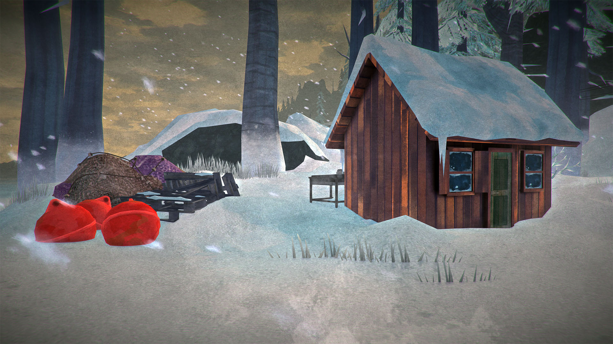
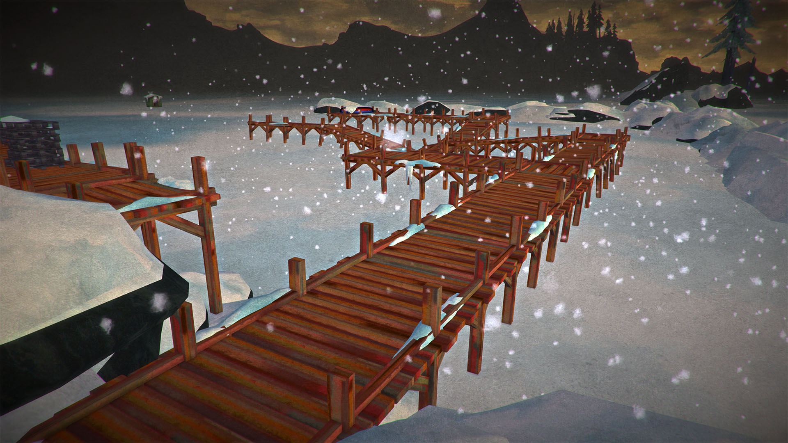

# Fishing Camp

**Categories:** Locations, Locations in Coastal Highway, Locations with a workbench · **Source:** [Fandom](https://thelongdark.fandom.com/wiki/Fishing_Camp)

**Fishing Camp**

**Location**

Region

Location

Between [Bear Creek Campground](./Bear%20Creek%20Campground.md) and [Jackrabbit Island](./Jackrabbit%20Island.md)

**General**

Type

Has a bed

Has a workbench|-

**Fishing Camp** is a collection of fishing cabins and a dock in [Coastal Highway](./Coastal%20Highway.md).

## Overview

The Fishing Camp is located on the western side of the region, between [Bear Creek Campground](./Bear%20Creek%20Campground.md) and [Jackrabbit Island](./Jackrabbit%20Island.md).

The Fishing Camp is a suitable place to set up a [safe house](./Safehouse.md). The four cabins combined provided ample supplies. There is a [fishing hut](./Fishing%20Hut.md) nearby to [catch fish](./Ice%20Fishing.md) when hungry, a [workbench](./Work%20Bench.md), and a bed to sleep. However, it lacks a way to make fire indoors or a windproof fire outdoors; additionally, the workbench is outside, exposed to predators and the elements. The fishing hut near the Camp has a potbelly stove.

A [hatchet](./Hatchet.md) often spawns near the fishing nets and pallets located near the roadside. A knife, a hammer, or a [mountaineering rope](./Mountaineering%20Rope.md) may be found on the workbench. Additionally, a corpse near the end of the dock may be holding a [hunting knife](./Hunting%20Knife.md). Keep an eye out for wolves that may be patrolling the area near the body.

## Gallery

_Aurora night PC (It has a [Buffer Memories](./Buffer%20Memories.md) of the Fishing Cabin)_
