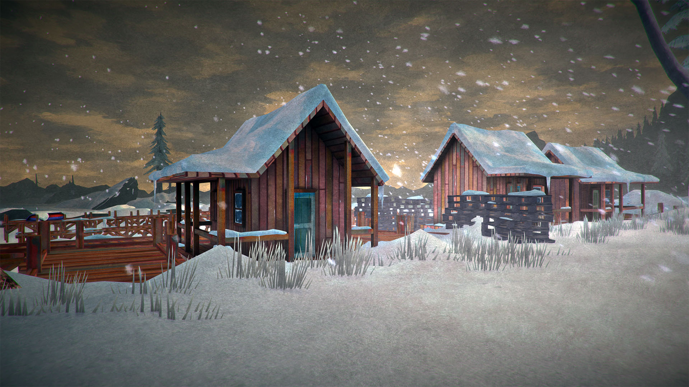

# Fishing Camp

**Fishing Camp**

| Property | Details |
| --- | --- |
| \[\[File: / \| Column 1 \| / \| --- \| / \|  / *Fishing\_Camp\_-\_fishing\_cabins.jpg* \| | 250px\]\] |
|  |  / *Fishing\_Camp\_-\_fishing\_cabins.jpg* |
| **Location** |  |
|  / *Fishing\_Camp\_map.png* |  |
| Region | [Coastal Highway](./Coastal%20Highway.md)\|- / Location |
| **General** |  |
| Type | Residential\|- /  / *bed\_icon.png* |
|  / *workbench\_icon\_green.png* | Has a workbench\|- |
