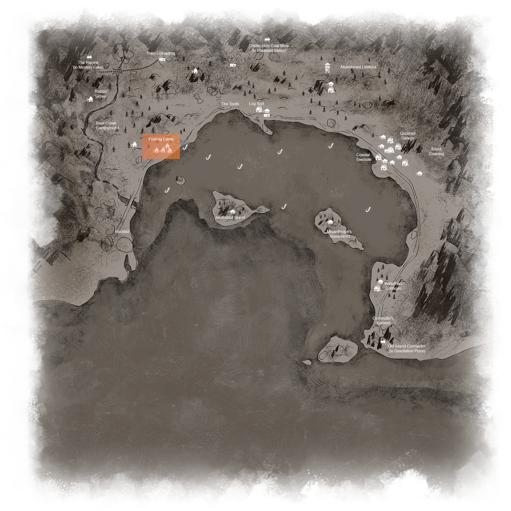

# Fishing Camp

**Categories:** Indoor locations, Locations, Locations in Coastal Highway, Locations with a workbench, Residential locations · **Source:** [Fandom](https://thelongdark.fandom.com/wiki/Fishing_Camp)

**Fishing Camp**

| Property | Details |
| --- | --- |
| \[\[File: /  / _Fishing\_Camp\_-\_fishing\_cabins.jpg_ | 250px\]\] |
|  |  / _Fishing\_Camp\_-\_fishing\_cabins.jpg_ |
| **Location** |  |
|  / _Fishing\_Camp\_map.png_ |  |
| Region | [Coastal Highway](./Coastal%20Highway.md)\|- / Location |
| **General** |  |
| Type | Residential\|- /  / _bed\_icon.png_ |
|  / _workbench\_icon\_green.png_ | Has a workbench\|- |
