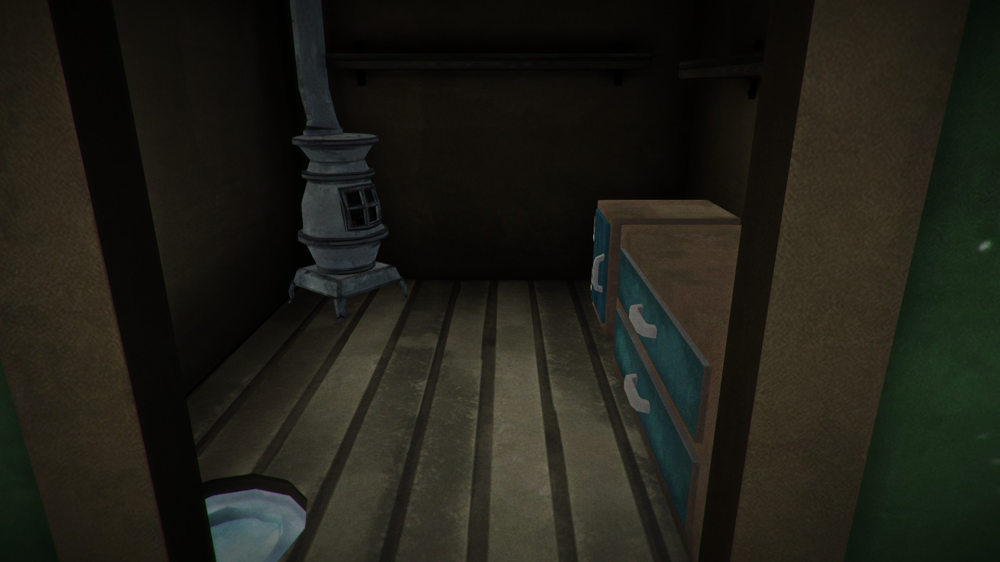

# Fishing Hut

**Categories:** Locations in Coastal Highway, Locations in Mystery Lake · **Source:** [Fandom](https://thelongdark.fandom.com/wiki/Fishing_Hut)

**Fishing huts**are a type of small structure found on frozen lakes and coasts. While they can be found in many regions, they are especially abundant in [Mystery Lake](./Mystery%20Lake%20%28region%29.md) and [Coastal Highway](./Coastal%20Highway.md).

<!-- #Overview -->
​

<!-- #overview -->
## Overview

Fishing huts are sheds placed on a frozen lake or ocean to provide shelter during ice [fishing](./Ice%20Fishing.md).

Fishing huts have an ice fishing hole, which can be used after breaking the ice cover of it with a [hatchet](./Hatchet.md), [hunting knife](./Hunting%20Knife.md), [prybar](./Prybar.md), or [heavy hammer](./Heavy%20Hammer.md). Other furniture includes a [pot belly stove](./Pot%20Belly%20Stove.md), [cupboard](./Cupboard.md), [drawer](./Drawer.md) and two shelves. There is enough space to place a [bedroll](./Bedroll.md) or a bearskin bedroll. In addition to being able to use the stove for warmth, fishing in a fishing hut results in faster catch times and reduced wear to [tip-ups](./Fishing%20Tip-Up.md) compared to free form ice fishing.

Most fishing huts lack doors, but animals, to include [wolves](./Wolf.md) and [bears](./Bear.md), do not enter them. Fishing huts with doors will also keep out bears and wolves when closed. _However_, even with the door closed, animals can still sense the player's presence, and may awaken the player if they attempt to [sleep](./Sleep.md). The player can try going to sleep again, but if a hostile animal is still nearby, there is a chance the player will be awoken again. If the player is unexpectedly awoken by a hostile animal, the game will register this as an interrupted sleep and will not save.

Note that fishing huts with door give a +3ºC [warmth](./Warmth.md) bonus (it doesn't matter whether the door is open or not).

Common items to find inside the hut are: [fishing tackle](./Fishing%20Tackle.md), [hook](./Hook.md), [food](./Food%20And%20Drink.md) and some wood like [cedar firewood](./Cedar%20Firewood.md) or [reclaimed wood](./Reclaimed%20Wood.md). Rarely, the player may find a [hatchet](./Hatchet.md), [hunting knife](./Hunting%20Knife.md), or [rifle ammunition](./Rifle%20Ammunition.md).

As the interior of fishing huts technically counts as outside, they make excellent shelters when trying for the [Night Walker](./Night%20Walker.md) and [Beneath a Starry Sky](./Beneath%20a%20Starry%20Sky.md) achievements, as well as warding off [Cabin Fever](./Cabin%20Fever.md). Magnifying lens can also be used to start fire in oven, in case if weather conditions are suitable.

Sleeping in a bedroll without a fire might lead to hypothermia and death.

<!-- #Locations -->
​

<!-- #locations -->
## Locations

The map with the most fishing huts is [Coastal Highway](./Coastal%20Highway.md), with a total of nine huts scattered across the frozen bay. [Mystery Lake](./Mystery%20Lake%20%28region%29.md) also hosts four fishing huts on [its namesake lake](./Mystery%20Lake%20%28location%29.md). Additionally, [Forsaken Airfield](./Forsaken%20Airfield.md) and [Bleak Inlet](./Bleak%20Inlet.md) have two huts each, with Bleak Inlet's huts being near the [Fallen Lighthouse](./Fallen%20Lighthouse.md) and Forsaken Airfield having huts near [Drift Island](./Drift%20Island.md). Finally, [Timberwolf Mountain](./Timberwolf%20Mountain.md), [Keeper's Pass South](./Keeper%27s%20Pass%20South.md), [Pleasant Valley](./Pleasant%20Valley.md), and [Ash Canyon](./Ash%20Canyon.md) each have one hut, located on [Crystal Lake](./Crystal%20Lake.md), a frozen river, [Pensive Pond](./Pensive%20Pond.md), and [Bitter Marsh](./Bitter%20Marsh.md) respectively. Ash Canyon's hut is unique in that it is ruined, but the [Pot belly stove](./Pot%20Belly%20Stove.md) can still be used for warmth.

Locations that don't have any fishing huts include [Blackrock](./Blackrock.md), [Broken Railroad](./Broken%20Railroad.md), [Desolation Point](./Desolation%20Point.md), [Forlorn Muskeg](./Forlorn%20Muskeg.md), [Hushed River Valley](./Hushed%20River%20Valley.md), and [Mountain Town](./Mountain%20Town.md), although it's possible to fish in most regions using a free-form fishing hole.

[ru:Домик для рыбалки](https://ru.wikipedia.org/wiki/%D0%94%D0%BE%D0%BC%D0%B8%D0%BA_%D0%B4%D0%BB%D1%8F_%D1%80%D1%8B%D0%B1%D0%B0%D0%BB%D0%BA%D0%B8)
