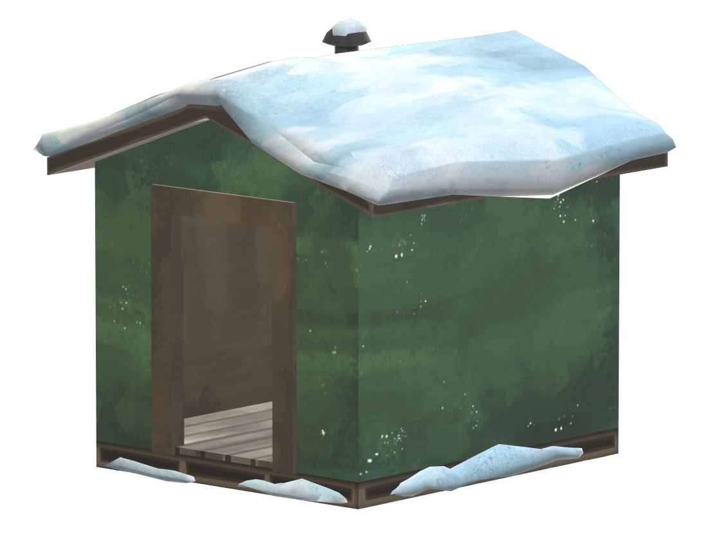

# Fishing Hut

<figure>

<figcaption>Fishing_hut.png</figcaption>
</figure>

**Fishing huts**are a type of small structure found on frozen lakes and coasts. While they can be found in many regions, they are especially abundant in <a href="./Mystery%20Lake%20%28region%29.md" class="wikilink" title="Mystery Lake">Mystery Lake</a> and <a href="./Coastal%20Highway.md" class="wikilink" title="Coastal Highway">Coastal Highway</a>.

## Overview

<table class="gallery">
<colgroup>
<col style="width: 100%" />
</colgroup>
<tbody>
<tr>
<td><figure>
[Missing image: fishing_hut_inside.jpg]
<figcaption>fishing_hut_inside.jpg</figcaption>
</figure></td>
</tr>
</tbody>
</table>

Fishing huts are sheds placed on a frozen lake or ocean to provide shelter during ice <a href="./Ice%20Fishing.md" class="wikilink" title="fishing">fishing</a>.

Fishing huts have an ice fishing hole, which can be used after breaking the ice cover of it with a <a href="./Hatchet.md" class="wikilink" title="hatchet">hatchet</a>, <a href="./Hunting%20Knife.md" class="wikilink" title="hunting knife">hunting knife</a>, <a href="./Prybar.md" class="wikilink" title="prybar">prybar</a>, or <a href="./Heavy%20Hammer.md" class="wikilink" title="heavy hammer">heavy hammer</a>. Other furniture includes a <a href="./Pot%20Belly%20Stove.md" class="wikilink" title="pot belly stove">pot belly stove</a>, <a href="./Cupboard.md" class="wikilink" title="cupboard">cupboard</a>, <a href="./Drawer.md" class="wikilink" title="drawer">drawer</a> and two shelves. There is enough space to place a <a href="./Bedroll.md" class="wikilink" title="bedroll">bedroll</a> or a bearskin bedroll. In addition to being able to use the stove for warmth, fishing in a fishing hut results in faster catch times and reduced wear to <a href="./Fishing%20Tip-Up.md" class="wikilink" title="tip-ups">tip-ups</a> compared to free form ice fishing.

Most fishing huts lack doors, but animals, to include <a href="./Wolf.md" class="wikilink" title="wolves">wolves</a> and <a href="./Bear.md" class="wikilink" title="bears">bears</a>, do not enter them. Fishing huts with doors will also keep out bears and wolves when closed. <u>However</u>, even with the door closed, animals can still sense the player's presence, and may awaken the player if they attempt to <a href="./Sleep.md" class="wikilink" title="sleep">sleep</a>. The player can try going to sleep again, but if a hostile animal is still nearby, there is a chance the player will be awoken again. If the player is unexpectedly awoken by a hostile animal, the game will register this as an interrupted sleep and will not save.

Note that fishing huts with door give a +3ºC <a href="./Warmth.md" class="wikilink" title="warmth">warmth</a> bonus (it doesn't matter whether the door is open or not).

Common items to find inside the hut are: <a href="./Fishing%20Tackle.md" class="wikilink" title="fishing tackle">fishing tackle</a>, <a href="./Hook.md" class="wikilink" title="hook">hook</a>, <a href="./Food%20And%20Drink.md" class="wikilink" title="food">food</a> and some wood like <a href="./Cedar%20Firewood.md" class="wikilink" title="cedar firewood">cedar firewood</a> or <a href="./Reclaimed%20Wood.md" class="wikilink" title="reclaimed wood">reclaimed wood</a>. Rarely, the player may find a <a href="./Hatchet.md" class="wikilink" title="hatchet">hatchet</a>, <a href="./Hunting%20Knife.md" class="wikilink" title="hunting knife">hunting knife</a>, or <a href="./Rifle%20Ammunition.md" class="wikilink" title="rifle ammunition">rifle ammunition</a>.

As the interior of fishing huts technically counts as outside, they make excellent shelters when trying for the <a href="./Night%20Walker.md" class="wikilink" title="Night Walker">Night Walker</a> and <a href="./Beneath%20a%20Starry%20Sky.md" class="wikilink" title="Beneath a Starry Sky">Beneath a Starry Sky</a> achievements, as well as warding off <a href="./Cabin%20Fever.md" class="wikilink" title="Cabin Fever">Cabin Fever</a>. Magnifying lens can also be used to start fire in oven, in case if weather conditions are suitable.

Sleeping in a bedroll without a fire might lead to hypothermia and death.

## Locations

The map with the most fishing huts is <a href="./Coastal%20Highway.md" class="wikilink" title="Coastal Highway">Coastal Highway</a>, with a total of nine huts scattered across the frozen bay. <a href="./Mystery%20Lake%20%28region%29.md" class="wikilink" title="Mystery Lake">Mystery Lake</a> also hosts four fishing huts on <a href="./Mystery%20Lake%20%28location%29.md" class="wikilink" title="its namesake lake">its namesake lake</a>. Additionally, <a href="./Forsaken%20Airfield.md" class="wikilink" title="Forsaken Airfield">Forsaken Airfield</a> and <a href="./Bleak%20Inlet.md" class="wikilink" title="Bleak Inlet">Bleak Inlet</a> have two huts each, with Bleak Inlet's huts being near the <a href="./Fallen%20Lighthouse.md" class="wikilink" title="Fallen Lighthouse">Fallen Lighthouse</a> and Forsaken Airfield having huts near <a href="./Drift%20Island.md" class="wikilink" title="Drift Island">Drift Island</a>. Finally, <a href="./Timberwolf%20Mountain.md" class="wikilink" title="Timberwolf Mountain">Timberwolf Mountain</a>, <a href="./Keeper%27s%20Pass%20South.md" class="wikilink" title="Keeper&#39;s Pass South">Keeper's Pass South</a>, <a href="./Pleasant%20Valley.md" class="wikilink" title="Pleasant Valley">Pleasant Valley</a>, and <a href="./Ash%20Canyon.md" class="wikilink" title="Ash Canyon">Ash Canyon</a> each have one hut, located on <a href="./Crystal%20Lake.md" class="wikilink" title="Crystal Lake">Crystal Lake</a>, a frozen river, <a href="./Pensive%20Pond.md" class="wikilink" title="Pensive Pond">Pensive Pond</a>, and <a href="./Bitter%20Marsh.md" class="wikilink" title="Bitter Marsh">Bitter Marsh</a> respectively. Ash Canyon's hut is unique in that it is ruined, but the <a href="./Pot%20Belly%20Stove.md" class="wikilink" title="Pot belly stove">Pot belly stove</a> can still be used for warmth.

Locations that don't have any fishing huts include <a href="./Blackrock.md" class="wikilink" title="Blackrock">Blackrock</a>, <a href="./Broken%20Railroad.md" class="wikilink" title="Broken Railroad">Broken Railroad</a>, <a href="./Desolation%20Point.md" class="wikilink" title="Desolation Point">Desolation Point</a>, <a href="./Forlorn%20Muskeg.md" class="wikilink" title="Forlorn Muskeg">Forlorn Muskeg</a>, <a href="./Hushed%20River%20Valley.md" class="wikilink" title="Hushed River Valley">Hushed River Valley</a>, and <a href="./Mountain%20Town.md" class="wikilink" title="Mountain Town">Mountain Town</a>, although it's possible to fish in most regions using a free-form fishing hole.

<a href="ru:%D0%94%D0%BE%D0%BC%D0%B8%D0%BA_%D0%B4%D0%BB%D1%8F_%D1%80%D1%8B%D0%B1%D0%B0%D0%BB%D0%BA%D0%B8" class="wikilink" title="ru:Домик для рыбалки">ru:Домик для рыбалки</a>

