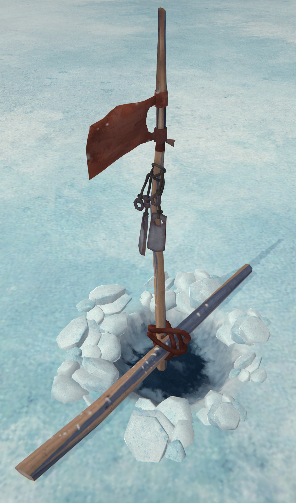
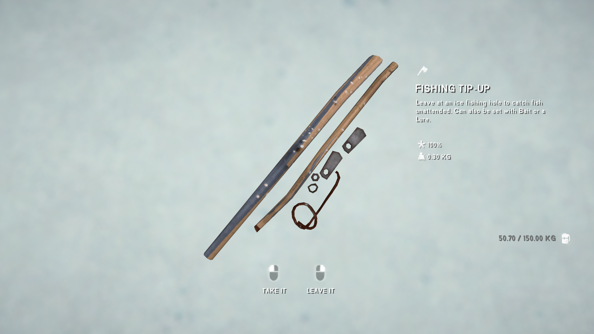
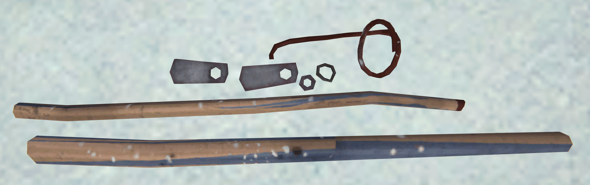

# Fishing Tip\-Up

**Contents**

- [Overview](#Overview)
- [Crafting](#Crafting)
- [Limitations](#Limitations)
- [Tips](#Tips)
- [Valid Fishing Locations](#Valid_Fishing_Locations)
- [Gallery](#Gallery)
- [Update history](#Update_history)

<table class="infobox">
<caption>Fishing Tip-Up</caption>
<colgroup>
<col style="width: 50%" />
<col style="width: 50%" />
</colgroup>
<tbody>
<tr>
<td colspan="2"><figure>

<figcaption>Fishing_Tip-Up_icon.png</figcaption>
</figure></td>
</tr>
<tr>
<td>
Release
</td>
<td>
<a href="./The%20Long%20Dark%20%E2%80%94%20Changelog.md#2.17" class="wikilink" title="21 June 2023">21 June 2023</a>
</td>
</tr>
<tr>
<td>
Wintermute
</td>
<td>
No
</td>
</tr>
<tr>
<td colspan="2" class="section">
<strong>Properties</strong>
</td>
</tr>
<tr>
<td>
Item type
</td>
<td>
<a href="./Tools.md" class="wikilink" title="Tools">Tools</a>|-
</td>
</tr>
<tr>
<td>
Stackable
</td>
<td>
No
</td>
</tr>
<tr>
<td>
Examine
</td>
<td>
Leave at an ice fishing hole to catch fish unattended. Can also be set with Bait or a Lure.
</td>
</tr>
<tr>
<td colspan="2" class="section">
<strong>Values</strong>
</td>
</tr>
<tr>
<td>
Weight
</td>
<td>
0.30 kg (0.66 lbs)
</td>
</tr>
<tr>
<td colspan="2" class="section">
<strong>Actions</strong>
</td>
</tr>
<tr>
<td>
Backpack
</td>
<td>
Place, Drop, Leave
</td>
</tr>
</tbody>
</table>

**Fishing Tip-Ups** are <a href="./Ice%20Fishing.md" class="wikilink" title="Ice Fishing">Ice Fishing</a> and <a href="./Trapping.md" class="wikilink" title="Trapping">Trapping</a> <a href="./Tools.md" class="wikilink" title="Tools">Tools</a> used to passively catch fish. They were introduced in the free update portion of the Part 3: Frontier Comforts of the <a href="./Tales%20from%20the%20Far%20Territory.md" class="wikilink" title="Tales from the Far Territory">Tales from the Far Territory</a> expansion.

## Overview

A Fishing Tip-Up is a low tech, improvised tool composed of 2 sticks in a cross shape, metal fasteners, and a fishing tackle. Two pieces of scrap, serving as bells, are also attached. At the top of the construction is a red cloth, meant to move in the wind and signal that a fish has been caught to its user from afar.

Similar to how <a href="./Snare.md" class="wikilink" title="Snares">Snares</a> work on land, Tip-Ups are traps used to passively fish in bodies of water without the player needing to constantly be present. <a href="./Fishing%20Bait.md" class="wikilink" title="Fishing Bait">Fishing Bait</a> and <a href="./Fishing%20Lure%20%28Acorns%29.md" class="wikilink" title="Fishing Lures">Fishing Lures</a> can be placed on the Tip-Up prior to placing in an open ice hole.

After clearing an ice hole with an ice breaker, and placing the Tip-Up in the water, the tool will auto fish for the player. As time passes and a fish bites the tackle, the tool will "tip up" and be pulled into the hole (hence the name), stopping itself from falling in completely due to its cross shape design. A bell will sound from the 2 metal bits clanking together when the tool falls in the hole, alerting the player of a catch if they are nearby.

The fish is collected in 2 steps:

1.  the hole must be cleared (if needed)
2.  collect the Tip-Up and the fish.

After the fish is collected, the tip-up has to be redeployed, like rabbit snares.

Combined with the Free-Form Ice Hole Cutting menu option, they can be used to fish within regions that do not natively have a <a href="./Fishing%20Hut.md" class="wikilink" title="Fishing Hut">Fishing Hut</a>, so long as the frozen body of water is sufficiently deep.

## Crafting

Tip-Ups can be crafted at a <a href="./Work%20Bench.md" class="wikilink" title="Workbench">Workbench</a>, requiring no extra tools. They take 40 minutes to make, and require: 2 <a href="./Stick.md" class="wikilink" title="Sticks">Sticks</a>, 1 <a href="./Cloth.md" class="wikilink" title="Cloth">Cloth</a>, 1 <a href="./Scrap%20Metal.md" class="wikilink" title="Scrap Metal">Scrap Metal</a>, and 1 <a href="./Fishing%20Tackle.md" class="wikilink" title="Fishing Tackle">Fishing Tackle</a>. Harvesting yields 1 <a href="./Scrap%20Metal.md" class="wikilink" title="Scrap Metal">Scrap Metal</a> and 1 <a href="./Stick.md" class="wikilink" title="Stick">Stick</a>. Crafting time can be reduced to 30 minutes if Simple Tools are used, and 20 minutes if Quality Tools are used. Ruined fishing tackles will still function in the recipe.

<table class="infobox">
<caption>Fishing Tip-Up</caption>
<tbody>
<tr>
<td colspan="2">
-
</td>
</tr>
<tr>
<td colspan="2">
-
</td>
</tr>
<tr>
<td colspan="2">
40.0 minutes
</td>
</tr>
<tr>
<td colspan="2" class="section">
<strong>Requirements</strong>
</td>
</tr>
<tr>
<td>
Facility
</td>
<td>
<strong>Template:iconlink</strong>
</td>
</tr>
<tr>
<td colspan="2" class="section">
<strong>Materials</strong>
</td>
</tr>
<tr>
<td colspan="2" class="section">
<strong>Template:iconlink plain</strong>
</td>
</tr>
<tr>
<td>
Item
</td>
<td>
<a href="./Stick.md" class="wikilink" title="Stick">Stick</a>
</td>
</tr>
<tr>
<td>
Quantity
</td>
<td>
2
</td>
</tr>
<tr>
<td colspan="2" class="section">
<strong>Template:iconlink plain</strong>
</td>
</tr>
<tr>
<td colspan="2">
<a href="./Cloth.md" class="wikilink" title="Cloth">Cloth</a>
</td>
</tr>
<tr>
<td colspan="2">
1
</td>
</tr>
<tr>
<td colspan="2" class="section">
<strong>Template:iconlink plain</strong>
</td>
</tr>
<tr>
<td colspan="2">
<a href="./Scrap%20Metal.md" class="wikilink" title="Scrap Metal">Scrap Metal</a>
</td>
</tr>
<tr>
<td colspan="2">
1
</td>
</tr>
<tr>
<td colspan="2" class="section">
<strong>Template:iconlink plain</strong>
</td>
</tr>
<tr>
<td colspan="2">
<a href="./Fishing%20Tackle.md" class="wikilink" title="Fishing Tackle">Fishing Tackle</a>
</td>
</tr>
<tr>
<td colspan="2">
1
</td>
</tr>
</tbody>
</table>

## Limitations

- Tip-Ups do not gain any benefits from the player's <a href="./Ice%20Fishing.md" class="wikilink" title="Ice Fishing Skill Level">Ice Fishing Skill Level</a>.
- Attempting to "farm fish" by placing more than 6 Tip-Ups per separate body of water will result in overfishing penalties where any Tip-Ups over the set limit will start to experience increasingly slower catch rates. The <a href="./Zone%20of%20Contamination.md" class="wikilink" title="Zone of Contamination&#39;s">Zone of Contamination's</a> fishing spot at <a href="./Unquenched%20Extraction.md" class="wikilink" title="Unquenched Extraction">Unquenched Extraction</a> is unique in that the overfishing penalty will apply when more than 4 Tip-Ups are deployed.
- Tip-Ups have durability and can break like snares, they lose condition over time while deployed at a rate of 0.5%/hour inside a fishing huts ice hole, and 1%/hour when placed in free-form ice fishing holes. They cannot be repaired, only harvested for 1 stick and 1 scrap metal.
- Tip-Ups have a 10% chance to have their "line break" on catch which will instantly drop it's condition by 10% and fail to retrieve the caught fish.
- Once condition drops below 0% the Tip-Up will vanish upon being picked up. The player should try to harvest low condition Tip-Ups just before they reach the 10% condition mark and risk the 10% chance of a line breakage destroying it completely.
- Ice holes do not freeze over while in direct use by the player, but Tip-Ups placed in ice holes do not enjoy this benefit. Recently cleared ice holes won't start freezing again for 10 in-game minutes, which can reduce the amount of ice clearing required to operate multiple Tip-Ups at once.

## Tips

- The player should exercise great caution while maintaining multiple tip ups out in the open, as the process of breaking ice will accelerate time and potentially cause rapid weather changes, and if the player's <a href="./Scent.md" class="wikilink" title="Scent">Scent</a> is high, animals like <a href="./Bear.md" class="wikilink" title="Bears">Bears</a>, <a href="./Wolf.md" class="wikilink" title="Wolves">Wolves</a>, and <a href="./Cougar.md" class="wikilink" title="Cougars">Cougars</a> will quickly home in on the player's location and attack.
- While a single Tip-Up can greatly benefit from a fishing hut's halved decay rate and slowed ice hole re-freezing rate, they are often best used out in the open ice by using the Free-Form Ice Hole cutting radial menu option where several may be placed next to each other for easy operation. Fishing huts can have free-form ice holes placed immediately outside their door allowing reach to all 6 Tip-Ups from the shelter of the hut, and the Ice fishing hole in the hut may still be fished from manually to level up/utilize fishing skill without contributing to the overfishing limit.
- With some effort in ice hole placement, it is possible to reach up to 4 Tip-Ups at once from the safety of a <a href="./Snow%20Shelter.md" class="wikilink" title="snow shelter">snow shelter</a>. There is at least one area in each fishable region allowing snow shelters access to suitable ice, except in <a href="./Crumbling%20Highway.md" class="wikilink" title="Crumbling Highway">Crumbling Highway</a> and the <a href="./Winding%20River.md" class="wikilink" title="Winding River">Winding River</a>.

## Valid Fishing Locations

| <a href="./Region.md" class="wikilink" title="Region">Region</a> | Hut Present? | Location | Water type |
|----|----|----|----|
| <a href="./Ash%20Canyon.md" class="wikilink" title="Ash Canyon">Ash Canyon</a> | Yes | <a href="./Bitter%20Marsh.md" class="wikilink" title="Bitter Marsh">Bitter Marsh</a> | Fresh Water |
| <a href="./Ash%20Canyon.md" class="wikilink" title="Ash Canyon">Ash Canyon</a> | No | <a href="./Long%20Falls.md" class="wikilink" title="Long Falls">Long Falls</a> | Fresh Water |
| <a href="./Ash%20Canyon.md" class="wikilink" title="Ash Canyon">Ash Canyon</a> | No | Between <a href="./Angler%27s%20Den.md" class="wikilink" title="Angler&#39;s Den">Angler's Den</a> and <a href="./Broad%20Falls.md" class="wikilink" title="Broad Falls">Broad Falls</a> | Fresh Water |
| <a href="./Bleak%20Inlet.md" class="wikilink" title="Bleak Inlet">Bleak Inlet</a> | Yes (east side) | The entire ocean areas to the south | Salt Water |
| <a href="./Broken%20Railroad.md" class="wikilink" title="Broken Railroad">Broken Railroad</a> | No | Pond north of <a href="./Maintenance%20Yard.md" class="wikilink" title="Maintenance Yard">Maintenance Yard</a> | Fresh Water |
| <a href="./Coastal%20Highway.md" class="wikilink" title="Coastal Highway">Coastal Highway</a> | Yes | The entire ocean area | Salt Water |
| <a href="./Desolation%20Point.md" class="wikilink" title="Desolation Point">Desolation Point</a> | No | The entire ocean area | Salt Water |
| <a href="./Forsaken%20Airfield.md" class="wikilink" title="Forsaken Airfield">Forsaken Airfield</a> | Yes | <a href="./Shoulder%20Lake.md" class="wikilink" title="Shoulder Lake">Shoulder Lake</a> | Fresh Water |
| <a href="./Forsaken%20Airfield.md" class="wikilink" title="Forsaken Airfield">Forsaken Airfield</a> | No | Pond near <a href="./Final%20Approach.md" class="wikilink" title="Final Approach">Final Approach</a> and <a href="./Surveyor%27s%20Memory.md" class="wikilink" title="Surveyor&#39;s Memory">Surveyor's Memory</a> | Fresh Water \|Fresh Water |
| <a href="./Hushed%20River%20Valley.md" class="wikilink" title="Hushed River Valley">Hushed River Valley</a> | No | <a href="./Monolith%20Lake.md" class="wikilink" title="Monolith Lake">Monolith Lake</a> | Fresh Water |
| <a href="./Keeper%27s%20Pass%20South.md" class="wikilink" title="Keeper&#39;s Pass South">Keeper's Pass South</a> | Yes | River area near <a href="./Mirthless%20Fork.md" class="wikilink" title="Mirthless Fork">Mirthless Fork</a> | Fresh Water |
| <a href="./Mountain%20Town.md" class="wikilink" title="Mountain Town">Mountain Town</a> | No | <a href="./Milton%20Basin.md" class="wikilink" title="Milton Basin">Milton Basin</a> | Fresh Water |
| <a href="./Mystery%20Lake%20%28region%29.md" class="wikilink" title="Mystery Lake">Mystery Lake</a> | Yes | <a href="./Mystery%20Lake%20%28location%29.md" class="wikilink" title="Mystery Lake">Mystery Lake</a> | Fresh Water |
| <a href="./Mystery%20Lake%20%28region%29.md" class="wikilink" title="Mystery Lake">Mystery Lake</a> | No | <a href="./Unnamed%20Pond.md" class="wikilink" title="Unnamed Pond">Unnamed Pond</a> | Fresh Water |
| <a href="./Crumbling%20Highway.md" class="wikilink" title="Old Island Connector">Old Island Connector</a> | No | The entire ocean area | Salt Water |
| <a href="./Pleasant%20Valley.md" class="wikilink" title="Pleasant Valley">Pleasant Valley</a> | Yes | <a href="./Pensive%20Pond.md" class="wikilink" title="Pensive Pond">Pensive Pond</a> | Fresh water |
| <a href="./Timberwolf%20Mountain.md" class="wikilink" title="Timberwolf Mountain">Timberwolf Mountain</a> | Yes | <a href="./Crystal%20Lake.md" class="wikilink" title="Crystal Lake">Crystal Lake</a> | Fresh Water |
| <a href="./Sundered%20Pass.md" class="wikilink" title="Sundered Pass">Sundered Pass</a> | Yes | <a href="./Ambler%27s%20Lake.md" class="wikilink" title="Ambler&#39;s Lake">Ambler's Lake</a> | Fresh Water |
| <a href="./Sundered%20Pass.md" class="wikilink" title="Sundered Pass">Sundered Pass</a> | No | <a href="./Giant%27s%20Thumbprint.md" class="wikilink" title="Giant&#39;s Thumbprint">Giant's Thumbprint</a> | Fresh Water |
| <a href="./Sundered%20Pass.md" class="wikilink" title="Sundered Pass">Sundered Pass</a> | No | <a href="./Seedling%20Spring.md" class="wikilink" title="Seedling Spring">Seedling Spring</a> | Fresh Water |
| <a href="./Zone%20of%20Contamination.md" class="wikilink" title="Zone of Contamination">Zone of Contamination</a> | No | <a href="./Unquenched%20Extraction.md" class="wikilink" title="Unquenched Extraction">Unquenched Extraction</a> | Fresh Water |

## Gallery

<table class="gallery">
<colgroup>
<col style="width: 25%" />
<col style="width: 25%" />
<col style="width: 25%" />
<col style="width: 25%" />
</colgroup>
<tbody>
<tr>
<td><figure>

<figcaption>A Tip-Up with a caught fish</figcaption>
</figure></td>
<td><figure>

<figcaption>A Deployed Tip-Up</figcaption>
</figure></td>
<td><figure>

<figcaption>Tip-Up inspect description</figcaption>
</figure></td>
<td><figure>

<figcaption>Tip-Up ground model</figcaption>
</figure></td>
</tr>
<tr>
<td><figure>

<figcaption>Max 4 holes reachable from snow shelter entrance with the following setup. Example located in the <a href="./Milton%20Basin.md" class="wikilink" title="Milton Basin">Milton Basin</a> across the shore from <a href="./Hermit%27s%20Cabin.md" class="wikilink" title="hermits cabin">hermits cabin</a>.</figcaption>
</figure></td>
<td></td>
<td></td>
<td></td>
</tr>
</tbody>
</table>

## Update history

- UPDATE **21 June 2023 (<a href="./The%20Long%20Dark%20%E2%80%94%20Changelog.md#2.17" class="wikilink" title="Update">Update</a>):**
  - Added to game.

**Lua execution error in Module:Navbox function navbox**

<a href="ru:%D0%96%D0%B5%D1%80%D0%BB%D0%B8%D1%86%D0%B0" class="wikilink" title="ru:Жерлица">ru:Жерлица</a>

