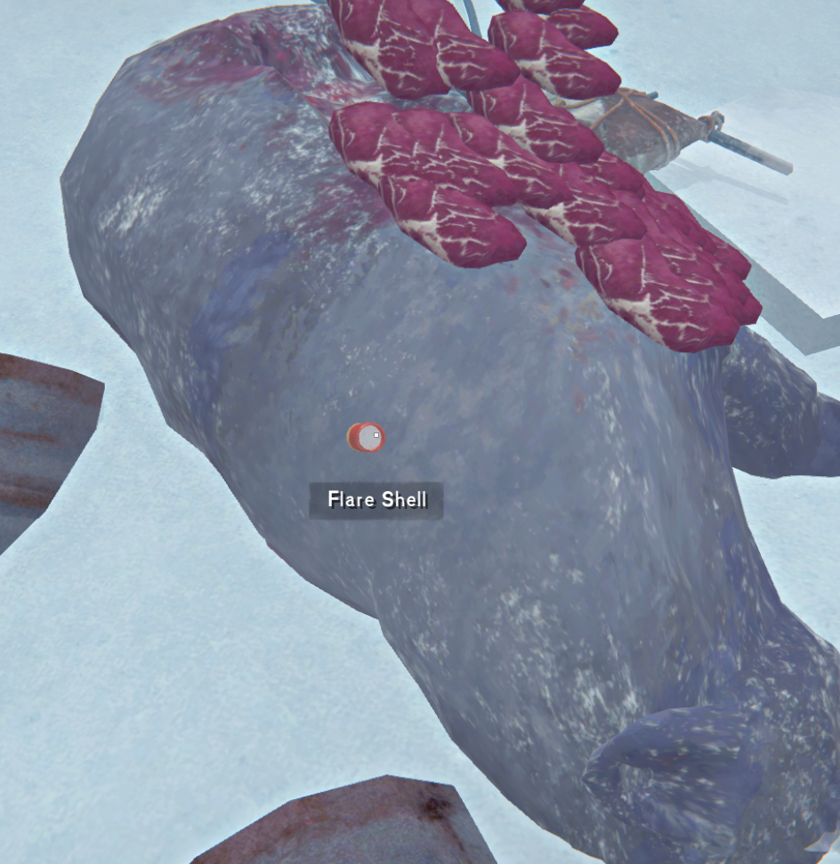

# Flare Shell

**Categories:** Pages with update history, Tools · **Source:** [Fandom](https://thelongdark.fandom.com/wiki/Flare_Shell)

**Contents**

- [Overview](#overview)
- [Locating](#locating)
- [Trivia](#trivia)
- [Gallery](#gallery)
- [Update history](#update-history)

**Flare Shell**

| Property | Details |
| --- | --- |
|  | [Flare Shell icon](../assets/Flare_Shell_icon.png) |
| Release | [16 December 2015](./The%20Long%20Dark%20%E2%80%94%20Early%20Access%20Changelog.md#0.298) |
| Wintermute | No |
| Renewable | Yes ([Trader](./Trader.md) or [Beachcombing](./Beachcombing.md)) |
| **Properties** |  |
| Item type | [Tools](./Tools.md) |
| Equipable | No |
| Stackable | Yes |
| Examine | An emergency beacon fired from a Distress Pistol. |
| **Values** |  |
| Weight | 0.05 kg (0.11 lbs) |

**Flare Shell**s are non-craftable ammunition items.

## Overview

Flare shells are the ammunition for the [Distress Pistol](./Distress%20Pistol.md). When fired they glow brightly for 15 game minutes and travel whole in an arching path until they contact a solid surface. After coming to rest, they remain in the environment indefinitely but cannot be further interacted with. Grounded flares cannot scare off predators after landing, only body shots will frighten predators. While a burning round does look like a [Flare](./Flare.md), it does not give off any heat and cannot be used to light a [Fire](./Fire.md).

They are always found in 100% condition and stack in the inventory. Flare Shells cannot be crafted at an [Ammunition Work Bench](./Ammunition%20Work%20Bench.md) and spent Flare Shell casings cannot be recovered like [Rifle Shell Casings](./Rifle%20Shell%20Casing.md) or [Revolver Shell Casings](./Revolver%20Shell%20Casing.md).

Occasionally, after shooting a flare shell and sticking any wildlife with a direct hit, the flare shell will be able to be picked up and reused after burning out. The reason behind this is unknown, but it seems to be a bug.

## Locating

Flare Shells are often found in an [Emergency Kit](./Emergency%20Kit.md) with the Distress Pistol. They are also sometimes discovered inside toolbox drawers or on [frozen corpses](./Frozen%20Corpse.md) or perhaps inside lockers. The Stockpile version of the [prepper cache](./Prepper%20Cache.md) always contains some, if that can be found. Flare Shells can also be obtained via [beachcombing](./Beachcombing.md) (not on Interloper).

Flare Shells cannot spawn inside containers on Interloper and Misery modes.

## Trivia

Flare shells always appear as a 12-Gauge Flare shells.

## Gallery

## Update history

- UPDATE **16 December 2015 ([Update](./The%20Long%20Dark%20%E2%80%94%20Early%20Access%20Changelog.md#0.298)):**
  - Added to game.
