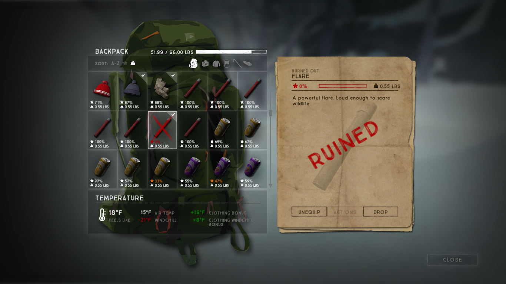
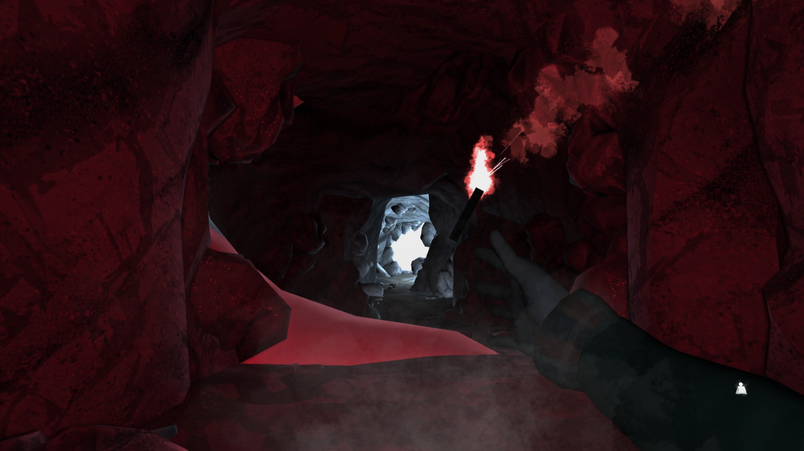
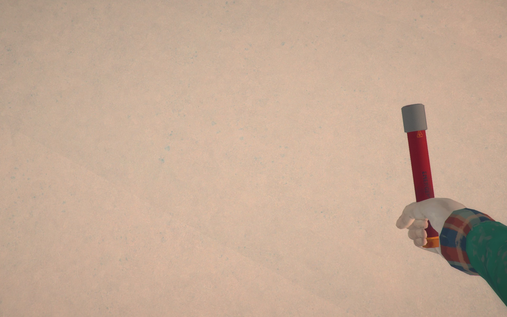
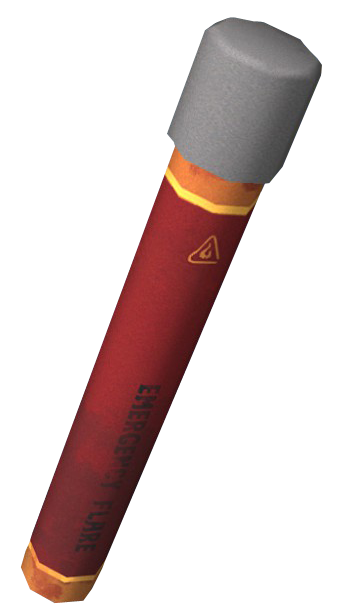
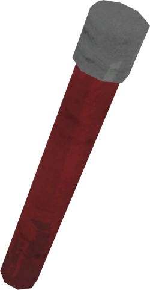
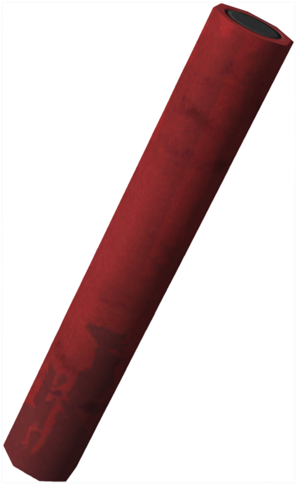

# Flare

**Categories:** Tools · **Source:** [Fandom](https://thelongdark.fandom.com/wiki/Flare)

**Contents**

- [Overview](#overview)
- [Usage](#usage)
- [Animal Deterrence](#animal-deterrence)
- [Frightening Wolves](#frightening-wolves)
- [Obtaining](#obtaining)
- [Trivia](#trivia)
- [Gallery](#gallery)

**Flare**

| Property | Details |
| --- | --- |
| | [Flare icon](../assets/Flare_icon.png) |
| **General** | |
| Item Type | Tool |
| Wintermute | No |
| Renewable | Yes |
| Firestarting Slot | Starter |
| **Statistics** | |
| Weight | [Weight icon](../assets/Weight_icon.png)0.25 kg(0.55 lbs) |
| Bonus chance | [Firestart mod icon](../assets/Firestart_mod_icon.png)+5% |

**Flares** are a multi-purpose tool in _The Long Dark_. They can be used as a light source, [firestarter](./Fire%20Starting.md), or frightening [wildlife](./Wildlife.md).

## Overview

Once lit, flares burn for 1 hour (5 real minutes), providing light and warmth to the surrounding area. However, unlike the [Storm Lantern](./Storm%20Lantern.md) or [Torch](./Torch.md), they cannot be manually extinguished nor re-lit once ignited. Flares can be lit in [strong winds and blizzards](./Weather.md) and will not be extinguished by them, however walking under a waterfall with a lit flare will instantly extinguish it and "ruin" it with no ability to relight it.

Flares are effective at deterring [wolves](./Wolf.md), [timberwolves](./Timberwolf.md), [deer](./Deer.md) and [rabbits](./Rabbit.md); wolves and timberwolves will not approach within 15M of a lit flare (held, or on the ground), and wolves may be frightened by lit flares when thrown (but not timberwolves).

Once a lit flare has consumed all its fuel it will become "Ruined" and have no further use, but will continue to weigh 0.25kg.

## Usage

- Flares may be selected from from the Radial Menu (Radial>Light Sources>Flare), the Light Sources hotkey ("1"), or from the inventory.
- For firestarting a flare must first be ignited, and then select as a "Starter" option in the campfire menu.
- Flares may be thrown while held ("RMB").

Thrown Flares can be picked up even while burning, this makes them an effective tool against multiple wolves (as long as the flare can be retrieved). Flares can even be picked up after they are burned out, though they serve no purpose (marked in the inventory as "RUINED" and red 'X' icon) and will still contribute weight to one's inventory.

## Animal Deterrence

Flares are effective at frightening wolves, deer and rabbits, and have limited usefulness against timberwolves.

- Wolves and timberwolves will respect lit flares and not approach within 15M of them (the same as [marine flares](./Marine%20Flare.md), [flare shells](./Flare%20Shell.md) and [campfires](./Campfire.md)). However, approaching a hostile wolf with a lit flare will result in an attack if you are encumbered, exhausted, have a sprain or sprint.
- Lit flares may cause a stalking wolf to flee when thrown (at the ground between the survivor and wolf), ideally the landing near the wolf's forelegs.
- Unlike blue [marine flares](./Marine%20Flare.md), red flares will not reduce [timberwolf](./Timberwolf.md) morale unless the flare physically hits the timberwolf, recovering the thrown flare without being bitten can be challenging.
- If a wolf is already charging into an attack, it will not be intimidated by a thrown flare.
- Flares and marine flares are most effective at passive deterrence when moving away from a predator.
- Flares are more effective at deterring and scaring wolves than torches.
- Bears are deterred by flares, stopping mid-charge just outside a 15 meter radius around the player, however they will continue to chase them until they reach safety (such as enter a vehicle, walk off a ledge etc) or the flare runs out and the bear attacks. Throwing the flare at a charging bear has no effect. Standing still for too long or not moving away quickly enough will provoke the bear to charge, ignoring the flare completely.

### Frightening Wolves

Below is an effective tactic for scaring wolves with lit torches or flares (either variety). This tactic will always work at frightening wolf (unlike thrown torches) and is easier to perform, especially against multiple wolves.

- Ignite the flare and hold it.
- Approaching the wolf to 15M, the animal will stop and assume a "stand ground" posture (forelegs spread, ears back and growling).
- Drop the flare (to where you are standing) and draw any weapon ("2") including [Stones](./Stone.md), then then aim at the wolf ("RMB").
- The wolf will flee.
- Timberwolves will also flee temporarily, but because their pack's morale is not reduced they will quickly return, it can nevertheless be useful if you have to walk through the pack to get to a safe place, fleeing timberwolves temporarily can't attack you, unlike ones which are standing and growling.

## Obtaining

Flares cannot be harvested, crafted, or repaired and are found uncommonly in all regions on or beside Frozen Corpses, in the trunks and glove compartments of Vehicles, or inside Structures (usually hidden beneath or between furniture).

## Trivia

- Flares are "Emergency Roadside Flares", a type of pyrotechnic used to designate roadside construction, traffic hazards, vehicular accidents, or vehicular distress.
- Ignited Flares most are likely red from burning strontium salts.

## Gallery

