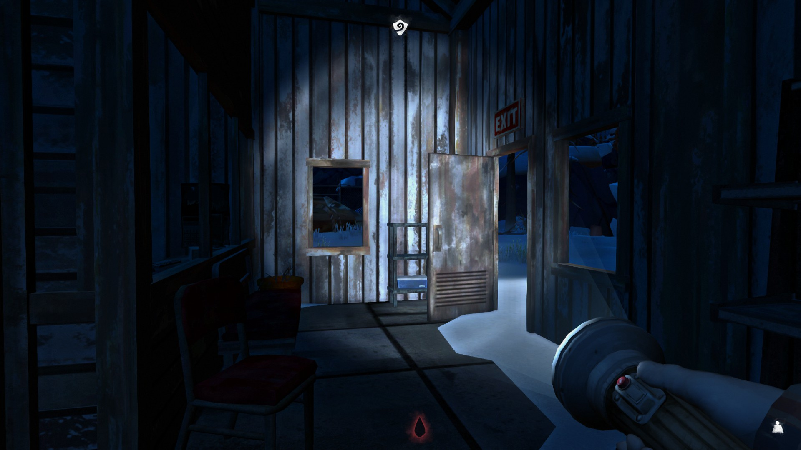
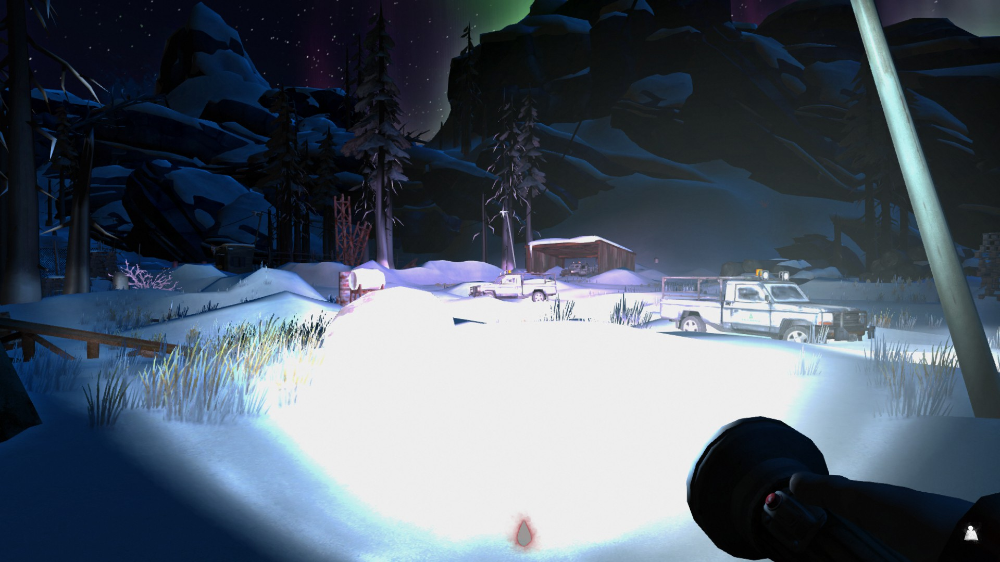

# Flashlight

**Contents**

- [Overview](#overview)
- [Powered](#powered)
- [High Beam](#high-beam)
- [Decay](#decay)
- [Tips](#tips)
- [Trivia](#trivia)
- [Gallery](#gallery)

**Flashlight**

| Property | Details |
| --- | --- |
|  |  / *flashlight\_icon.png* |
| **General** |  |
| Item Type | Tool\|- |
| Weight | 1.00 kg(2.2 lbs) |
| Harvest | 1 × [Scrap Metal](./Scrap%20Metal.md) |
| Repair | 1 × [Scrap Metal](./Scrap%20Metal.md) |

> “**Banged up flashlight.**”
>
> — In-game description

*For the unique version of the Flashlight, see [Miner's Flashlight](./Miner%27s%20Flashlight.md).*

The **Flashlight**is a light emitting, self-defense tool in *[The Long Dark](./The%20Long%20Dark.md)*. It is available in both Wintermute and Survival mode, and was added in the launch of [Episode 2: Luminance Fugue](./Episode%202%20-%20Luminance%20Fugue.md)*.*

## Overview

The Flashlight is battery-powered portable light source used as a modern industrial age era replacement of the [Torch](./Torch.md) and [Storm Lantern](./Storm%20Lantern.md), but is unfortunately no longer functional due to the effects of the [First Flare](./First%20Flare.md) (much like all modern electronics currently).

When equipped and used by the player, they will receive a message informing them that the battery is currently dead, making it little more than an unusable paper weight. During an [Aurora](./Aurora.md) or [Glimmer Fog](./Glimmer%20Fog.md), however, the Flashlight battery will instantly recharge to full battery capacity, and can be used as a portable light source again.

Flashlight is not available on Interloper.

### Powered

Turning the Flashlight on creates a cone of light, but will slowly drain its battery. While a Flashlight is on and wielded, its "high beam" mode (RMB) can be used, rapidly draining its battery but greatly lighting the surrounding area.

A 100% charged flashlight will last 1 hour of continuous use, or around 25 seconds when using the high beam mode. When used and turned off, Flashlights will slowly recharge back to their maximum storage capacity, as long as an Aurora/Glimmer Fog event remains active. Once these events end, the battery will immediately die, and the Flashlight will become unusable until the next event.

### High Beam

The high beam setting of the Flashlight can be used as a temporary defense against charging Aurora predators: (aurora [Wolf](./Wolf.md), aurora [Timberwolf](./Timberwolf.md), and aurora [Poisoned Wolf](./Poisoned%20Wolf.md), and aurora [Bear](./Bear.md)), but only so long as the battery is not completely drained. Flashlight high beams have absolutely no effect on aurora [Cougar](./Cougar.md).

Flashlight do not effect wildlife when powered by [Glimmer Fog](./Glimmer%20Fog.md) (since they are currently not aurora predators).

### Decay

Storm Lanterns and Flashlights are the only tools that do not [Decay](./Decay.md), even when equipped during a [Struggle](./Struggle.md). However they spawn with various levels of Condition and can be repaired with [Scrap Metal](./Scrap%20Metal.md).

## Tips

- When turned on, a Flashlight provides light, but slowly drains its battery. The battery will be instantly full at the start of an Aurora/Glimmer Fog event, but will immediately be drained once these events end.
- The Flashlight is useful for saving [matches](./Matches%20%28disambiguation%29.md) for torches or [lamp fuel](./Lantern%20Fuel.md) for storm lanterns, and players may take advantage of this during an Aurora/Glimmer Fog event when traveling through low light areas.
- When turned on, Flashlights provide a limited cone of light effect that has the farthest reach of any wieldable light source. They however do not saturate the entire nearby area with light, unlike [flares](./Flare.md), torches, and storm lanterns. This can create a "tunnel vision" effect that leaves nearby corners of the player's vision unlit. Turning the High Beam mode on will greatly saturate the area in light, at the cost of battery life.
- A Flashlight's high beam (Place / Aim / Throw key) is effective at stopping the charge of an Aurora Wolf, Aurora Timberwolf or Aurora Bear. High Beam drains a large amount of battery while active, but only a short burst is required to stop a charging aurora animal.
- Flashlights can remain powered even when dropped or placed, allowing them to be used as temporary stationary lights during an aurora. Their high beam cannot be active when placed/dropped.
- The Flashlight requires [tools](./Simple%20Tools.md) and Scrap Metal to repair.
- Scrapping a Flashlight will give 1 Scrap Metal.

## Trivia

During an Aurora or Glimmer Fog event, using the Flashlight on High will cause the tip of the Flashlight to emit sparks, visually explaining why the battery power dies so quickly. Despite the obviously high power consumption, the battery will never short circuit/suffer critical operational damage from being overcharged.

The light the Flashlight emits in High Beam Mode flashes between the colors Purple, Green, and Blue.

The Flashlight appears to be loosely based on a 1920s vintage Ever-Ready flashlight, however uses a LED bulb as opposed to the Ever-Ready's fluorescent bulb.

## Gallery

| Column 1 | Column 2 |
| --- | --- |
|  / *The flashlight in use* |  / *Utilizing the high beam function* |

**Lua execution error in Module:Navbox function navbox** [ru:Фонарик](ru:%D0%A4%D0%BE%D0%BD%D0%B0%D1%80%D0%B8%D0%BA)
